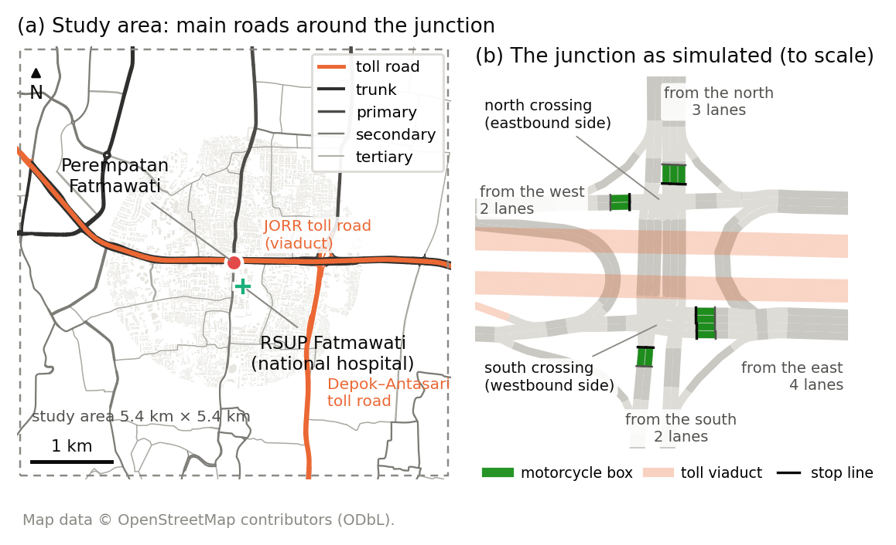
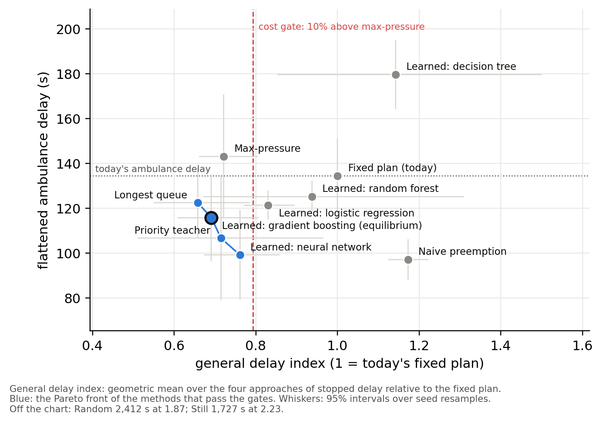

**Topic.** The topic is unchanged from Assignment 1. Sections 1 to 3 revise the proposal; Sections 4 and 5 are new.

**Feedback on Assignment 1 and how we used it.** [To be completed by the group once Assignment 1 feedback is returned: the lecturer's feedback in one or two sentences, then how this report responds, at most 150 words in total.]

# 1. Introduction

## 1.1 Problem and context

Perempatan Fatmawati, under South Jakarta's JORR toll viaduct, lies 326 m north of RSUP Fatmawati, a national referral hospital with a 24-hour emergency department (Direktorat Jenderal Kesehatan Lanjutan, n.d.; Figure 1). About four in five vehicles here are motorcycles (Yusuf & Isradi, 2025); at red they fill the motorcycle box and every gap between cars. Indonesian law gives ambulances right of way and exempts them from signals (Undang-Undang Nomor 22 Tahun 2009, arts. 134–135), yet a boxed-in queue cannot move aside: only a timely green for the ambulance's approach clears the path. The junction already runs at the worst level of service, averaging 85 s of delay per vehicle (Sumabrata et al., 2026).

{width=100%}

**Problem statement.** No data-driven ambulance-priority rule exists for motorcycle-dominated junctions, because ambulance passages cannot be recorded safely on live roads. We built a digital twin of the junction, generated open sensor data on ambulance passages, and learned priority controllers that cut ambulance delay while keeping every direction's delay fair and bounded.

## 1.2 Why it matters

Survival from cardiac arrest falls by about two percentage points for every minute advanced life support is delayed (Larsen et al., 1993). Among Jakarta emergency-department patients, the median ambulance response was 24 minutes and only 9% arrived by ambulance (Brice et al., 2022).

## 1.3 Goals

1. **Twin.** The junction and surrounding main roads in SUMO from OpenStreetMap, with motorcycle boxes, the city's four-stage signal plan, and drivers yielding to ambulances only where there is room, calibrated to published queue lengths.
2. **Dataset.** 108 simulated hours of virtual sensor readings as CSV tables, with a data dictionary and data card.
3. **Controllers.** Five model families trained to imitate a priority-aware rule that requests the ambulance's stage just in time to clear the queue ahead, against stillness and random baselines.
4. **Evaluation.** Every method on one grid of ambulance cases, scored against an empty-road reference, flattened over directions and judged by a Nash bargaining equilibrium.

# 2. Related Work

Fixed-time plans follow Webster (1958), adapted for Indonesia's mixed traffic (Direktorat Jenderal Bina Marga, 2023). Max-pressure control (Varaiya, 2013) uses only local queues. Deep reinforcement learning dominates research but is hard to audit (Wei et al., 2019); on tabular data, tree ensembles match deep models and stay interpretable (Grinsztajn et al., 2022).

Chen et al. (2024) time preemption around queue spillback; Roy et al. (2024) tune it in a Vissim-based digital twin; EMVLight (Su et al., 2023) treats yielding as a speed rule. Savithramma et al. (2022) predict queue-clearing green time with gradient-boosted trees, but they, like a Surabaya SUMO study (Izzuddin et al., 2025), treat two-wheelers only as counts. A transport digital twin joins a model, a live data link and synchronisation (Kušić et al., 2023); like other SUMO twins (Schaffland et al., 2024), ours defers synchronisation, because TomTom's terms forbid storage and safety-critical use (TomTom, n.d.).

**Gap and novelty.** A real Jakarta junction beside a national hospital, mostly motorcycles, with boxes and the city's own signal plan; yielding limited to real gaps; an open dataset of ambulance passages with verified labels, which we have not found elsewhere; and interpretable control behind a safety shield, chosen by an equilibrium that neglects no direction.

# 3. Business Model

Three public bodies share the problem: RSUP Fatmawati's emergency department, Jakarta's 119 ambulance service (Pusat Krisis dan Kegawatdaruratan Kesehatan Daerah, n.d.) and the Transport Agency's signal-control unit. The value is seconds saved for patients and crews at a bounded, fair cost to everyone else, and evidence before any capital spending, from a pipeline that rebuilds any junction from open maps.

| Stakeholder | Need | How the project meets it |
|---|---|---|
| Patients and ambulance crews | Fewer stops, predictable passage | Flattened ambulance delay is the headline measure |
| RSUP Fatmawati emergency department | Earlier, predictable arrivals | Passage times for every direction |
| Signal operators | No manual intervention, no gridlock | Controllers only request stages; the plant enforces safety |
| Motorcyclists and other road users | Fair, bounded delay | Delay per approach against today; worst approach shown |
| City government and researchers | Evidence and reusable data | Paired-seed tests; open tables and data card |

# 4. Characterising and Analysing Data

## 4.1 Data sources and the four V's

- **Sources.** OpenStreetMap roads (ODbL); Indonesian design rules; published counts, the city's signal plan and a calibrated simulation of the junction for calibration (Sumabrata et al., 2026); the twin's own sensor tables, which are the dataset. Ambulance passages cannot be recorded safely on live roads, so synthetic data from a validated generator is the accepted substitute (Jordon et al., 2022).
- **Volume.** 108 episodes, 77,760 learning rows and 732 ambulance trips in under a gigabyte of CSV, plus 3,072 evaluation passages.
- **Velocity.** The simulation steps every 0.5 s; a controller decides every 5 s, which every model serves in milliseconds.
- **Variety.** Nine tables at seven grains, from sensor and minute to tick, signal phase, 15 minutes, ambulance trip and episode, with a data dictionary that labels each column's role.
- **Veracity.** Labels are recomputed from the logged columns before training (the 30 s queue label matched the later camera reading in all 308,448 checkable values, and the teacher's label was reproduced on every tick but 79 ties at the logged precision); calibration was fitted to the published queue lengths (longest queues +6% north, −19% east and −24% south of the published simulation's, west capacity-limited, at 22% to 35% of counted volumes); results describe the twin, not the street.

## 4.2 Platforms, software and tools

| Role | Now | If the project expands |
|---|---|---|
| Simulation | SUMO 1.27 through its Python library (Alvarez Lopez et al., 2018) | many junctions on a cloud batch service |
| Modelling | Python, pandas and scikit-learn (Pedregosa et al., 2011) | gradient-boosting libraries on GPUs |
| Demonstration | R with dplyr, ggplot2 and rpart (R Core Team, 2026) | dashboards on the same tables |
| Storage | CSV, configuration, checksums | Parquet in object storage |

## 4.3 Analysis techniques and statistical methods

**Supervised learning.** Each 5 s tick is a row of sensor features, labelled with the stage a priority-aware teacher requests: the ambulance's stage once its arrival time falls within the time to clear the queue ahead, otherwise the max-pressure stage. Five families compete on splits that keep whole episodes and seeds apart: logistic regression, a decision tree, a random forest (Breiman, 2001), gradient boosting and a small neural network, each minimising a log-loss in which every stage counts equally. Each must beat three baselines: keeping the current stage, the most common stage and a random stage. Two further tasks forecast each queue 30 s ahead and the ambulance's arrival time.

| Model | Macro-F1 | Accuracy, ambulance ticks |
|---|---|---|
| Baseline: keep the current stage | 0.28 | 0.34 |
| Baseline: most common stage | 0.14 | 0.50 |
| Baseline: random stage | 0.24 | 0.25 |
| Logistic regression | 0.91 | 0.82 |
| Decision tree | 0.70 | 0.57 |
| Random forest | 0.89 | 0.82 |
| Gradient boosting | 0.96 | 0.96 |
| Neural network | 0.95 | 0.88 |

*Table 1. The teacher's stage on held-out seed 3: 25,920 ticks, of which 1,986 have an ambulance on an approach.*

Gradient boosting imitates the teacher best, with a macro-F1 of 0.96 against 0.28 for the best baseline; trained on shuffled labels it falls to 0.25, so nothing leaks. It keeps a macro-F1 of 0.91 on an evening window and 0.89 on high demand that it never saw in training. For the 30 s queue, the best model per approach cuts the error of assuming the queue stays as it is by 31% to 38%. The arrival-time model halves the error of the teacher's free-road estimate (58 s against 114 s) but is late on 34% of ticks against a 20% target, so the teacher's own estimate stays the safer input.

**Evaluation.** Every method meets the same grid of ambulance cases: three hospital movements, eight arrival moments across the 231 s signal cycle, three demand levels and four seeds. Ambulance delay is measured against an empty-road run and averaged with equal weight per direction. Each approach's delay is indexed to the city's fixed plan. Methods must pass a safety gate, keep general delay within 10% of max-pressure and leave no approach more than 20% worse than today. Among those on the Pareto front, a Nash bargaining rule (Nash, 1950) chooses the method that maximises the product of every player's gain.

Each run holds its demand level for 4.4 hours. At the design and high levels the north approach, calibrated at capacity, never clears: its queue grows past the ambulances' release point, and up to 19% of ambulances fail to reach the hospital before the run ends. Those levels are therefore stress tests, and the main result uses the low level, the only one that stays stationary. An ambulance that never arrives counts at the delay it had built up when the run stopped, so stranding ambulances is never rewarded.

| Method | Ambulance delay (s) | Worst direction (s) | Stranded | General delay, index | Worst approach, index | Passes gates | Nash product |
|---|---|---|---|---|---|---|---|
| Naive preemption | 97.1 | 183.7 | 0% | 1.17 | 1.32 | no | – |
| Learned: neural network | 99.1 | 192.5 | 0% | 0.76 | 1.03 | yes | 0.0117 |
| Priority teacher | 106.6 | 215.5 | 0% | 0.71 | 0.95 | yes | 0.0526 |
| Learned: gradient boosting | 115.8 | 238.8 | 0% | 0.69 | 0.94 | yes | 0.0592 |
| Learned: logistic regression | 121.3 | 227.9 | 0% | 0.83 | 1.11 | no | – |
| Longest queue | 122.4 | 203.5 | 0% | 0.66 | 0.93 | yes | 0.0590 |
| Learned: random forest | 125.2 | 241.1 | 0% | 0.94 | 1.26 | no | – |
| City's fixed plan | 134.4 | 251.1 | 0% | 1.00 | 1.00 | no | – |
| Max-pressure | 143.1 | 260.1 | 0% | 0.72 | 1.00 | yes | – |
| Learned: decision tree | 179.7 | 280.7 | 0% | 1.14 | 1.54 | no | – |
| Still | 1726.6 | 4755.5 | 20% | 2.23 | 11.27 | no | – |
| Random | 2412.2 | 6822.7 | 25% | 1.87 | 13.29 | no | – |

*Table 2. Methods at the low demand level of the evaluation grid. Stranded: never reached the hospital in the run. Delay index: 1.00 = the city's fixed plan. Gates judged on point estimates, because no method passes them at the 95% level. A Nash product is shown for methods on the Pareto front of those that pass.*

With four seeds no method can be shown to stay within the margins at the 95% level, so the cost and approach gates fall back to point estimates, while safety is still tested for a significant rise in collisions. On them the equilibrium is **the learned gradient-boosting controller**. It wins 46% of 1,000 bootstrap resamples of the seeds against 26% for the priority teacher, with no method passing in 1%; its Nash product only just beats that of longest-queue control (0.0592 against 0.0590). Choosing it means valuing one second of ambulance delay at between about 131 and 179 vehicle-seconds of everyone else's: a higher value would favour the priority teacher, a lower one longest-queue control. In the stress tests the priority teacher cuts ambulance delay against the fixed plan by 59% at design demand and 38% at high demand, and strands 1% and 5% of ambulances against 16% and 19%. But the adaptive methods leave their worst approach 3.2 to 4.2 times its fixed-plan delay, so none passes the approach gate there. With 70% motorcycles instead of 80% at the same counts, ambulance delay grows 1.9 to 2.3 times for every method, and the adaptive methods leave one approach 1.8 to 2.9 times worse than the fixed plan, so none passes the gates; the learned gradient-boosting controller still matches the teacher's ambulance gain (215 s against 220 s and 279 s today).

In closed loop the neural network keeps 127% of the teacher's cut in ambulance delay against today's plan and gradient boosting 67%, while the decision tree, the weakest imitator offline, ends up 34% worse than today: offline accuracy predicts control only roughly. Replaying every possible switch time on one seed shows that perfect timing alone would cut max-pressure's ambulance delay from 159 s to 82 s; naive preemption captures 95% of that gain and the teacher only 15%, because it waits for the last safe moment to spare cross traffic, while the best moment for the ambulance is usually at detection. Adaptive control also raises the twin's collision rate near the junction, from 0.12 to 0.16–0.31 per 1,000 vehicle-kilometres; with four seeds the rise is significant only for the learned logistic-regression controller, which therefore fails the safety gate, but its direction is consistent and calls for conflict measures before any deployment.

## 4.4 Demonstration in R

The dataset can be downloaded from [download link to be added by the group]. The R Markdown file reads the tables, checks every column against the data dictionary, summarises scenarios and missing values, plots the vehicle mix, queues, delay by controller and ambulance passages, and fits a shallow decision tree to the teacher's label on two seeds, tested on the third. The tree reaches an accuracy of 0.69, against 0.31 for keeping the current stage and 0.37 for the most common stage.

{width=92%}

# 5. Standards, Data Governance and Management

- **Process.** CRISP-DM (Chapman et al., 2000) structures the work: the proposal is business understanding, calibration and validators are data understanding, the generator and grouped splits are data preparation, Section 4.3 is modelling and evaluation, and the live view is a research deployment.
- **Data standards.** FAIR principles (Wilkinson et al., 2016) guide the release: a download link and data card make it findable, CSV keeps it accessible, SI units and the dictionary make it interoperable, and seeds make any row reproducible. The data card follows the datasheets pattern (Gebru et al., 2021).
- **Licences.** The road network derives from OpenStreetMap and is shared under the ODbL with attribution; the sensor tables are a produced work under it (Open Data Commons, 2009). TomTom speeds are shown live only, never stored or combined with these data (TomTom, n.d.).
- **Accessibility, security and integrity.** Public download with SHA-256 checksums and versioned releases.
- **Confidentiality and ethics.** The dataset holds no personal data. A real deployment would ingest ambulance location traces, which are personal and, linked to patients, health data under Indonesia's data-protection law, which also requires an impact assessment (Undang-Undang Nomor 27 Tahun 2022, arts. 4, 34). Priority shifts delay onto other road users, mostly motorcyclists, so delay is reported per approach. The plant caps every red at 252 s or less for every controller that only requests stages; naive preemption, which forces and holds a green as common practice does, bypasses that cap and left an approach red for 362 s.

# References

Alvarez Lopez, P., Behrisch, M., Bieker-Walz, L., Erdmann, J., Flötteröd, Y.-P., Hilbrich, R., Lücken, L., Rummel, J., Wagner, P., & Wießner, E. (2018). Microscopic traffic simulation using SUMO. In *2018 21st International Conference on Intelligent Transportation Systems (ITSC)* (pp. 2575–2582). IEEE. https://doi.org/10.1109/ITSC.2018.8569938

Breiman, L. (2001). Random forests. *Machine Learning, 45*(1), 5–32. https://doi.org/10.1023/A:1010933404324

Brice, S. N., Boutilier, J. J., Gartner, D., Harper, P., Knight, V., Lloyd, J., Pusponegoro, A. D., Rini, A. P., Turnbull-Ross, J., & Tuson, M. (2022). Emergency services utilization in Jakarta (Indonesia): A cross-sectional study of patients attending hospital emergency departments. *BMC Health Services Research, 22*, Article 639. https://doi.org/10.1186/s12913-022-08061-8

Chapman, P., Clinton, J., Kerber, R., Khabaza, T., Reinartz, T., Shearer, C., & Wirth, R. (2000). *CRISP-DM 1.0: Step-by-step data mining guide*. SPSS.

Chen, Y.-Y., Wang, J.-Y., Lo, S.-C., & Sung, W.-T. (2024). An emergency vehicle traffic signal preemption system considering queue spillbacks along routes and negative impacts on non-priority traffic. *IET Intelligent Transport Systems, 18*(8), 1385–1395. https://doi.org/10.1049/itr2.12518

Direktorat Jenderal Bina Marga. (2023). *Pedoman kapasitas jalan Indonesia* [Indonesian highway capacity guideline] (No. 09/P/BM/2023). Kementerian Pekerjaan Umum dan Perumahan Rakyat. https://binamarga.pu.go.id/index.php/nspk/detail/09pbm2023-pedoman-kapasitas-jalan-indonesia-

Direktorat Jenderal Kesehatan Lanjutan. (n.d.). *RSUP Fatmawati Jakarta*. Kementerian Kesehatan Republik Indonesia. Retrieved October 3, 2026, from https://keslan.kemkes.go.id/uptkami/detail/7

Gebru, T., Morgenstern, J., Vecchione, B., Vaughan, J. W., Wallach, H., Daumé, H., III, & Crawford, K. (2021). Datasheets for datasets. *Communications of the ACM, 64*(12), 86–92. https://doi.org/10.1145/3458723

Grinsztajn, L., Oyallon, E., & Varoquaux, G. (2022). Why do tree-based models still outperform deep learning on typical tabular data? In S. Koyejo, S. Mohamed, A. Agarwal, D. Belgrave, K. Cho, & A. Oh (Eds.), *Advances in Neural Information Processing Systems 35* (pp. 507–520). Curran Associates. https://doi.org/10.52202/068431-0037

Izzuddin, M. H., Hidayat, W. N., Shafyan, A., Kiyohara, R., & Santoso, D. S. (2025). Simulasi dan analisis perbandingan kinerja sistem lalu lintas untuk kendaraan ambulans darurat [Simulation and comparative performance analysis of traffic systems for emergency ambulances]. *Journal of Innovative and Creativity, 5*(2), 7340–7349. https://doi.org/10.31004/joecy.v5i2.1105

Jordon, J., Szpruch, L., Houssiau, F., Bottarelli, M., Cherubin, G., Maple, C., Cohen, S. N., & Weller, A. (2022). *Synthetic data – what, why and how?* arXiv. https://doi.org/10.48550/arXiv.2205.03257

Kušić, K., Schumann, R., & Ivanjko, E. (2023). A digital twin in transportation: Real-time synergy of traffic data streams and simulation for virtualizing motorway dynamics. *Advanced Engineering Informatics, 55*, Article 101858. https://doi.org/10.1016/j.aei.2022.101858

Larsen, M. P., Eisenberg, M. S., Cummins, R. O., & Hallstrom, A. P. (1993). Predicting survival from out-of-hospital cardiac arrest: A graphic model. *Annals of Emergency Medicine, 22*(11), 1652–1658. https://doi.org/10.1016/S0196-0644(05)81302-2

Nash, J. F. (1950). The bargaining problem. *Econometrica, 18*(2), 155–162. https://doi.org/10.2307/1907266

Open Data Commons. (2009). *Open Data Commons Open Database License (ODbL) v1.0*. Open Knowledge Foundation. https://opendatacommons.org/licenses/odbl/1-0/

Pedregosa, F., Varoquaux, G., Gramfort, A., Michel, V., Thirion, B., Grisel, O., Blondel, M., Prettenhofer, P., Weiss, R., Dubourg, V., Vanderplas, J., Passos, A., Cournapeau, D., Brucher, M., Perrot, M., & Duchesnay, É. (2011). Scikit-learn: Machine learning in Python. *Journal of Machine Learning Research, 12*, 2825–2830. https://jmlr.org/papers/v12/pedregosa11a.html

Pusat Krisis dan Kegawatdaruratan Kesehatan Daerah. (n.d.). *Tentang PK3D Dinas Kesehatan DKI Jakarta* [About PK3D]. Dinas Kesehatan Provinsi DKI Jakarta. Retrieved October 3, 2026, from https://pk3d.jakarta.go.id/TentangKami

R Core Team. (2026). *R: A language and environment for statistical computing* (Version 4.6.1) [Computer software]. R Foundation for Statistical Computing. https://www.R-project.org/

Roy, S., Hunter, M., Saroj, A., & Guin, A. (2024). Development of emergency vehicle preemption strategies on smart corridors in a digital twin environment. In *Proceedings of the 17th ACM SIGSPATIAL International Workshop on Computational Transportation Science GenAI and Smart Mobility Session (IWCTS '24)* (pp. 12–21). ACM. https://doi.org/10.1145/3681772.3698213

Savithramma, R. M., Sumathi, R., & Sudhira, H. S. (2022). SMART emergency vehicle management at signalized intersection using machine learning. *Indian Journal of Science and Technology, 15*(35), 1754–1763. https://doi.org/10.17485/IJST/v15i35.1151

Schaffland, A., Nelson, J., & Schöning, J. (2024). Simulating traffic networks: Driving SUMO towards digital twins. *SUMO Conference Proceedings, 5*, 113–125. https://doi.org/10.52825/scp.v5i.1105

Su, H., Zhong, Y. D., Chow, J. Y. J., Dey, B., & Jin, L. (2023). EMVLight: A multi-agent reinforcement learning framework for an emergency vehicle decentralized routing and traffic signal control system. *Transportation Research Part C: Emerging Technologies, 146*, Article 103955. https://doi.org/10.1016/j.trc.2022.103955

Sumabrata, R. J., Haqueline, R., & Mauramdha, G. (2026). Microscopic simulation analysis of the Fatmawati intersection in Jakarta. In *Proceedings of the 19th International Conference on Quality in Research (QiR 2025)* (Advances in Engineering Research, Vol. 303, pp. 31–44). Atlantis Press. https://doi.org/10.2991/978-94-6239-717-0_4

TomTom. (n.d.). *TomTom portal terms & conditions*. Retrieved October 3, 2026, from https://docs.tomtom.com/legal/terms-and-conditions

*Undang-Undang Nomor 22 Tahun 2009 tentang Lalu Lintas dan Angkutan Jalan* [Law Number 22 of 2009 on Road Traffic and Transport] (Indonesia). Lembaran Negara Republik Indonesia Tahun 2009 Nomor 96. https://peraturan.bpk.go.id/Details/38654/uu-no-22-tahun-2009

*Undang-Undang Nomor 27 Tahun 2022 tentang Pelindungan Data Pribadi* [Law No. 27 of 2022 on Personal Data Protection] (Indonesia). Lembaran Negara Republik Indonesia Tahun 2022 Nomor 196. https://peraturan.bpk.go.id/Details/229798/uu-no-27-tahun-2022

Varaiya, P. (2013). Max pressure control of a network of signalized intersections. *Transportation Research Part C: Emerging Technologies, 36*, 177–195. https://doi.org/10.1016/j.trc.2013.08.014

Webster, F. V. (1958). *Traffic signal settings* (Road Research Technical Paper No. 39). Road Research Laboratory; Her Majesty's Stationery Office.

Wei, H., Zheng, G., Gayah, V., & Li, Z. (2019). *A survey on traffic signal control methods*. arXiv. https://doi.org/10.48550/arXiv.1904.08117

Wilkinson, M. D., Dumontier, M., Aalbersberg, I. J., Appleton, G., Axton, M., Baak, A., Blomberg, N., Boiten, J.-W., da Silva Santos, L. B., Bourne, P. E., Bouwman, J., Brookes, A. J., Clark, T., Crosas, M., Dillo, I., Dumon, O., Edmunds, S., Evelo, C. T., Finkers, R., ... Mons, B. (2016). The FAIR Guiding Principles for scientific data management and stewardship. *Scientific Data, 3*, Article 160018. https://doi.org/10.1038/sdata.2016.18

Yusuf, M. H., & Isradi, M. (2025). The implementation analysis of the electronic road pricing (ERP) system on Fatmawati Road (Ketimun 1 intersection – TB Simatupang intersection). *Engineering and Technology Journal, 10*(3), 4052–4060. https://doi.org/10.47191/etj/v10i03.15

# Use of generative AI

We used Claude (Anthropic, via Claude Code, September–November 2026) to brainstorm, critique the simulator design, draft and revise this report from our decisions and notes, draft simulation, analysis and figure code that we reviewed and tested, run label checks, and check references by web search. The problem, decisions and sources are ours; we re-checked every reference.
