# 0. Purpose, reading guide and notation

The proposal says what the project will do and why: build a simulation-based digital twin of a four-intersection, left-hand-traffic grid, generate open tabular data on ambulance passages through it, and use that data to train a supervised signal controller that cuts ambulance travel time while keeping general-traffic delay within a stated bound. This document says exactly *how* the data behind that promise are produced: the road network, the physics of every vehicle, the way demand is generated, how the traffic lights decide, how the tables are logged, how the demand level is calibrated, how the simulator is validated, and how the resulting CSV files feed the models and the Assignment 3 report. Every equation the generator uses is written out, followed by a one-sentence plain-English reading for readers without a traffic-engineering background.

Vehicle-level records of ambulance passages cannot be collected safely on live roads, so the project generates them with a validated simulator; synthetic data from a validated generator are the accepted substitute when real collection is unsafe or impossible (Jordon et al., 2022). In the vocabulary of Kušić et al. (2023) a transport digital twin is a model, a live data link and a synchronisation loop; version 1 delivers the model layer and is built so that the other two can be added later without changing the data schema (Section 1); a simulated version of both has since been built on top of it (Section 13). The simulator is purpose-made rather than SUMO so that two-colour signals, per-driver parameter distributions and left-hand two-lane geometry are first-class (proposal Section 2.3); SUMO remains the planned external validation backend (Sections 12.2 and 13).

## 0.1 How this document maps to the proposal and to the report

| Proposal goal (proposal Section 1.3) | Specified in |
|---|---|
| 1. The twin: a $2 \times 2$ grid, left-hand traffic, two lanes per direction, red/green signals with internal all-red clearance, Intelligent Driver Model drivers, Poisson arrivals, origin–destination routing, an ambulance vehicle type | Sections 2–7 |
| 2. The dataset: at least 100 reproducible episodes as CSV tables with a data dictionary and a data card | Sections 8, 9 and 11 |
| 3. The model: a gradient-boosted model that predicts, per candidate phase, the general queue 30 s ahead and the ambulance delay, deployed as a priority-aware controller behind a safety shield | Sections 5, 6, 7 and 12.3 |
| 4. The evaluation: paired random seeds against fixed-time, max-pressure and naive full preemption; ambulance travel time primary, general delay and recovery time secondary; confidence intervals over at least eight seeds | Sections 7, 10 and 12.3 |

The Assignment 3 report must present the project under the five section names of the unit brief within 2,500 words (reused proposal text counts; references do not). Sections 1 to 3 of the report revise the proposal. Section 12 of this document is written so that the report's remaining sections can be lifted from it directly:

| Report section (named as in the brief) | Material in this document | Indicative words |
|---|---|---|
| 4. Characterising and Analysing Data: data sources and the four V's; platforms, software and tools; analysis techniques and statistical methods; demonstration in R | 12.1, 12.2, 12.3 and 12.4, with 12.5 supplying the results | about 1,100 |
| 5. Standard for Data Science Process, Data Governance and Management | 12.6 | about 250 |
| Front matter and the generative-AI statement | 12.0 and 12.7 | outside the five sections |

**Configuration and provenance.** Every constant below is a field of one configuration object. The full configuration is saved as JSON, together with a short hash of it, beside every generated dataset, and the hash and the generator version are stamped on every episode row. Numbers marked *measured* were read from the {{RUN_LABEL}} and the validation run; they are regenerated by the build step of this document, not typed in.

**Figures.** Figures A1–A7 are static diagrams numbered by subject, not by order of first appearance; Figures V1–V4 are outputs of the validation run (Section 10). Figures A1–A7 carry their number and title inside the image, and the caption below each paraphrases it; Figures V1–V4 are reproduced as the validation run writes them, with panel titles only, and take their number from the caption.

**Units.** SI throughout: metres (m), seconds (s), m/s, m/s². Traffic rates in vehicles per hour (veh/h) and vehicles per hour per lane (veh/h/lane). The coordinate origin is the centre of the south-west junction, $x$ east, $y$ north.

**Time axis of an episode.** $t = 0$ is the start of the warm-up. Warm-up $[0, 300)$ s, main period $[300, 3900)$ s, cool-down $[3900, 4200]$ s with spawning switched off. KPIs and labels use only the main period.

| Symbol | Meaning | Default |
|---|---|---|
| $\Delta t$ | physics time step | 0.5 s |
| $s, v, a$ | position of the front bumper along its edge, speed, acceleration | — |
| $v_0$ | a driver's desired (free-flow) speed | sampled |
| $a_{\max}, b$ | maximum acceleration, comfortable deceleration | sampled |
| $T$ | desired time headway | sampled |
| $s_0, l_{veh}$ | standstill gap, vehicle length | 2.0 m, 4.5 m |
| $b_{emerg}, b_{stop}$ | physical braking limit, stop-or-commit deceleration | 7.0, 3.0 m/s² |
| $v_{limit}, v_{turn}$ | speed limit, speed cap inside a turning movement | 13.9, 5.0 m/s |
| $L_{block}, L_{stub}, w_{lane}$ | junction spacing, stub length, lane width | 200, 150, 3.5 m |
| $w_{box}$ | side of the square junction box | 14 m |
| $\lambda_e(t)$ | arrival rate at boundary node $e$ | calibrated |
| $g, r_{all}, C$ | displayed green, all-red, fixed-time cycle | 20, 4, 96 s |
| $g_{eff}, l$ | effective green, lost time per phase | 18, 6 s |
| $s_{sat}, c, x$ | saturation flow, approach capacity, volume-to-capacity ratio | measured |
| $n_a, q_a$ | vehicles on approach $a$; of which queued ($v < 2$ m/s) | logged |
| $p_a$ | max-pressure value of approach $a$ | computed |
| `ev_*` | emergency-vehicle (ambulance) columns and random stream | Section 7 |

Approaches are named by the arm a vehicle arrives from: N, E, S, W. Movements are T (through), NS (near-side turn, the one that does not cross oncoming traffic: a left turn under left-hand traffic) and FS (far-side turn, which crosses oncoming traffic: a right turn under left-hand traffic). *Junction* is this document's word for the proposal's *intersection*. Junctions are $J(i,j)$ with $i$ east, $j$ north; `junction_id` $= j \cdot \text{grid}_x + i$.

# 1. Pipeline overview

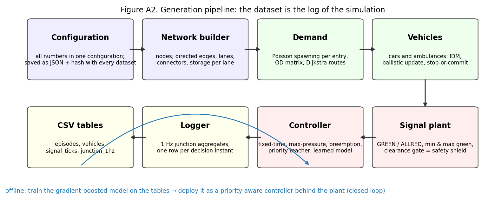{width=100%}

The dataset cannot be written before the simulation exists: it *is* the log of the simulation. The proposal's business model rests on it: the dataset is the product, serving as training data for the controller (Section 12.3), as evidence for an investment decision through the paired-seed comparison (Sections 8.3 and 12.3) and as a reusable benchmark (Sections 8 and 12.6). One episode is one run of the world with a given seed and scenario. The order of operations inside every half-second step determines what each logged row "sees":

1. **1 Hz log.** On whole seconds, write the per-junction aggregates (`junction_1hz`) and, for showcase episodes, every vehicle's state.
2. **Signals.** Handle green onsets whose clearance gate has opened; at each junction's decision instant build the feature row, ask the controller for a request, pass the request through the plant, evaluate stop-or-commit on the approach that lost its green, and log one `signal_ticks` row.
3. **Spawning.** For each boundary node, draw whether a new car (and, if enabled, an ambulance) requests entry; insert the head of the node's entry queue if there is room.
4. **Accelerations.** For every vehicle, find its leader and compute the Intelligent Driver Model acceleration.
5. **Movement.** Advance vehicles (connectors first, then edges), handle stop-line crossings, box entry and despawning at the boundary.
6. **Overlap guard, bookkeeping, plant timers, gridlock check.**

At the end of the episode a post-pass computes the labels (`y_mp_action` from each row's own columns, `y_q_total_t30` from the 1 Hz log) and the episode KPIs. The same feature-building function produces the row the controller acts on **and** the row that is logged, so the training schema and the serving schema are identical by construction. That is what makes the model layer ready for the live data link the proposal plans: a state estimate built from real detectors and ambulance GPS, fed into the same function, yields a row the trained model can consume.

# 2. Arena geometry

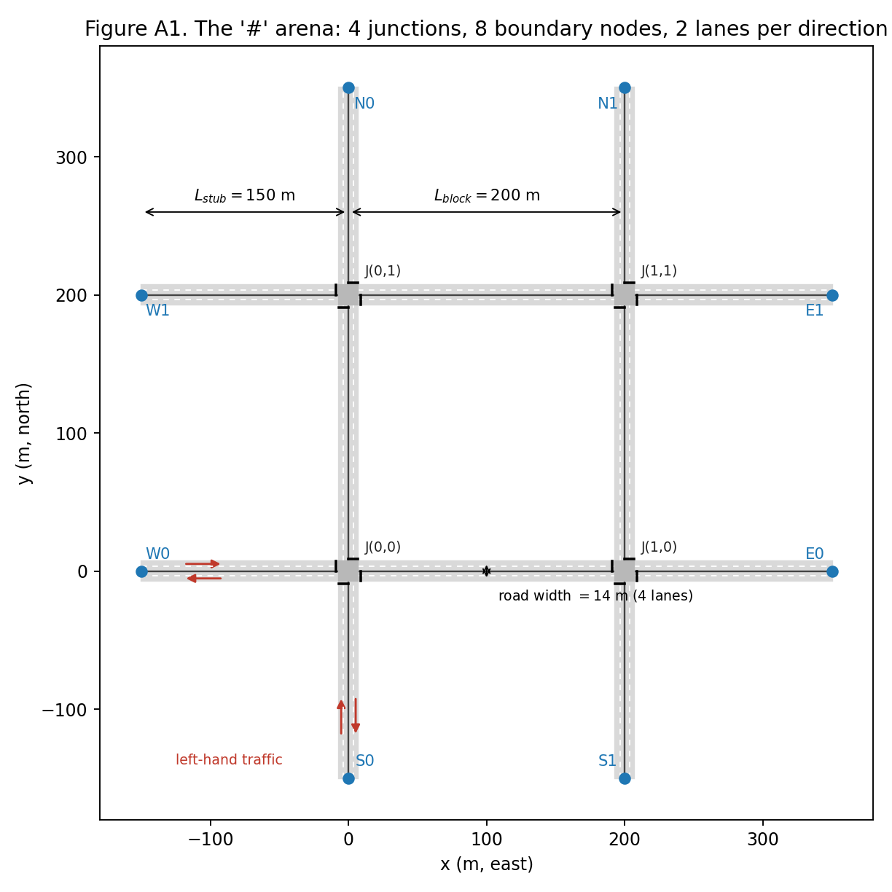{width=85%}

Two horizontal and two vertical two-way roads cross to form a $2 \times 2$ grid of four-way junctions; the roads continue past the grid to eight boundary nodes that are both sources and sinks. Left-hand traffic with two lanes per direction is the proposal's Jakarta geometry. The network builder accepts any $\text{grid}_x \times \text{grid}_y$ (the single-junction $1 \times 1$ case is used for validation).

**Road, box and edge lengths.** With $n_{lanes} = 2$ lanes per direction,

$$ w_{road} = 2\, n_{lanes}\, w_{lane} = 14\ \text{m}, \qquad w_{box} = w_{road}, $$
$$ L_{int} = L_{block} - w_{box} = 186\ \text{m}, \qquad L_{stub}^{edge} = L_{stub} - \tfrac{1}{2} w_{box} = 143\ \text{m}. $$

Directed edges run from the edge of one box to the edge of the next (or to a boundary node). The stop line sits 2 m upstream of the box: $s_{stop} = L_e - 2$. Inside a box, each of the 12 movements (4 approaches × 3 movements) is a *connector* of length $w_{box}$; turning radii are drawing-only.

**Lane geometry by heading rotation.** Let $\mathbf{h} = (h_x, h_y)$ be the edge's unit heading and $\mathbf{n} = (-h_y, h_x)$ its left normal. Lane $k$ ($k = 0$ kerb lane, $k = n_{lanes} - 1$ median lane) is offset from the road axis by

$$ \mathbf{o}_k = \sigma\, \mathbf{n}\; w_{lane} \left(n_{lanes} - k - \tfrac{1}{2}\right), \qquad \sigma = +1 \text{ (left-hand traffic)},\; -1 \text{ (right-hand)}, $$

so the kerb lane is 5.25 m and the median lane 1.75 m to the left of the axis. A vehicle at distance $s$ along the edge is drawn at $(x, y) = \mathbf{P}_{start} + \mathbf{h}\, s + \mathbf{o}_k$. *Reading:* under left-hand traffic every car drives on the left of the centre line as seen from the driver, and the generator never hard-codes which side that is.

**Exit arm of a movement.** With the rotation matrix $R(\theta) = \begin{pmatrix}\cos\theta & -\sin\theta \\ \sin\theta & \cos\theta\end{pmatrix}$,

$$ \mathbf{h}_{out}^{T} = \mathbf{h}, \qquad \mathbf{h}_{out}^{NS} = R(+90^\circ \sigma)\, \mathbf{h}, \qquad \mathbf{h}_{out}^{FS} = R(-90^\circ \sigma)\, \mathbf{h}. $$

The unit test that pins this down: a southbound vehicle, $\mathbf{h} = (0, -1)$, under left-hand traffic turns near-side to $(1, 0)$, the **east** arm. No U-turns, no turns on red.

**Storage.** The number of vehicles a lane can hold bumper to bumper is

$$ S_{lane}(L) = \left\lfloor \frac{L}{l_{veh} + s_0} \right\rfloor = \left\lfloor \frac{L}{6.5} \right\rfloor, $$

giving 28 per internal lane and 22 per stub lane (56 and 44 per edge). Queue features are normalised by the storage of their own edge. The static table `network_edges.csv` lists, for each of the 24 edges: id, end nodes, heading, length, lanes, storage, whether it is a stub, the approach name and junction at its destination, and its endpoint coordinates. Node and edge ids follow the notation of Section 0: junction $J(i,j)$ is written `Jij`; a boundary node is `S` or `N` followed by the index $i$ of its vertical road, or `W` or `E` followed by the index $j$ of its horizontal road; a directed edge id is `<from>_<to>`, so `S0_J00` is the stub entering the south-west junction from the south and `J00_J01` the northbound internal edge from $J(0,0)$ to $J(0,1)$.

# 3. Vehicle model

## 3.1 Driver parameters: one latent aggressiveness

Each vehicle draws its parameters once, at the moment it requests entry (so that vehicles are identical across controllers for the same seed). A latent aggressiveness $\alpha \sim \mathrm{Beta}(2, 2)$ on $[0, 1]$ shifts every trait in a correlated way, and a lognormal factor adds individual scatter:

$$ \theta = \bar{\theta}\,\bigl(1 + c_\theta\,(\alpha - 0.5)\bigr)\, e^{\sigma_\theta Z}, \qquad Z \sim \mathcal{N}(0, 1), $$

followed by clipping to a plausible range.

| Trait $\theta$ | Mean $\bar\theta$ | Slope $c_\theta$ | Scatter $\sigma_\theta$ | Clip |
|---|---|---|---|---|
| desired speed $v_0$ | $v_{limit} = 13.9$ m/s | +0.20 | 0.08 | $[0.85, 1.15]\, v_{limit}$ |
| max acceleration $a_{\max}$ | 1.5 m/s² | +0.50 | 0.10 | $[0.8, 2.5]$ |
| comfortable deceleration $b$ | 2.0 m/s² | +0.30 | 0.10 | $[1.2, 3.0]$ |
| time headway $T$ | 1.2 s | −0.40 | 0.10 | $[0.8, 1.8]$ |

*Reading:* an aggressive driver (large $\alpha$) wants to go faster, accelerates and brakes harder, and follows more closely. $\alpha$ is stored in `vehicles.csv` as a hidden variable that can later serve as a regression target. The mean headway of 1.2 s was chosen so that the measured saturation flow lands in the 1600–1900 veh/h/lane range that the design adopted as its acceptance band for a through lane (Section 10, Experiment 1).

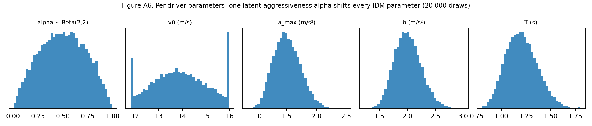{width=100%}

## 3.2 Car-following: the Intelligent Driver Model

Every vehicle's acceleration is the Intelligent Driver Model (IDM) of Treiber et al. (2000), the standard car-following model of microscopic simulation:

$$ a = a_{\max}\left[\, 1 - \left(\frac{v}{v_0^{loc}}\right)^{4} - \left(\frac{s^{*}(v, \Delta v)}{g}\right)^{2} \right], $$
$$ s^{*}(v, \Delta v) = s_0 + \max\!\left(0,\; v\,T + \frac{v\, \Delta v}{2\sqrt{a_{\max}\, b}}\right), \qquad \Delta v = v - v_{lead}, $$

where $g$ is the bumper-to-bumper gap to the leader and $s^*$ the gap the driver wants. *Reading:* accelerate towards your preferred speed, ease off as you approach it, and brake harder the closer you are to the car ahead relative to the gap you want; the wanted gap is a standing buffer plus about $T$ seconds of travel, plus more when you are closing in. On a free road (no leader within 100 m) the last term vanishes.

The IDM term is never clamped inside the formula (clamping destroys its collision-free property). After computing $a$: if $a < -3$ m/s² while the vehicle is moving, a *hard brake* is counted (a standing vehicle cannot brake); then $a \leftarrow \max(a, -b_{emerg})$ with $b_{emerg} = 7$ m/s² as the physical limit. A non-positive gap (two vehicles abreast in different lanes or connectors that aim for the same box slot) is never fed to the IDM; the yielding vehicle instead drops back at its own comfortable $b$ (Section 3.5).

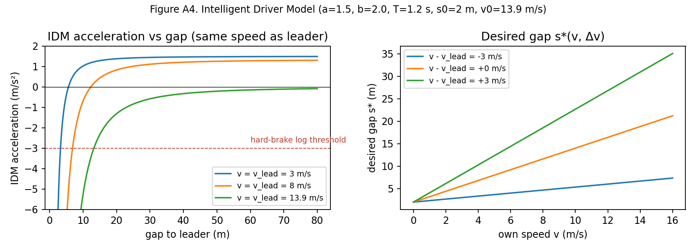{width=100%}

## 3.3 Ballistic update with an exact stop

Positions are advanced with constant acceleration over the step, and a vehicle that would come to rest within the step stops exactly where it does and never rolls back:

$$ \text{if } v + a\,\Delta t \ge 0:\quad s' = s + v\,\Delta t + \tfrac{1}{2} a\,\Delta t^{2},\quad v' = v + a\,\Delta t; $$
$$ \text{else:}\quad s' = s + \frac{v^{2}}{2|a|},\quad v' = 0. $$

After all vehicles have moved, an *overlap guard* runs front-first over every lane and connector: if $s_{follower} > s_{leader} - l_{veh} - 0.3$ the follower is pushed back to that position and its speed capped at the leader's; the event is counted (`n_overlap_fixed`). It is a health metric, not a feature: the rate per vehicle-step must stay below $10^{-4}$ (measured value in Section 10).

## 3.4 Desired speed, speeding and turn anticipation

On an edge, through traffic uses $v_0^{loc} = v_0$: speeding is allowed, which is what $\alpha$ is for. A vehicle whose next movement is a turn starts slowing up to 120 m before the box so that it reaches the corner at $v_{turn}$, using half of its own comfortable braking:

$$ v_0^{loc} = \min\!\left(v_0,\; \sqrt{v_{turn}^{2} + 2\,(0.5\, b)\, d_{box}}\right), \qquad d_{box} \le 120\ \text{m}. $$

*Reading:* from 120 m out the driver's target speed falls along a gentle braking curve that ends at the turning speed exactly at the box. The gentle factor and the long zone are there because the IDM lags behind a falling desired speed; they keep the cap continuous for the fastest driver and avoid hard-brake artefacts (Appendix B). Inside a connector, turns are capped at $v_{turn} = 5$ m/s and through movements at $\min(v_0, v_{limit})$.

## 3.5 Two lanes per direction without lane changing

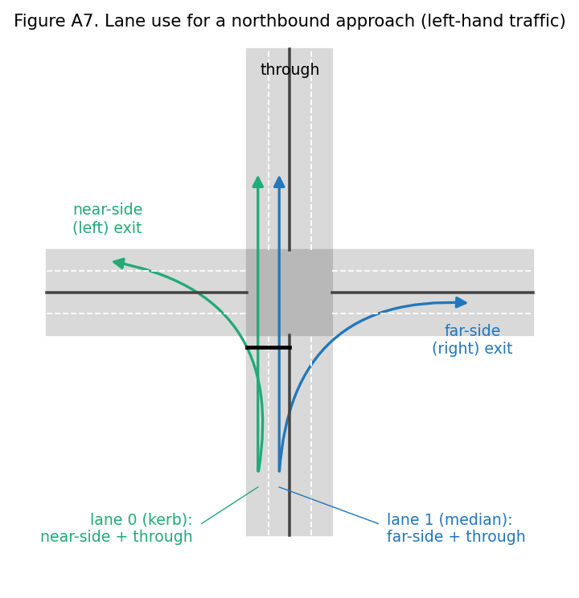{width=60%}

A vehicle's lane is fixed when it enters an edge; there are no mid-link lane changes. At the stop line the kerb lane serves near-side turns and through traffic, the median lane serves far-side turns and through traffic. Lane choice at edge entry follows the vehicle's *next* movement: NS → lane 0, FS → lane $n_{lanes} - 1$, through or boundary-bound → the lane with fewer vehicles (tie → lane 0). The connector delivers the vehicle to whichever lane of the exit edge its *following* movement needs (a "merge inside the box" simplification, stated in the data card); the target lane is planned on the approach, within the 100 m leader horizon of the stop line, counting vehicles already on connectors heading for the same lane, and is not recomputed at box entry. Two vehicles abreast that aim for the same exit lane zipper at the box entry: the one further along leads (ties by vehicle id); while the other is abreast of it, it sees the box edge as a standing leader, so the IDM brings it to rest before the edge end, braking at least at its comfortable deceleration $b$ and harder when the remaining gap demands it (a step below −3 m/s² is logged as a hard brake, as in Section 3.2, and the applied deceleration is clipped at the physical limit $b_{emerg}$); a residual hold at the edge is counted in `n_merge_holds`, and one whose instantaneous stop would imply braking above the physical limit (speed above $b_{emerg}\,\Delta t = 3.5$ m/s) is also counted in `merge_hard_stops`. A hold between 1.5 and 3.5 m/s implies an abrupt stop of 3 to 7 m/s² that is counted only in `n_merge_holds`; the release has {{N_MERGE_HOLDS}} in total and {{N_MERGE_HARD}}, so the rule is documented rather than changed. A through vehicle never plans the exit lane already claimed by the head of the other lane ahead of it, re-plans only if the other lane is emptier by more than one vehicle, and keeps its plan within 15 m of the box, so the zipper order cannot flip under it.

## 3.6 Who is my leader?

The gap $g$ and leader speed $v_{lead}$ in the IDM come from the nearest of these candidates within a 100 m horizon:

- the vehicle ahead in the same lane: $g = s_{ahead} - l_{veh} - s$;
- the stop line, treated as a stationary leader of zero length at $s_{stop}$, whenever the vehicle "sees" it: it is not committed and either its approach is not green, it has been latched STOPPING, or the lane it needs on the far side is blocked, meaning a queued vehicle ($v < 2$ m/s) leaves less than $l_{veh} + s_0 + 1 = 7.5$ m free at its start, and the vehicle can still stop at $b_{stop}$ (the don't-block-the-box rule, which is anticipatory and colour-independent);
- when it will cross: any vehicle on a connector of the same approach heading for the same exit lane, $g = (L_e - s) + s_{other} - l_{veh}$, or the last vehicle on the target exit lane, $g = (L_e - s) + w_{box} + s_{last} - l_{veh}$;
- inside a connector: a vehicle ahead on the same or a sibling connector to the same exit lane, or the last vehicle on the target exit lane.

*Reading:* a car will not enter the box if the lane it needs on the far side has no room. Within 100 m of the line, a car that is not committed treats the stop line as a parked car whenever its approach is red, and also on green whenever its exit lane is full; that second rule is the one that does not depend on the light colour. A car that can no longer stop enters anyway and, if it halts inside the box, is counted in `n_box_blocked`.

## 3.7 Stop or commit at red onset

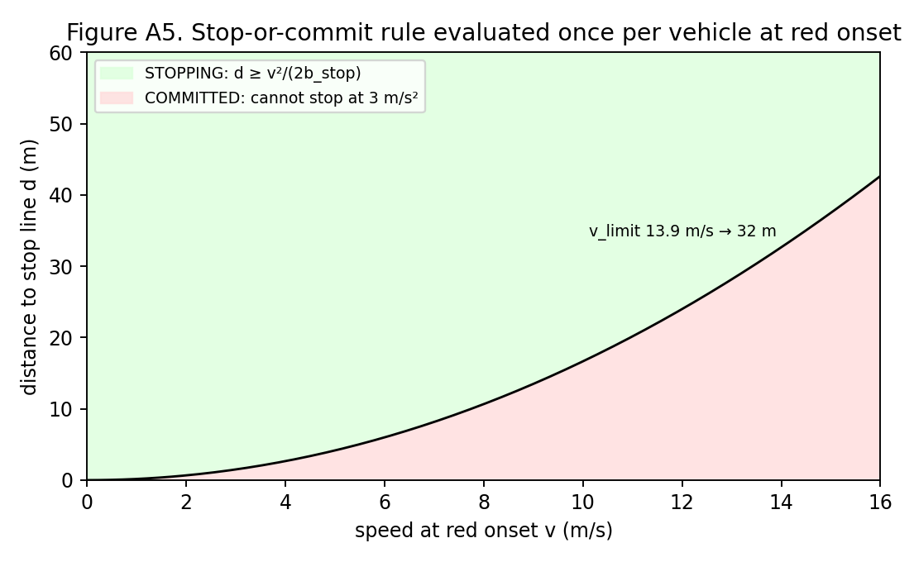{width=65%}

Amber does not exist in this design, so the dilemma it normally resolves is handled explicitly. At the instant an approach loses its green, every vehicle on that approach edge is evaluated once, nearest the stop line first, with its own distance $d$ and speed $v$:

$$ d \ge \frac{v^{2}}{2\, b_{stop}} \;\Rightarrow\; \text{STOPPING}, \qquad \text{otherwise}\;\text{COMMITTED}, \qquad b_{stop} = 3\ \text{m/s}^{2}. $$

A STOPPING vehicle takes the stop line as its leader; a COMMITTED vehicle ignores the line, finishes crossing during the all-red, and is counted in `n_red_commits`. Chains of committed vehicles are allowed; a vehicle entering the edge after red onset defaults to STOPPING; green onset clears all latches. A COMMITTED vehicle that nevertheless comes to rest before the line is re-latched STOPPING (counted in `n_commit_revoked`), so a stalled commit cannot freeze the junction, and the COMMITTED exemption from the red rule holds only during the all-red that follows its own red onset. *Reading:* when the light turns red, a car that can stop comfortably before the line does so; one that cannot keeps going and clears during the safety gap.

**Worked numbers.** The commit distance $v^2/(2 b_{stop})$ is 32.2 m at 13.9 m/s, 42.7 m for the fastest car (16.0 m/s) and 50.5 m for an ambulance at its fixed 17.4 m/s (Section 7), which makes ambulances the vehicles most likely to commit at red onset. A vehicle that commits at exactly that distance and keeps its speed needs, to clear the stop-line setback, the box and its own length ($2 + 14 + 4.5 = 20.5$ m beyond the line),

$$ t_{clear}(v) \approx \frac{v}{2\, b_{stop}} + \frac{20.5}{v}, $$

which is below 4 s only for $v \in [7.4, 16.6]$ m/s and reaches its minimum of 3.7 s at 11.1 m/s. Slow committed vehicles therefore need more than the 4 s minimum all-red, which is why the all-red is **extended until the box is empty** (Section 5) and why the all-red extension histogram has a right tail. Four seconds is a minimum, not a derived safety bound.

## 3.8 Per-vehicle bookkeeping

`total_wait` accumulates $\Delta t$ while $v < 2$ m/s; `n_stops` counts transitions from $v > 2$ to $v < 0.5$; `accel_energy` $= \sum a^2 \Delta t$; `n_hard_brakes` and `n_red_commits` as above. These are logged per vehicle and summed per episode.

# 4. Demand and routing

## 4.1 Arrivals: a Poisson process by coin flips

At every step, while spawning is on ($t < 3900$ s), each boundary node $e$ flips a coin:

$$ \Pr(\text{new request at } e \text{ in this step}) = p_e = \lambda_e(t)\, \Delta t, \qquad \lambda_e(t) = \lambda_{base}\; \kappa_e\; \pi(t). $$

*Reading:* every half-second each entrance produces a new car with probability rate × 0.5 s; over many flips this is Poisson traffic (the Bernoulli approximation is accurate while $p_e \le 0.1$, i.e. up to about 720 veh/h per entry). {{PE_SENTENCE}} $\kappa_e$ is the asymmetry factor: 1 everywhere for the `sym` scenario, 1.4 on the north–south entries and 0.7 on the east–west entries for `ns_heavy`. The released dataset uses a flat profile, $\pi(t) \equiv 1$. A daily profile of hourly multipliers (about 0.1 at night, up to 1.35 in the morning peak and 1.4 in the evening peak) exists for the twin extension of Section 13; flat runs keep their configuration hash unchanged. Per episode, $\lambda_{base}$ is jittered by a factor $U(0.9, 1.1)$ around its calibrated level.

A request draws its destination and parameters immediately. If the first 10 m of its chosen lane are free and the gap to the last vehicle satisfies $g \ge s_0 + v_{spawn}\, T$, it is inserted at $s = 0$ with $v_{spawn} = \min(v_0, v_{last})$ when a vehicle is within 50 m, else $0.8\, v_0$; otherwise it waits in the node's first-in-first-out entry queue and accrues `entry_queue_delay`.

## 4.2 Destinations and routes

The destination is drawn from the origin's row of an origin–destination (OD) matrix over the seven other boundary nodes. The default row is relational: the far end of the vehicle's own road 0.30; each end of the parallel road 0.15; each of the four ends of the two crossing roads 0.10 (sums to 1.00). The `uniform` pattern uses 1/7 each. The route is the shortest path on the directed edge graph with turns charged as extra metres,

$$ \text{cost(route)} = \sum_{e \in \text{route}} L_e + \sum_{\text{turns}} \text{penalty}, \qquad \text{penalty}_T = 0,\; \text{penalty}_{NS} = 10,\; \text{penalty}_{FS} = 25\ \text{m}, $$

with exact ties broken by a coin from the demand RNG stream.

## 4.3 Free-flow time and delay

$$ T_{ff} = \sum_{e} \frac{L_e}{v_0} + n_{turn}\,\frac{w_{box}}{v_{turn}} + n_{thru}\,\frac{w_{box}}{\min(v_0, v_{limit})}, $$
$$ D = \underbrace{(t_{enter} - t_{request})}_{\text{entry-queue delay}} + \underbrace{(t_{exit} - t_{enter})}_{\text{travel time}} - T_{ff}. $$

*Reading:* delay is how much longer the trip took than it would have on empty roads with every light green, plus any wait to get onto the road. Unfinished vehicles at the end of the episode count the delay accrued so far. The free-flow time ignores the turn slow-down of Section 3.4 and the re-acceleration after the box, so every turn contributes roughly five seconds of "delay" that is geometry rather than congestion (a lone car on an empty road loses about three seconds slowing on the approach and two regaining speed; listed as a limitation in Section 13).

**Gridlock.** The rule is evaluated for the network as a whole (no stop-line crossing anywhere for 120 s while at least 10 vehicles are in the network) and for each junction separately (no crossing at that junction for 120 s while at least 10 vehicles wait on its four approach edges). At the first detection the episode ends with `gridlock = True` and is kept as a labelled failure; `gridlock_junction` records which junction fired the rule (−1 for the network-wide rule). This is how the proposal's "gridlock flagged" requirement is met. {{GRIDLOCK_SENTENCE}}

**Spillback locks.** Short of gridlock, an approach lane can stand for a long time because its exit lane is blocked by spillback from the next junction. Two liveness measurements are logged per episode without changing any rule: `max_head_wait_s`, the longest time any lane-head vehicle stood still, and `n_spillback_locks` (with `spillback_lock_t` and `spillback_lock_junction`), the number of times an approach lane went 120 s without a stop-line crossing although its approach had been green for at least 40 s within that window; a lock is latched per lane until a crossing or until the lane empties, and is recorded, not acted on. {{LIVENESS_SENTENCE}}

# 5. The signal plant: the safety shield

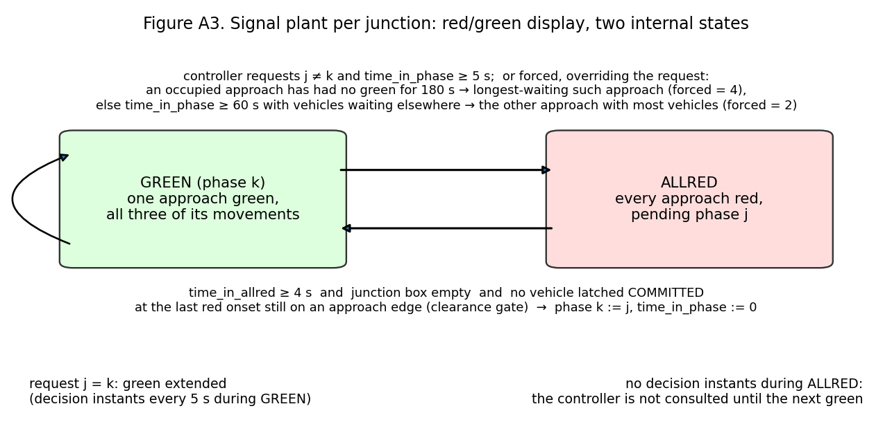{width=90%}

Each junction has one *plant*: the safety layer that sits between any controller and the lights, which the proposal calls the safety shield. The display only ever shows red or green; the safety logic lives in two internal states. Every controller, including the learned one, only ever *requests* a phase, and the plant decides when the request can be applied safely, exactly as a real signal cabinet does.

- **State.** `phase` $\in \{0{:}N, 1{:}E, 2{:}S, 3{:}W\}$ (the approach currently or most recently green), `state` $\in \{\text{GREEN}, \text{ALLRED}\}$, `time_in_phase`, `pending_phase`, `n_switches`.
- **Split phasing.** Phase $k$ gives green to all three movements of approach $k$ and red to everything else, so no two green movements can ever conflict and every destination stays reachable.
- **Timings.** Minimum green 5 s, maximum green 60 s, all-red at least 4 s, a starvation guard of 180 s (three maximum greens), one decision instant every 5 s during green (the first at green onset + 5 s), none during all-red.

**Switch procedure at a decision instant with request $j$.**

1. **Starvation guard.** If an approach with vehicles has had no green for 180 s or more (since its green last ended, or since the start of the episode), the plant forces a switch to the longest-waiting such approach (ties in rotation order) and records `forced = 4`. This is the guarantee behind the proposal's fairness requirement: whatever the controller asks for, an occupied approach gets its green within the guard plus one decision interval and one all-red. It pre-empts the max-green rule below, which on its own can starve a third approach because it always picks the largest count. The guard bounds the time to a *green*; the time a lane head waits behind a blocked exit lane is a separate matter (Section 13).
2. **Max green.** Otherwise, if `time_in_phase` $\ge 60$ s and some other approach has vehicles, the plant forces a switch to the other approach with the most vehicles (ties in rotation order) and records `forced = 2`. Max green is not a metronome: with nobody waiting elsewhere, green is simply held.
3. If $j$ equals the current phase, green is extended; the next decision is in 5 s.
4. Otherwise the plant enters ALLRED with `pending_phase` $= j$, runs the stop-or-commit evaluation on the approach that lost green, and logs `switched = True`.
5. Green for $j$ begins at the first step $t$ with $t - t_{allred} \ge 4$ s **and** no vehicle on any of the junction's twelve connectors **and** no vehicle that was latched COMMITTED at the previous red onset still on an approach edge of the junction (the clearance gate; committed vehicles enter regardless of colour). The extension beyond 4 s is logged (`allred_extension`).

There are no decision instants during ALLRED, so the controller is not consulted again until the next green. Because decision instants exist only during green and start at +5 s, the forced codes for "min green" (1) and "all-red" (3) are structurally unreachable; only codes 0 (none), 2 (max green) and 4 (starvation guard) occur in the data. The episode row records the longest red an occupied approach faced (`max_approach_red_s`) and the number of guard switches (`n_forced_starvation`).

**Safety invariants**, checked by the test suite and counted in every episode (`n_invariant_violations` must be 0): never two approaches green; box empty, and no committed vehicle still upstream, at every green onset; no stop-line crossing on red unless COMMITTED during the all-red that follows its own red onset (a crossing while another approach is green is a violation whatever the latch); minimum green respected; all-red $\ge 4$ s; vehicle conservation (requests = arrived + in network + still queued at entry). Every controller's request passes through this plant, so every controller is safe by construction and the comparison between them is fair. This is what the proposal means by safety-shielded requests, and it is why a learned rule can sit behind an existing signal controller's own interlocks without a separate safety layer.

**Effective green, lost time, capacity.** Per phase the lost time is start-up lost time plus all-red, $l = l_{startup} + r_{all} \approx 2 + 4 = 6$ s, so

$$ g_{eff} = g + r_{all} - l = 20 + 4 - 6 = 18\ \text{s}, \qquad C = 4\,(g + r_{all}) = 96\ \text{s}, $$
$$ c = s_{sat}\; n_{lanes}\; \frac{g_{eff}}{C}, \qquad x = \frac{q}{c}. $$

*Reading:* of each 24 s slot about 18 s actually move cars; two seconds are lost getting rolling and four are the safety gap. With the measured saturation flow of {{SAT_FLOW}} veh/h/lane the formula gives $c_{formula} = {{CAPACITY_FORMULA_M}}$ veh/h per two-lane approach; the simulated junction realises $c = {{CAPACITY_M}}$ veh/h of it under fixed time (Section 9), which is the capacity the demand levels are calibrated against. The 18 s effective green is a fixed design constant used for capacity, calibration and Webster's term; it is not recomputed from the measured start-up lost time of {{LOST_TIME}} s (which would give 18.7 s). The measured lost time is used where it matters for control: in the teacher's clearing time of Section 7. Webster's (1958) uniform-delay term, used only as a sanity check at low load, is

$$ d_1 = \frac{C\,(1 - g_{eff}/C)^{2}}{2\,(1 - x\, g_{eff}/C)}. $$

# 6. Controllers and label functions

Every controller maps the logged feature row to a requested approach. The plant (the safety shield) enforces safety, so a controller is just a rule.

- **fixed_time.** Rotate N→E→S→W, requesting the next approach once `time_in_phase` $\ge 20$ s; it serves empty approaches, which is what fixed time does. This is the deployed default that Webster-style timing plans produce.
- **max_pressure** (the teacher on rows without an ambulance; Section 7 adds the ambulance rule that completes the label rule). For approach $a$ let $X_a$ be its three exits minus those whose target edge is blocked (Section 3.6). Then

$$ p_a = n_a - \frac{1}{|X_a|}\sum_{d \in X_a} n^{down}_d, \qquad p_a = -10^{9} \text{ if } X_a = \varnothing, $$

$$ \text{request} = \begin{cases} \arg\max_k p_k & \text{if } p_{best} > p_{phase} + 2 \\ \text{phase} & \text{otherwise,} \end{cases} $$

with ties to the lowest index and the max-green rule applied first. *Reading:* an approach's pressure is how many cars are on it minus how full the roads it would send them onto are; an approach whose every exit is full cannot be served; a two-vehicle hysteresis stops the lights flickering. This is a max-pressure-style heuristic in the spirit of Varaiya (2013), not the per-movement form, and it is throughput-optimal only under idealised assumptions this network violates. It is the proposal's main non-priority baseline, and the paired comparison of Section 10 (Experiment 5) shows where it wins and loses: with the specified hysteresis and minimum green it switches about four times a minute, beats fixed time at design demand and loses to it at high demand, because every switch costs about 5 s of lost time (the 4 s minimum all-red plus the measured {{LOST_TIME}} s start-up lost time of Section 5). The label `y_mp_action` is therefore a strong parameter-light heuristic, not an optimum; the hysteresis and the minimum green are configuration values if a calmer teacher is wanted.

- **random_dwell.** Hold a random $U(5, 40)$ s, then request a random other approach. Used only to put rare states (starved approaches, spillback) into the dataset; train split only.
- **max_pressure_eps.** With probability $\varepsilon = 0.3$ request a uniformly random approach, else max-pressure.
- **preempt_naive** and **priority_mp.** The ambulance rules of Section 7. Neither drives a dataset episode: the behaviour mixture of Section 8.4 has four controllers, and these two are run only in the evaluation stage. The teacher therefore enters the dataset only as the label `y_mp_action`, evaluated on the states that the four behaviour controllers visited.
- **The learned controller.** The gradient-boosted model of Section 12.3, called through the same interface in the modelling stage; it is not a behaviour controller of the dataset, it is what the dataset is for.

A longest-queue rule (switch when another approach holds more than three vehicles more than the current one) is also implemented; it is the controller under which the queue-discharge experiment of Section 10 runs, where it holds the green on the only occupied approach. It drives no dataset episode and is not evaluated.

**Labels.** Throughout, *teacher* and *label rule* mean the same thing: the rule `priority_mp` (Section 7), whose request is logged as `y_mp_action` on every row from the row's own columns, and which the supervised model of Section 12.3, the proposal's supervised signal controller, is trained to imitate. On rows without an ambulance it is exactly the max-pressure request. It is the *request*, not the applied phase, so it can differ from `action_applied` on max-green rows even under the max-pressure controller. `y_q_total_t30` is the junction's queued-vehicle count 30 s later, read from `junction_1hz` at the first whole second $\ge t + 30$; it is NaN on the last 30 s of the main period, during cool-down, and after a gridlock stop. No other label is logged; in particular there is no per-row ambulance-delay-ahead target and no counterfactual per-phase outcome (Section 12.3 explains how the proposal's model goal is met without them).

**Why a mixture of behaviour controllers.** Under one deterministic policy, states it avoids never occur, and the applied action is a deterministic function of the state, so a model of "queue 30 s ahead given state and action" cannot separate the effect of the action from the state. Random-dwell and $\varepsilon$-greedy episodes supply both actions at similar states; fixed time supplies long queues. The imitation label is defined on every row regardless of which controller drove, so the classifier sees the rule evaluated on off-policy states. Regression targets are "under the logged policy" and are described as such. One gap is stated openly: none of the four behaviour controllers grants ambulance priority, so the rows on which `y_mp_action` asks for the ambulance's approach are states produced by non-priority control, and the states that follow an early switch for an ambulance occur only when $\varepsilon$-greedy or random-dwell happens to produce one. The closed-loop evaluation of Section 12.3 is therefore also a test of how the learned controller behaves in states it rarely saw; adding teacher-driven episodes to the mixture is a candidate change for the next generator version.

# 7. The ambulance extension (healthcare scenario)

The business setting is the proposal's: Jakarta's Area Traffic Control System (ATCS), operated by UP.SPLL of the Transport Agency (Dishub DKI), can give an ambulance of the Health Agency's 119 fleet a green, but today a control-room operator decides each case by hand (UP.SPLL Dinas Perhubungan Provinsi DKI Jakarta, n.d.). The healthcare value of the project is ambulance response time, where every minute counts (Larsen et al., 1993) and Jakarta's median response is long (Brice et al., 2022); the intervention is emergency-vehicle priority at signals, decided by a rule learned from this dataset instead of by an operator. In the deployment the proposal describes, ambulance GPS is the only new input a city has to add to its existing signal control, so the simulator models the ambulance channel as a GPS-style feed and nothing else. The extension keeps every car-side rule unchanged so that datasets with and without ambulances are comparable.

**Naming.** Column, stream and scenario names use the prefix `ev` for *emergency vehicle*, the general term of the preemption literature and of the proposal's title. Every emergency vehicle in this dataset is an ambulance (`vehicle_type = "ambulance"`), and the text says ambulance throughout.

**Spawning.** A fifth random stream (`ev`) drives everything about ambulances, so cars are bit-identical with ambulances on or off for the same seed. The scenario factor `ev_rate` is "0" (30% of episodes) or "default" (70%). At "default" every boundary node flips a second coin each step,

$$ p_{ev} = \frac{\lambda_{ev}}{3600}\,\Delta t, \qquad \lambda_{ev} = 4\ \text{ambulances/h per node}, $$

independent of car demand. That rate is far above reality and is chosen for statistical power (about {{EV_PER_EPISODE}} ambulances per episode in the measured run); it is stated in the data card. Destination and route come from the same OD row and the same shortest-path rule.

**Ambulance parameters** (fixed, no $\alpha$ draw): $v_0 = 1.25\, v_{limit} = 17.4$ m/s, $a_{\max} = 2.5$, $b = 3.0$ m/s², $T = 0.9$ s, $l_{veh} = 6.0$ m. Same IDM, same stop-or-commit rule, same lanes and box rules. **Ambulances never run a red light**: their advantage can only come from the signal, which keeps every safety invariant intact and makes the signal controller the object of study. Without lane changing an ambulance behind a queue waits for the queue to discharge. The proposal treats this as Jakarta's geometry rather than a defect: with two full lanes and no shoulder there is no room to yield, so the signal is the only lever. What remains a stated limitation is that cars cannot pull aside even where a real street would let them.

**What a controller can see** (GPS-style channel, no sensor noise), per approach $a$: `ev_present_a`; `ev_dist_a`, the distance of the nearest ambulance to the stop line (−1 if none; the 300 m horizon never binds here because every approach edge is shorter than 300 m, so `ev_present_a` means an ambulance is somewhere on the approach edge); `ev_eta_a` $= d / \max(v_{ev}, 3\ \text{m/s})$; and `ev_q_ahead_a`, the number of queued vehicles ahead of it in its lane. These four columns are the only input the design adds to what an existing signal controller already measures (the queue and occupancy counts of Section 8.2): the proposal's ambulance GPS as the only new input. The 119 fleet's vehicle tracking would supply them in a deployment; in the twin they are read without noise or delay (Section 13).

**Naive full preemption** (`preempt_naive`): request the approach of the ambulance with the smallest ETA whenever that ETA is at most 20 s; otherwise behave as max-pressure. This is the "force green for the ambulance" strategy of the preemption literature (Nelson & Bullock, 2000; Chen et al., 2024; Roy et al., 2024; Su et al., 2023), the immediate forced green of current practice, and the proposal's third baseline.

**Priority-aware teacher** (`priority_mp`, the label rule): request the ambulance's approach only when it will arrive within the time the queue ahead of it needs to discharge,

$$ \text{ETA}_a \le t_{clear,a} = r_{all} + l_{startup} + q^{ahead}_a\, h_{sat}, $$

with the measured start-up lost time and saturation headway; before that it keeps serving max-pressure, and after the ambulance has crossed it returns to max-pressure. *Reading:* switch exactly early enough that the last car in front of the ambulance has rolled across the line when the ambulance reaches it, and not a second earlier. This is the proposal's ETA-aware pre-clearing, written as a formula so that it can be inspected and imitated; it is what the crews' need for fewer stops and a predictable passage turns into at the junction.

**New measurements.** `vehicles.csv` carries `vehicle_type` (`car` or `ambulance`). `episodes.csv` adds `n_ambulances` (requests in the whole episode) and, over ambulances requested in the main period (NaN if none): `ev_mean_travel_time_s`, `ev_mean_delay_s`, `ev_p90_delay_s` and `ev_mean_stops`; `car_mean_delay_penalty_s`, the proposal's cost to general traffic, defined as the mean car delay minus the same quantity in a paired run of the same seed and controller with no ambulances, which the generator runs automatically (the non-priority cost that Chen et al. (2024) offset with compensating green after the emergency vehicle has passed); and `recovery_time_s`, which, unlike the four ambulance KPIs, is not restricted to the main period: it is averaged over every (ambulance, junction) pair of the whole episode, and its recovery window runs to the end of the episode. For the recovery time, each (ambulance, junction) pair records the junction's `q_total` the moment the ambulance enters one of its approach edges, $q_0$; after the ambulance's front bumper leaves the box at $t_{clear}$, the recovery time is the first whole second $t \ge t_{clear}$ at which $q_{total}(t) \le 1.1\, q_0$, minus $t_{clear}$. The episode value is the mean over pairs; pairs whose queue has not returned to that level by the end of the episode are left out, so the metric is optimistic when recovery is slow. *Reading:* how long after the ambulance has gone until the junction looks the way it did when the ambulance appeared; this is the recovery after preemption that Nelson and Bullock (2000) studied, finding that single calls barely affect a coordinated corridor, closely spaced calls disrupt it more, and a smooth transition recovers best.

**Evaluation protocol** (proposal Goal 4). The evaluation is a separate modelling-and-evaluation stage, not part of dataset generation: `preempt_naive` and `priority_mp` are implemented but are not in the behaviour mixture of Section 8.4, so no episode of the released dataset is driven by them, and the ambulance KPIs in the data card are grouped over the four behaviour controllers only. The evaluation grid is five controllers {fixed_time; max_pressure, the proposal's main non-priority baseline and the reference for the bound on car delay (Section 10, Experiment 5, shows it loses to fixed time at high demand); preempt_naive, the proposal's naive full preemption; priority_mp, the teacher and the reference for the imitation; the learned controller} × two demand levels {design, high} × at least eight seeds, with ambulances on and the same seed, hence the same cars and the same ambulance requests, under every controller. The **primary metric** is ambulance travel time through the grid, `ev_mean_travel_time_s`, as the proposal states; `ev_mean_delay_s` is reported beside it. Because paired runs give every ambulance the same route, and hence the same free-flow time, under every controller, the paired difference in `ev_mean_delay_s` between two controllers equals the paired difference in travel time plus the difference in entry-queue wait, which is close to zero at design demand but large once a controller lets queues back up to the entry nodes, so at high demand the two metrics can rank controllers differently and are never used interchangeably. The pilot tables of Section 12.5 lead with `ev_mean_delay_s`; the per-episode results also hold `ev_mean_travel_time_s`, and the report's evaluation table carries both, travel time first. **Secondary metrics** are the general delay of cars (`mean_total_delay_s`, compared with max-pressure on the same seed; its paired form against the no-ambulance run is `car_mean_delay_penalty_s`), `recovery_time_s`, and the fairness spread defined in Section 12.3. The proposal's **stated bound on general traffic** is operationalised there as well: the learned controller must keep car delay within a margin of max-pressure, and the margin proposed as the group's operating point is 10%. Differences are paired by seed and reported as 95% $t$-intervals (Section 12.3). Results are reported in Section 12.5. {{PILOT_PROVENANCE}}

**Who reads which column.** The proposal's stakeholder table maps onto the dataset as follows.

| Stakeholder (need) | Where the dataset answers it |
|---|---|
| Ambulance crews and patients (fewer stops, predictable passage) | `ev_mean_travel_time_s`, `ev_mean_delay_s`, `ev_p90_delay_s`, `ev_mean_stops`; the ETA-aware teacher above |
| Traffic-control operators (no manual intervention, no gridlock) | every request passes the plant of Section 5; `gridlock`, `gridlock_t`; `down_blocked_*` in `signal_ticks` |
| General road users (fair, bounded delay) | `mean_total_delay_s` against the bound, `car_mean_delay_penalty_s`, `recovery_time_s`; delay by entry node from `origin` and `total_delay_s` in `vehicles.csv` |
| City government (evidence before investment) | paired seeds with common random numbers (Section 8.3) and $t$-intervals (Section 12.3) |
| Researchers and students (reusable data) | the CSV tables, the data dictionary, the data card and the download link (Sections 8 and 12.4) |

# 8. Dataset schema

## 8.1 Tables and grain

| File | One row per | Primary key | Rows in the {{RUN_LABEL}} |
|---|---|---|---|
| `episodes.csv` | episode | `episode_id` | {{N_EPISODES}} |
| `vehicles.csv` | vehicle (car or ambulance) | `episode_id, veh_id` | {{N_VEHICLES}} |
| `signal_ticks.csv` | junction × decision instant (**the ML table**) | `episode_id, junction_id, t` | {{N_TICKS}} |
| `junction_1hz.csv` | junction × second | `episode_id, junction_id, t` | {{N_1HZ}} |
| `network_edges.csv` | directed edge | `edge_id` | 24 |
| `vehicle_states_<id>.csv` | vehicle × second (showcase episodes only) | `episode_id, t, veh_id` | optional |

Plus `data_dictionary.csv` (every column of every table with type, unit, description and namespace), `config.json` (the full configuration including the calibrated demand levels) and `DATACARD.md`, a datasheet in the sense of Gebru et al. (2021). These files, with their SHA-256 checksums (Section 12.4), are what the download link of the report points to.

## 8.2 The ML table, `signal_ticks` ({{N_TICK_COLS}} columns)

One row per junction per decision instant. Columns are grouped by namespace; the namespace is recorded in the data dictionary so that feature sets can be selected by rule rather than by hand. The full column-by-column dictionary is Appendix C.

| Namespace | Columns | What they hold |
|---|---|---|
| key, time | `episode_id, junction_id, t, tick_idx, is_warmup, is_cooldown, is_tail` | identity of the row and the period flags |
| signal | `phase, time_in_phase_s, max_green_remaining_s` | the plant's own state |
| state (per approach N, E, S, W) | `q_a, n_a, q_a_l0, q_a_l1, arr_a_30s` | queued and total vehicles on the approach edge, per lane, and arrivals in the trailing 30 s |
| downstream (per exit direction) | `down_n_d, down_occ_d, down_blocked_d` | vehicles on the outgoing edge, its occupancy relative to storage, whether its start is blocked |
| neighbour (per direction) | `nb_d_exists, nb_d_phase, nb_d_green_toward_me` | whether a neighbouring junction exists there, its phase, and whether its green feeds this junction |
| sensor | `obs_q_a` (×4) | the noisy queue count defined below |
| ev (per approach) | `ev_present_a, ev_dist_a, ev_eta_a, ev_q_ahead_a` | the ambulance channel of Section 7 |
| action | `action_requested, action_applied, forced, switched` | what the controller asked, what the plant did |
| label | `y_mp_action, y_q_total_t30` | the imitation target and the 30 s-ahead queue |

**Flags.** `is_warmup` ($t < 300$), `is_cooldown` ($t \ge 3900$), `is_tail` (last 30 s of the main period, where the 30 s-ahead label would look into cool-down). Training and evaluation use rows with none of the three set.

**Sensor copy.** For each approach the observed queue is a noisy version of the true one,

$$ \tilde{q}_a = \mathrm{Binomial}(q_a,\, 1 - p_{miss}) + \mathrm{Poisson}(p_{miss}/2), \qquad p_{miss} \in \{0, 0.1\}, $$

drawn from the sensor stream; with $p_{miss} = 0$ it equals $q_a$. Models trained on `obs_q_*` instead of `q_*` quantify how much control quality survives realistic sensing (a camera-based queue count of the kind an area traffic control centre already has), and the twin's estimator later writes into the same columns.

**Leakage rules.** No feature depends on anything after $t$; every window is trailing. The pressure values that generate the label are not stored as columns. There is no clock feature (no time of day, no cumulative counters) so a model cannot memorise the demand schedule. `junction_id` is a key, not a feature: the corner a junction sits in is already implied by which neighbours exist.

## 8.3 Seeds, streams and determinism

$$ \text{seed} = 100000 + \text{episode\_id}, \qquad \text{seed} \to \text{five independent child streams } (\text{demand}, \text{vehicles}, \text{controller}, \text{sensor}, \text{ev}). $$

The five streams are spawned from the episode seed by a hash-based seed-sequence scheme, so they are statistically independent, and changing how one stream is consumed (switching ambulances off, or running a different controller) leaves the draws of the other four unchanged. Arrivals, destinations and route ties come from the demand stream; driver parameters from the vehicles stream; $\varepsilon$ draws and random dwells from the controller stream; `obs_q` noise from the sensor stream; everything about ambulances from the ev stream. Two controllers run on the same seed therefore face identical cars (common random numbers), which is what makes the proposal's paired comparisons meaningful. The determinism test runs an episode twice and asserts identical `vehicles.csv`; `config_hash` (first 12 hex characters of the SHA-1 of the configuration JSON and generator version) and `generator_version` are stamped on every episode row.

## 8.4 Scenario mixture, splits and preprocessing

Each episode draws, stratified so that the realised shares match the targets: demand level {low 25%, design 40%, high 25%, stress 10%}; asymmetry {sym, ns_heavy}; OD pattern {default 70%, uniform 30%}; controller {max_pressure 40%, max_pressure_eps 30%, fixed_time 20%, random_dwell 10%}; sensor noise {0: 60%, 0.1: 40%}; ambulance rate {0: 30%, default: 70%}. Splits are assigned per episode, never per row: 70/15/15 train/validation/test stratified by (demand level, controller); every **stress** episode goes to `test_ood` and is never trained on; random-dwell episodes are train-only. Consecutive rows five seconds apart are near-duplicates, so a row-wise split would report an accuracy that collapses in closed loop.

**Preprocessing.** The proposal names three preprocessing steps; all three are done by the generator so that the published CSV files are analysis-ready. *Warm-up filtering:* rows and vehicles are flagged (`is_warmup`, `is_cooldown`, `is_tail`, Section 8.2) rather than deleted, and every consumer applies the same filter. *Episode-level splits:* the `split` column above. *Label post-pass:* `y_mp_action` and `y_q_total_t30` are computed after the episode ends (Sections 1 and 6). The analysis in R (Section 12.4) starts from the flag filter and needs no further cleaning. Because every episode is an independent seed, generation and preprocessing parallelise trivially across episodes: a release is one independent job per episode whose only shared input is the configuration.

Episodes of the {{RUN_LABEL}} (every episode is listed for a pilot; a release is summarised by mix, split and mean KPIs):

{{EPISODES_TABLE}}

# 9. Demand calibration from the measured saturation flow

The demand levels are defined by load, not by a textbook number. The chain is: measured saturation headway → saturation flow → formula capacity → measured capacity → target volume-to-capacity ratio → arrival rate per entry.

1. **Saturation headway** from the queue-discharge experiment (Section 10, Experiment 1; the calibration chain is given first because it is part of generation): the mean headway of vehicles 5 to 15 of a 20-vehicle standing queue after green,
   $$ h_{sat} = \frac{1}{11}\sum_{i=5}^{15}\left(t_i - t_{i-1}\right), \qquad s_{sat} = \frac{3600}{h_{sat}}, $$
   and the start-up lost time is the sum over the first four headways (vehicles 1 to 4) of their excess over $h_{sat}$. *Measured:* $h_{sat} = {{H_SAT}}$ s, $s_{sat} = {{SAT_FLOW_M}}$ veh/h/lane, $l_{startup} = {{LOST_TIME}}$ s.
2. **Formula capacity** per two-lane approach under fixed time: $c_{formula} = s_{sat} \cdot 2 \cdot 18/96 = {{CAPACITY_FORMULA_M}}$ veh/h. It counts a through-only single-lane discharge, which the simulated junction cannot sustain on two lanes with zipper merging at the box and turning vehicles capped at $v_{turn}$.
3. **Measured capacity.** One saturated single-junction probe episode under fixed time (every approach fed at 1.3 times the formula capacity for 1200 s after warm-up) measures what the junction actually passes: $c = $ main-period throughput / 4 approaches $= {{CAPACITY_M}}$ veh/h, a realisation of {{CAPACITY_RATIO}} of the formula value. Both numbers and their ratio are saved with the dataset.
4. **Flow per unit of base rate.** From the OD matrix and the routes, the flow on each approach edge is a fixed multiple of $\lambda_{base}$,
   $$ F_e = \sum_{o}\sum_{d} \lambda_{base}\,\kappa_o\, P(d \mid o)\, \mathbb{1}[e \in \text{route}(o, d)] = \lambda_{base}\, f_e, $$
   and the busiest internal approach has $f_{\max} = {{F_MAX}}$ (edge `{{BUSIEST_EDGE}}`, read from-node to to-node as in Section 2).
5. **Base rate per level** from the target ratio $x_\ell \in \{0.4, 0.7, 0.95, 1.15\}$ for {low, design, high, stress}, using the measured capacity:
   $$ \lambda_{base}(\ell) = \frac{x_\ell\, c}{f_{\max}}, $$
   giving {{LAMBDA_TABLE}} veh/h per entry node. The calibration step writes these into the configuration saved with the dataset; every episode row carries `measured_sat_flow_vphpl`. The single-junction sweep of Section 10 runs the same simulator as the probe, so their agreement ({{REALISED_VC}}) checks the calibration arithmetic, not the capacity itself; the independent evidence for the capacity is the saturation-flow measurement and the fixed-time delay curve of Section 10. The calibration is also single-junction: on the 2×2 grid the nominal levels are not sub-capacity for every controller (Section 10, Experiment 5, and Section 13).

*Reading:* "design" demand means the busiest approach runs at 70% of what a fixed-time signal actually carries in this simulator, measured rather than assumed. The calibration uses the default OD row with symmetric demand ($\kappa_e = 1$); under `ns_heavy` the north–south stubs carry 1.4 times the base rate, so a "high" north-south-heavy episode loads those stub approaches above the fixed-time capacity of a single approach (nominal $x = 1.4 \times 0.95 / f_{\max} \approx 1.13$ before jitter, about 1.36 at stress), which is intended as a hard case and is visible in the KPIs.

# 10. Validation experiments and results

The five experiments below are run before any dataset is generated; they write the figures reproduced here and a machine-readable validation summary from which the numbers in this document are filled.

**Experiment 1: queue discharge.** Twenty vehicles stand in one lane on a single-junction grid; the light turns green; stop-line crossing times are recorded.

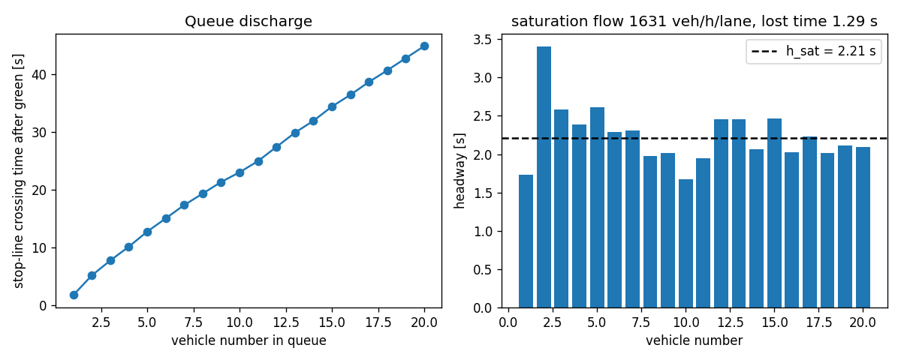{width=100%}

Result: $h_{sat} = {{H_SAT}}$ s, saturation flow {{SAT_FLOW}} veh/h/lane (acceptance band 1600–1900), start-up lost time {{LOST_TIME}} s. Pass.

**Experiment 2: delay versus demand on one junction under fixed time.** The arrival rate is swept so that the busiest approach runs at a nominal $x$ from 0.2 to 1.1; mean total delay per vehicle must rise smoothly and blow up near capacity, and at low load should track Webster's (1958) uniform-delay term. The sweep also measures the capacity at which the busiest approach saturates; it agrees with the probe of Section 9 (ratios of the four levels {{REALISED_VC}}), which is a consistency check of the calibration rather than an independent validation.

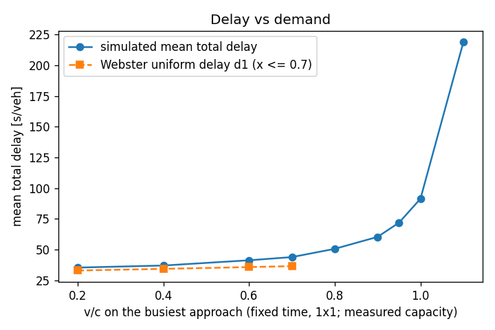{width=85%}

{{SWEEP_TABLE}}

**Experiment 3: one design-demand hour on the 2×2 grid with max-pressure.** All invariant counters must be zero and delay plausible.

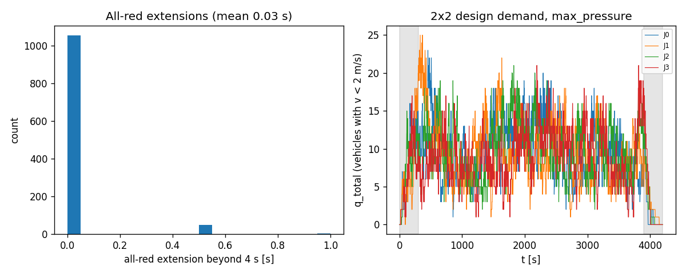{width=100%}

Result: mean total delay {{DESIGN_DELAY}} s per vehicle (plausibility band 30–90 s), 90th percentile {{DESIGN_P90}} s, throughput {{DESIGN_THROUGHPUT}} veh/h, mean all-red extension {{DESIGN_ALLRED}} s, invariant violations {{DESIGN_VIOL}}, runtime {{DESIGN_RUNTIME}} s for 4200 simulated seconds. Switch rate {{DESIGN_SWITCH_RATE}} per minute per junction against an acceptance band of 0.7–3.5: the specified teacher flickers above the band, a known property discussed in Section 6. Hard brakes per red onset {{DESIGN_HB_PER_ONSET}}, of which a share of {{DESIGN_EMERG_SHARE}} were clipped at the physical limit: a STOPPING vehicle near the stop-or-commit boundary brakes harder than its comfortable rate, so this is a property of the specified rule and a health metric, not a comfort KPI. Longest red faced by an occupied approach {{DESIGN_MAX_RED}} s, starvation-guard switches {{DESIGN_N_STARV}}, merge holds {{DESIGN_N_MERGE}} (hard merge stops {{DESIGN_MERGE_HARD}}), commits revoked {{DESIGN_N_REVOKED}}, longest standing lane head {{DESIGN_HEAD_WAIT}} s, spillback locks {{DESIGN_SPILL}}. The grey bands in the right panel are warm-up and cool-down; the queues settle within the warm-up.

**Experiment 4: ring-road fundamental diagram.** Vehicles on a closed 1 km loop at increasing density; flow must rise to a capacity near the saturation flow and fall to zero at the jam density $1000/(l_{veh} + s_0) = 154$ veh/km/lane. The IDM (Treiber et al., 2000) gives a concave free branch and a roughly linear congested branch, so "approximately triangular" is the expected shape.

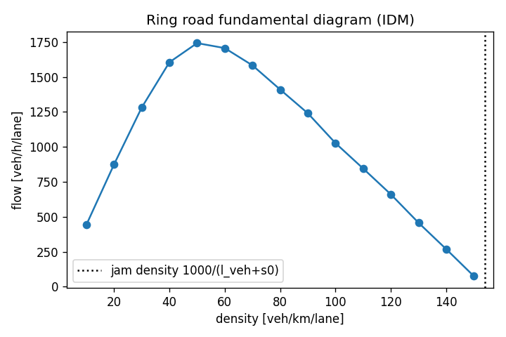{width=75%}

**Experiment 5: max-pressure against fixed time on paired seeds.** The two rule-based controllers of Section 6 are run on the same seeds at design and high demand (three seeds each in the validation run); the paired difference in mean total delay is reported with its 95% $t$ half-width.

{{PAIRED_TABLE}}

Max-pressure wins at design demand and loses at high demand; Section 6 explains why and Section 12.3 draws the consequence for the learned controller. The same two controllers on the full 2×2 grid, one seed per level, show where the network stops clearing its load (vehicles in the network 900 s into the episode and at its end):

{{GRID_LEVELS_TABLE}}

**Dataset health.** Over the {{N_EPISODES}} episodes of the measured run: invariant violations {{TOTAL_VIOL}}; overlap-guard rate {{OVERLAP_RATE}} per vehicle-step; red commits per episode {{RED_COMMITS_RANGE}}; gridlock episodes {{N_GRIDLOCK}}; label balance of `y_mp_action` over main-period rows: {{LABEL_BALANCE}}; share of rows where the label asks for a switch: {{LABEL_SWITCH_RATE}}.

# 11. Step-by-step: generating the dataset

The generator is a small Python package (Python 3.11 or newer with numpy, pandas, matplotlib and pytest; scikit-learn for the models). Generating a release is five steps. The first three are each a single command: the test suite, the validation experiments and the generator. The last two are done by hand: a check of the output and the publication.

1. **Test.** Run the unit-test suite: geometry (the heading-rotation test of Section 2), IDM, stop-or-commit, plant timing, the safety invariants, determinism, label recomputation, the sensor copy, and the ambulance tests (teacher rules on hand-made rows, ambulance spawning and observation, common random numbers for cars with and without ambulances).
2. **Validate.** Run the five validation experiments of Section 10. They measure the saturation flow and start-up lost time, sweep demand, run the design episode and the ring road, compare max-pressure with fixed time on paired seeds, and save the figures and the validation summary.
3. **Generate.** Run the generator with the number of episodes and an output folder. It first calibrates the four demand levels from the measured saturation flow and a capacity probe episode (Section 9), then runs the episodes of the stratified scenario mixture (Section 8.4), the paired no-ambulance run of every episode with ambulances, and writes the tables of Section 8, the configuration, the data dictionary and the data card. A 1 Hz trajectory log of chosen showcase episodes can be added for animation and for the offline replay of Section 13; such logs are optional extras, not covered by the checksum file and not counted in the file sizes quoted in this document. Further episodes can be generated later as a separate batch with a starting episode id beyond the existing ones, written to their own folder and concatenated by hand; existing seeds do not change, because the seed is a function of the episode id (Section 8.3), but the scenario mixture and the split fractions are stratified within each batch, not across the union.
4. **Check.** Every row of `episodes.csv` must have `n_invariant_violations = 0` and the same `config_hash`; the data card reports the realised episode mix by demand level and controller, the ambulance KPIs by controller and the label balance; the realised split counts are read from the `split` column (measured run: {{SPLIT_COUNTS}}).
5. **Publish.** Compute the SHA-256 checksum of each table, the network table, the data dictionary and the configuration into a checksum file placed beside them (the file quoted in Section 12.4; the build step of this document writes it), and publish them with the data card at the download link that the report cites.

The {{RUN_LABEL}} used for the numbers in this document took {{RUNTIME_RANGE}} s per 4200-second episode (mean {{RUNTIME_MEAN}} s), so the 120-episode release plus its paired no-ambulance runs takes roughly {{FULL_RUN_ESTIMATE}} on a laptop. The release size of 120 meets the proposal's commitment of at least 100 reproducible episodes with a margin, so that the 10% stress share yields about twelve out-of-distribution episodes for `test_ood`. File sizes of the measured run: {{SIZE_TABLE}}.

# 12. Material for the Assignment 3 report, under the brief's section names

## 12.0 Front matter the report must carry

- **First page.** The brief asks whether the topic of Assignment 3 differs from Assignment 1. Answer: *No. The topic is unchanged; Sections 1–3 are revised from the proposal in response to the feedback and to the measured results (runtime, saturation flow, demand levels).*
- **Second page (3% of the unit mark).** Two headings, *Feedback received on Assignment 1* and *How we incorporated it* (at most 150 words), left as a placeholder until the feedback is released; the response should name the sections that changed and point to the evidence (for example the validation results of Section 10 or the measured KPIs of Section 8.4).
- **Files.** One PDF and one R Markdown file, never zipped; each member uploads the same report under their own name in the brief's naming pattern.

## 12.1 Characterising and Analysing Data (a): data sources and the four V's

- **Source.** Self-generated synthetic microsimulation, because vehicle-level data on ambulance passages cannot be collected safely on live roads and synthetic data from a validated simulator are the accepted substitute (proposal Section 1.1; Jordon et al., 2022). Version 1 is the model layer of the digital twin defined in the proposal (model, live data link, synchronisation loop; Kušić et al., 2023); no real road data enters it. Public data serve context only in version 1: the city congestion figures of the TomTom index (The Jakarta Post, 2024) and the city's open inventory of signals connected to its area traffic control system (Pemerintah Provinsi DKI Jakarta, n.d.). Calibration to a real Jakarta intersection is future work (Section 13): the signal inventory would give junction locations, open street geometry the block lengths, lane counts and speed limits, and the congestion figures a city-level delay to check a calibrated twin against. The demand levels of version 1 are calibrated from the simulator's own measured saturation flow (Section 9), not from public data. The dataset is the product: the twin's tables are the training data for the controller, the evidence for an investment decision, and a reusable benchmark.
- **Preprocessing.** The three steps the proposal names (warm-up filtering, episode-level splits, label post-pass) are built into the generator (Section 8.4) and are per episode, so preprocessing distributes trivially.
- **Volume.** The {{RUN_LABEL}} holds {{N_TICKS}} decision rows, {{N_VEHICLES}} vehicle rows and {{N_1HZ}} one-second rows ({{TOTAL_MB}} MB of CSV). Rows scale linearly with episodes: a 120-episode release is about {{SCALED_TICKS}} decision rows and {{SCALED_MB}} MB; a thousand episodes would be a few million rows, still laptop-sized.
- **Velocity.** The physics runs at 2 Hz, the aggregates at 1 Hz, and a decision row is produced for each junction every 5 s of green. Generation throughput is about {{EPISODES_PER_HOUR}} logged episodes per hour including the paired no-ambulance runs (the logged runtime covers the logged episode only); in a live twin a decision must be served within the 5 s decision interval, and the ambulance channel updates at the rate of the fleet's GPS feed.
- **Variety.** Four relational tables at different grains (episode, vehicle, decision instant, second), a static network table, a JSON configuration, a data card; numeric, boolean, categorical and string (route) columns; optional trajectory logs for animation.
- **Veracity.** Ground truth is known by construction; realism is established by the validation experiments (saturation flow, Webster's 1958 delay term, the fundamental diagram); measurement noise is injected deliberately and documented; the limitations list (no amber, no lane changes, split phasing, Poisson arrivals, IDM drivers, no pedestrians, no motorcycles) is explicit. Synthetic is not real: results are about the twin.

## 12.2 Characterising and Analysing Data (b): platforms, software and tools, now and if the project expands

| Role | Now (version 1, CSV only) | If the project expands |
|---|---|---|
| Generation and physics | Python 3.13 (3.11 or newer required), numpy, pandas; plain Python loop, one process per episode | SUMO (Lopez et al., 2018) through its control interface as an independently validated backend; a vectorised step if episodes ever exceed three minutes |
| Testing and validation | pytest (geometry, IDM, stop-or-commit, plant timing, invariants, determinism, labels, ambulances); the validation experiments of Section 10 | the same tests against the SUMO backend |
| Storage and release | CSV tables, the configuration, the data dictionary, the data card and a checksum file; about {{SCALED_MB}} MB for 120 episodes | Parquet with DuckDB or Arrow for multi-gigabyte trajectory logs; object storage with a Zenodo DOI per release |
| Modelling | scikit-learn (Pedregosa et al., 2011): logistic regression, histogram gradient boosting, decision tree | distributed training (Spark or Dask) only beyond hundreds of millions of rows |
| Demonstration and report | R (R Core Team, 2026) with `dplyr`, `ggplot2`, `rpart` and `rmarkdown`; this document rendered from Markdown | unchanged |
| Versioning and provenance | `generator_version`, `config_hash` and the seed on every episode row; code under version control | versioned releases with DOIs |

## 12.3 Characterising and Analysing Data (c): data analysis techniques and statistical methods, rationale and expected outcomes

- **How this realises proposal Goal 3.** The proposal promised a gradient-boosted model that predicts, per candidate phase, the ambulance delay and the general queue 30 s ahead, deployed as a priority-aware controller behind a safety shield. The dataset supports that goal in two supervised parts, not as a per-phase counterfactual (the design rules out re-running each step under each of the four phases). Task A imitates the priority-aware teacher, the rule that already trades the ambulance's arrival against the queue ahead of it (Section 7); Task B predicts the junction queue 30 s ahead *under the action that was logged*, and because the behaviour mixture of Section 6 applies different actions in similar states, the fitted regressor can be evaluated at each of the four candidate phases for a fixed state, which is the per-candidate-phase prediction the proposal describes, valid under the logged policies and reported as such. No ambulance-delay-ahead label is logged: ambulance delay exists after the fact, per vehicle in `vehicles.csv` and per episode in `episodes.csv`, and the ambulance effect of a phase choice is therefore measured in closed loop rather than predicted per row. A per-row ambulance-delay-ahead label is planned for the next generator version (Section 13). The deployed controller is the gradient-boosted model behind the plant of Section 5. Gradient-boosted trees are chosen because on tabular data of this size they match or beat deep models and stay inspectable (proposal Section 2.1; Grinsztajn et al., 2022), whereas deep reinforcement learning is hard to audit and is future work.
- **Descriptive.** Delay distributions by demand level and controller; label balance; feature–label correlations; the hidden aggressiveness $\alpha$ against individual delay (cars only: ambulances carry a fixed $\alpha = 1.0$); ambulance versus car delay; car delay by entry node under each controller (the fairness view below).
- **Task A, imitation (four classes).** Predict `y_mp_action` from the feature row. Logistic regression (class-balanced) as the interpretable baseline; a histogram gradient-boosting classifier as the main model; a depth-5 decision tree to show the recovered rule. Metrics: balanced accuracy, macro-F1, F1 of the "switch" rows, confusion matrix, permutation importance; truth features versus noisy sensor features.
- **Task B, per-candidate-phase regression.** Predict `y_q_total_t30` from the state and the *applied* action with Ridge and a histogram gradient-boosting regressor; report MAE, RMSE, $R^2$ and the partial dependence on the action, which is the control-relevant effect size (queue at $t + 30$ is mostly explained by queue at $t$, so $R^2$ alone flatters).
- **Validation design.** Grouped cross-validation by episode; the stress level as an out-of-distribution test; then, in the modelling stage, **closed-loop deployment** of the learned model as a controller (switch only if $P(\text{best}) > P(\text{current}) + 0.1$ for the classifier, or the phase with the lowest predicted cost for the regressor) on the evaluation grid of Section 7: fixed-time, max-pressure, naive full preemption, the teacher and the learned controller, at design and high demand, on at least eight paired seeds, scored on the primary and secondary metrics of Section 7. The teacher's own closed-loop result is the reference for the imitation, not a ceiling: an imperfect copy of a rule can do better or worse than the rule it copies.
- **Inference.** For a paired comparison over $n$ seeds with differences $\Delta_i$,
  $$ \bar{\Delta} \pm t_{n-1,\,0.975}\, \frac{s_\Delta}{\sqrt{n}}, $$
  with $n \ge 8$ ($t_{7,0.975} = 2.365$; never 1.96 at these sample sizes). A Wilcoxon signed-rank test cannot reach $p < 0.05$ with five pairs, so it is not used. This paired comparison is the evidence before capital spend that the proposal promises the city: the same ambulances and the same cars face each controller (common random numbers, Section 8.3), so the difference is the controller's.
- **The bound on general delay.** The proposal's acceptance criterion is that the learned controller keeps general-traffic delay within a stated margin of max-pressure. It is stated on cars, per demand level, as a paired difference $\Delta_i = \bar D_i^{\,\text{learned}} - \bar D_i^{\,\text{max-pressure}}$, where $\bar D_i$ is the episode's `mean_total_delay_s` (cars spawned in the main period) on seed $i$. The bound is met at a demand level when the upper end of the 95% $t$-interval on $\bar\Delta$ is at most the margin $m$. The margin is fixed before the evaluation runs and reported with the result; the group's proposed operating point is $m = 0.10\,\bar D^{\,\text{max-pressure}}$, ten per cent of the max-pressure mean car delay at that demand level, so that the bound scales with congestion. The full trade-off curve is reported in any case, so a city can move the operating point (proposal Section 2.4).
- **Fairness across approaches.** No episode-level column holds this; it is computed from `vehicles.csv` in the analysis. For each episode, take cars spawned in the main period, group them by `origin` (the eight entry nodes, each of which feeds one outer approach arm of one junction) and take the mean `total_delay_s` of each group, $\bar D_o$. The fairness statistic is the ratio of the largest to the smallest group mean, $F = \max_o \bar D_o / \min_o \bar D_o$ ($F = 1$ when every entry arm waits the same on average), reported per controller and demand level with the same paired-seed intervals as the other secondary metrics, and the eight $\bar D_o$ are shown as a bar chart so the reader sees *which* arm pays for the priority. Grouping by entry node attributes a trip's whole delay to its first approach; the per-approach queues `q_a` of `signal_ticks` give the complementary junction-level view.
- **Expected outcome, stated honestly.** Before the closed loop, the learned controller was expected, on car delay, to track max-pressure at design demand (its label is exactly the max-pressure request on every row without an ambulance), and, like its teacher, to lose to fixed time at high demand (Section 10, Experiment 5), where the max-pressure family leaves the grid over-saturated (Section 13), and to degrade further on stress. On ambulance travel time it is expected to approach the teacher it imitates; naive preemption may save more ambulance seconds still, at a larger cost to cars, which is the trade-off the report is about. The result is a table of the Section 7 metrics per controller and demand level with paired-seed intervals: ambulance seconds saved against the cost to cars relative to max-pressure and the bound above, the recovery time, and the fairness ratio. The operating point a city would choose is a threshold on that table, and reporting it cleanly is the result (proposal Section 2.4). {{CL_BOUND_CHECK}}

## 12.4 Characterising and Analysing Data (d): demonstration in R

The demonstration is the feasibility check the brief asks for and is kept separate from the analysis programme of 12.3: it characterises the dataset in R (tables, grain, features by namespace, missingness, basic distributions) and fits one small model to show that the label is learnable from the logged row. The modelling programme of 12.3 (gradient boosting, grouped cross-validation, closed-loop test, paired $t$-intervals) runs in Python and is reported under 12.3 and 12.5, not here. The demonstration is an R Markdown file submitted with the report. It reads the four relational CSV tables from the download link (and the network table for geometry), checks row counts and column names against the data dictionary, summarises missingness (labels are NaN only on tail and cool-down rows), and plots: the delay histogram by demand level; mean delay by controller; one junction's `q_total` over time; the label balance; $\alpha$ against delay; ambulance versus car delay; mean car delay by entry node. One simple feasibility model (`rpart` on `y_mp_action`, or a logistic model of switch versus hold) is fitted with a by-episode hold-out. A minimal skeleton, run from the folder that holds the downloaded tables:

```r
library(dplyr); library(ggplot2); library(rpart)
ep <- read.csv("episodes.csv")
vh <- read.csv("vehicles.csv")
st <- read.csv("signal_ticks.csv")
jh <- read.csv("junction_1hz.csv")
main <- st %>% filter(!is_warmup, !is_cooldown, !is_tail)
cars <- vh %>% filter(!is_warmup, vehicle_type == "car")   # alpha plots use cars only
ggplot(vh %>% filter(!is_warmup), aes(total_delay_s, fill = vehicle_type)) +
  geom_histogram(bins = 60, position = "identity", alpha = 0.6) + scale_x_log10()
train_ep <- ep$episode_id[ep$split == "train"]
fit <- rpart(factor(y_mp_action) ~ . - episode_id - junction_id - t - tick_idx
             - action_requested - action_applied - forced - switched - y_q_total_t30,
             data = main %>% filter(episode_id %in% train_ep), maxdepth = 5)
pred <- predict(fit, main %>% filter(!(episode_id %in% train_ep)), type = "class")
```

**Release checklist (obligations from the brief).** The report must carry a link to download the dataset, and the R Markdown file is uploaded as a separate file next to the PDF, named after the brief's pattern.

- **Download link.** {{DOWNLOAD_URL}} (generator {{GENERATOR_VERSION}}, configuration hash {{CONFIG_HASH}}).
- **Integrity.** A checksum file is published beside the tables, and the report quotes the release checksums so that a reader can verify the download. Checksums of the {{RUN_LABEL}} (first 16 hexadecimal characters of each SHA-256; the checksum file holds the full values):

{{SHA256_TABLE}}

- **Licence.** CC BY 4.0 for the data and MIT for the code, stated in the data card and on the download page.

## 12.5 Results of the pilot models

{{ML_RESULTS}}

## 12.6 Standard for Data Science Process, Data Governance and Management

- **Process standard.** The CRISP-DM phases (Chapman et al., 2000) map onto the milestones: business understanding (proposal), data understanding (validation and data card), data preparation (generator, flags, splits), modelling (tasks A and B), evaluation (closed loop on paired seeds), deployment (offline replay of a logged episode, the first digital-twin step of Section 13). Code follows PEP 8 (van Rossum et al., 2001) with unit tests and a semantic `generator_version`.
- **Data standards.** FAIR (Wilkinson et al., 2016): findable (download link, data card), accessible (CSV), interoperable (SI units, data dictionary with namespaces), reusable (licence, configuration and seed regenerate any row). The data card follows the datasheets-for-datasets pattern (Gebru et al., 2021). Quality dimensions: completeness (conservation invariant), consistency (label recompute test), accuracy (validation experiments).
- **Accessibility.** Public download link (12.4), CSV readable by any tool, data dictionary and data card alongside, versioned releases named by `generator_version` and `config_hash`; any row can be regenerated from the configuration and the seed, so the data never depend on one hosting location.
- **Security and integrity.** SHA-256 checksums published with the link; code and data under version control; a corrupted or altered copy is detected by the checksum and rebuilt from the seed rather than trusted. Retention as versioned releases.
- **Confidentiality.** The dataset is synthetic: no personal data, no consent issues, no re-identification risk. Provenance is (generator version, configuration hash, seed). Proposed licences: CC BY 4.0 for data, MIT for code.
- **What changes with real data.** A deployed system would ingest ambulance GPS traces, which are location data adjacent to patient information: health-data regulation, de-identification, access control and retention limits would apply before any real feed enters the twin. The signal side (queue counts from the control centre's cameras) is operational data without personal content.
- **Ethics and safety.** This is a research artefact. The learned rule is designed to be deployable behind an existing signal controller's interlocks, as the proposal says, but nothing here drives a real signal: the safety shield (the plant of Section 5) is simulated, and a deployment would first need the real-data steps above. Priority shifts delay onto general traffic, so fairness across approaches is measured as the spread of mean car delay across the eight entry nodes (12.3) and reported next to the ambulance gain, so that the trade-off the proposal promises is a number, not a sentence; the plant's starvation guard (Section 5), not the max-green rule, is what stops an approach starving: whatever the controller requests, an occupied approach gets a green within the 180 s guard plus one decision interval and the all-reds around it, and `max_approach_red_s` records the realised worst case per episode. The label rule is a published, inspectable formula. Generative-AI use is disclosed in 12.7, as the unit requires.

## 12.7 Use of generative AI (statement for the report)

The proposal's statement is carried forward and widened to cover what has been produced since. Wording for the report, to be checked by every group member before submission:

"We used Claude (Anthropic, via Claude Code, September–November 2026) to brainstorm candidate framings, to critique our simulator design, to draft the simulator code, its unit tests, the dataset generator, the validation and modelling scripts, the digital-twin extension, the R Markdown demonstration and this methodology companion, all of which we reviewed, ran, tested and modified, to draft and revise the proposal and this report from our problem choice, design decisions and notes, and to check reference details by web search. The choice of problem, the design decisions and the cited sources are our own, and we re-checked every reference against its published version."

# 13. Limitations and future work

No amber (replaced by stop-or-commit and an extended all-red); no lane changing (merge inside the box); split phasing, which lowers capacity relative to paired phasing; Poisson arrivals with a flat profile; IDM drivers without reaction time; no pedestrians or motorcycles; a box-empty clearance gate rather than a per-movement conflict matrix; free-flow time ignoring the turn slow-down; the box counted empty when a vehicle's front bumper leaves it; no teacher-driven episodes in the behaviour mixture; no per-row ambulance-delay-ahead label.

Known properties of the specified rules, documented in the data card: the max-pressure teacher switches about four times a minute and loses to fixed time at high demand; hard braking near the stop-or-commit boundary occurs at {{DESIGN_HB_PER_ONSET}} events per red onset in the design episode (Section 10, Experiment 3); the realised junction capacity is about 10% below the textbook formula, which is why demand is calibrated against the measured value; and the starvation guard bounds the wait for a green, not the wait of a lane head behind an exit lane blocked by spillback, which the liveness measurements of Section 4.3 record.

{{GRID_LOAD_SENTENCE}}

{{TWIN_SENTENCE}}

Planned: the per-row ambulance-delay-ahead label (the extra seconds the nearest ambulance on an approach spends queued over the next 30 s, computed in the post-pass from a per-ambulance 1 Hz log); a live link to real detectors and ambulance GPS, the remaining part of a digital twin in the sense of Kušić et al. (2023); SUMO (Lopez et al., 2018) as an external validation backend; reinforcement learning after the course (Wei et al., 2019); GPS noise and delivery delay on the ambulance channel; and calibration to a real Jakarta intersection.

# References

Brice, S. N., Boutilier, J. J., Gartner, D., Harper, P., Knight, V., Lloyd, J., Pusponegoro, A. D., Rini, A. P., Turnbull-Ross, J., & Tuson, M. (2022). Emergency services utilization in Jakarta (Indonesia): A cross-sectional study of patients attending hospital emergency departments. *BMC Health Services Research, 22*, Article 639. https://doi.org/10.1186/s12913-022-08061-8

Chapman, P., Clinton, J., Kerber, R., Khabaza, T., Reinartz, T., Shearer, C., & Wirth, R. (2000). *CRISP-DM 1.0: Step-by-step data mining guide*. SPSS.

Chen, Y.-Y., Wang, J.-Y., Lo, S.-C., & Sung, W.-T. (2024). An emergency vehicle traffic signal preemption system considering queue spillbacks along routes and negative impacts on non-priority traffic. *IET Intelligent Transport Systems, 18*(8), 1385–1395. https://doi.org/10.1049/itr2.12518

Gebru, T., Morgenstern, J., Vecchione, B., Vaughan, J. W., Wallach, H., Daumé, H., III, & Crawford, K. (2021). Datasheets for datasets. *Communications of the ACM, 64*(12), 86–92. https://doi.org/10.1145/3458723

Grinsztajn, L., Oyallon, E., & Varoquaux, G. (2022). Why do tree-based models still outperform deep learning on typical tabular data? *Advances in Neural Information Processing Systems, 35* (Datasets and Benchmarks Track). https://proceedings.neurips.cc/paper_files/paper/2022/hash/0378c7692da36807bdec87ab043cdadc-Abstract-Datasets_and_Benchmarks.html

Jordon, J., Szpruch, L., Houssiau, F., Bottarelli, M., Cherubin, G., Maple, C., Cohen, S. N., & Weller, A. (2022). *Synthetic data – what, why and how?* arXiv. https://doi.org/10.48550/arXiv.2205.03257

Kušić, K., Schumann, R., & Ivanjko, E. (2023). A digital twin in transportation: Real-time synergy of traffic data streams and simulation for virtualizing motorway dynamics. *Advanced Engineering Informatics, 55*, Article 101858. https://doi.org/10.1016/j.aei.2022.101858

Larsen, M. P., Eisenberg, M. S., Cummins, R. O., & Hallstrom, A. P. (1993). Predicting survival from out-of-hospital cardiac arrest: A graphic model. *Annals of Emergency Medicine, 22*(11), 1652–1658. https://doi.org/10.1016/S0196-0644(05)81302-2

Lopez, P. A., Behrisch, M., Bieker-Walz, L., Erdmann, J., Flötteröd, Y.-P., Hilbrich, R., Lücken, L., Rummel, J., Wagner, P., & Wießner, E. (2018). Microscopic traffic simulation using SUMO. In *2018 21st International Conference on Intelligent Transportation Systems (ITSC)* (pp. 2575–2582). IEEE. https://doi.org/10.1109/ITSC.2018.8569938

Nelson, E. J., & Bullock, D. (2000). Impact of emergency vehicle preemption on signalized corridor operation: An evaluation. *Transportation Research Record, 1727*(1), 1–11. https://doi.org/10.3141/1727-01

Pedregosa, F., Varoquaux, G., Gramfort, A., Michel, V., Thirion, B., Grisel, O., Blondel, M., Prettenhofer, P., Weiss, R., Dubourg, V., Vanderplas, J., Passos, A., Cournapeau, D., Brucher, M., Perrot, M., & Duchesnay, É. (2011). Scikit-learn: Machine learning in Python. *Journal of Machine Learning Research, 12*, 2825–2830. https://jmlr.org/papers/v12/pedregosa11a.html

Pemerintah Provinsi DKI Jakarta. (n.d.). *Data lampu lalu lintas terintegrasi Intelligent Transport System Area Traffic Control System (ITS ATCS)* [Data set]. Jakarta Open Data. https://data.jakarta.go.id/dataset/data-traffic-light-atcs-dki-jakarta

R Core Team. (2026). *R: A language and environment for statistical computing* (Version 4.6.1) [Computer software]. R Foundation for Statistical Computing. https://www.R-project.org/

Roy, S., Hunter, M., Saroj, A., & Guin, A. (2024). Development of emergency vehicle preemption strategies on smart corridors in a digital twin environment. In *Proceedings of the 17th ACM SIGSPATIAL International Workshop on Computational Transportation Science GenAI and Smart Mobility Session (IWCTS '24)* (pp. 12–21). ACM. https://doi.org/10.1145/3681772.3698213

Su, H., Zhong, Y. D., Chow, J. Y. J., Dey, B., & Jin, L. (2023). EMVLight: A multi-agent reinforcement learning framework for an emergency vehicle decentralized routing and traffic signal control system. *Transportation Research Part C: Emerging Technologies, 146*, Article 103955. https://doi.org/10.1016/j.trc.2022.103955

The Jakarta Post. (2024, January 16). Jakarta's global traffic ranking improves, but congestion worsens. *Asia News Network*. https://asianews.network/jakartas-global-traffic-ranking-improves-but-congestion-worsens/

Treiber, M., Hennecke, A., & Helbing, D. (2000). Congested traffic states in empirical observations and microscopic simulations. *Physical Review E, 62*(2), 1805–1824. https://doi.org/10.1103/PhysRevE.62.1805

UP.SPLL Dinas Perhubungan Provinsi DKI Jakarta. (n.d.). *ATCS Jakarta: Fungsi dan manfaat*. https://atcs-jakarta.com/

van Rossum, G., Warsaw, B., & Coghlan, A. (2001). *PEP 8 – Style guide for Python code*. Python Software Foundation. Retrieved October 3, 2026, from https://peps.python.org/pep-0008/

Varaiya, P. (2013). Max pressure control of a network of signalized intersections. *Transportation Research Part C: Emerging Technologies, 36*, 177–195. https://doi.org/10.1016/j.trc.2013.08.014

Webster, F. V. (1958). *Traffic signal settings* (Road Research Technical Paper No. 39). Her Majesty's Stationery Office.

Wei, H., Zheng, G., Gayah, V., & Li, Z. (2019). *A survey on traffic signal control methods*. arXiv. https://doi.org/10.48550/arXiv.1904.08117

Wilkinson, M. D., Dumontier, M., Aalbersberg, I. J., Appleton, G., Axton, M., Baak, A., Blomberg, N., Boiten, J.-W., da Silva Santos, L. B., Bourne, P. E., Bouwman, J., Brookes, A. J., Clark, T., Crosas, M., Dillo, I., Dumon, O., Edmunds, S., Evelo, C. T., Finkers, R., ... Mons, B. (2016). The FAIR Guiding Principles for scientific data management and stewardship. *Scientific Data, 3*, Article 160018. https://doi.org/10.1038/sdata.2016.18

# Appendix A. Worked numeric examples

- **Commit distance.** $v^2 / (2 b_{stop})$: 13.9 m/s → 32.2 m; 16.0 m/s → 42.7 m; 17.4 m/s (ambulance) → 50.5 m; 5 m/s → 4.2 m.
- **Box clearing time** of a just-committed vehicle: $t_{clear}(v) = v/6 + 20.5/v$: 5 m/s → 4.9 s; 11.1 m/s → 3.7 s; 16 m/s → 3.9 s; an ambulance (17.4 m/s, 6.0 m long, 22 m to clear) → 4.2 s.
- **Capacity.** $c_{formula} = {{SAT_FLOW_M}} \times 2 \times 18 / 96 = {{CAPACITY_FORMULA_M}}$ veh/h per two-lane approach; the fixed-time capacity the simulated junction actually realises, and against which the demand levels are calibrated, is $c = {{CAPACITY_M}}$ veh/h ({{CAPACITY_RATIO}} of the formula value, Section 9).
- **Design demand.** $\lambda_{base} = 0.7 \times {{CAPACITY_M}} / {{F_MAX}} = {{LAMBDA_DESIGN}}$ veh/h per entry; eight entries give about {{DESIGN_TOTAL_VPH}} vehicle requests per hour on the grid.
- **Webster (1958) at design load.** $d_1 = 96 (1 - 18/96)^2 / (2 (1 - 0.7 \cdot 18/96)) = 36.5$ s; the simulated single-junction value at $x = 0.7$ was {{SWEEP_07_DELAY}} s (total delay including entry queueing).
- **Storage.** $\lfloor 186 / 6.5 \rfloor = 28$ vehicles per internal lane; $\lfloor 143 / 6.5 \rfloor = 22$ per stub lane.
- **Teacher threshold.** An ambulance with three queued cars ahead of it needs $t_{clear} = 4 + l_{startup} + 3\, h_{sat}$, about 12 s with the measured values; the teacher asks for its green when the ETA falls to that number, the naive rule 20 s out regardless of the queue.

# Appendix B. Implementation notes: where the generator refines the written design

The generator follows the project's design specification; these refinements were made while building it and are recorded so that the document describes what actually runs and how to read the data.

- Decision instants exist only during green, starting 5 s after onset, so the forced codes 1 (min green) and 3 (all-red) never occur; only 0 (none), 2 (max green) and 4 (starvation guard) appear.
- A vehicle that leaves a connector in a step is not integrated again by the edge loop of the same step (an earlier version advanced it an extra $v\,\Delta t$ at every junction crossing).
- `signal_ticks` carries `down_n_*` in addition to occupancy so that the label is recomputable from the row alone.
- An exit is "blocked" per edge when, on any of its lanes, the last vehicle is queued ($v < 2$ m/s) and its rear bumper leaves less than $l_{veh} + s_0 + 1 = 7.5$ m free at the lane start; a vehicle that is driving away does not block. A vehicle whose target lane is blocked treats the stop line as its leader only while it can still stop at $b_{stop}$; past that point it enters the box anyway and, if it halts inside, is counted in `n_box_blocked`. An approach with all three exits blocked gets pressure $-10^9$.
- The label picks ties by lowest index and, at max green, the highest-pressure other approach; the plant's forced switch picks the largest vehicle count in rotation order. The label is the request, not the applied phase.
- `y_mp_action` is computed on every row; `y_q_total_t30` is read at the first whole second $\ge t + 30$ (decision instants can fall on half seconds), is NaN on tail and cool-down rows, and is also NaN when the episode ended early through gridlock.
- The stop line is a zero-speed virtual leader at $L_e - 2$, so vehicles halt about 2 m before it and enter the box at $L_e$; the stop-or-commit evaluation runs at the decision instant before vehicles move.
- Turn anticipation uses a 120 m zone and half the driver's comfortable deceleration (the design specification said 60 m and the full $b$); see Section 3.4.
- A vehicle leaves the box when its front bumper passes the connector end; the clearance gate is therefore slightly optimistic by the time its rear needs.
- A hard brake is counted only while the vehicle is moving ($v > 0$).
- The 300 m ambulance horizon never binds on this grid (edges are 143 m and 186 m long), so `ev_present_a` is true from the moment an ambulance enters the approach edge; between the stop line and the box edge it is still reported, with `ev_dist_a = 0` and `ev_eta_a = 0`.
- `n_ambulances` counts ambulance requests over the whole episode; the `ev_mean_*` KPIs use ambulances requested in the main period. Ambulances store `alpha = 1.0`.
- At box entry a through or boundary-bound vehicle takes the exit lane with fewer vehicles, counting vehicles already on connectors to that lane; two vehicles released side by side that aim for the same exit lane zipper-merge at the box entry, which shows up as hard brakes.
- `episodes.csv` has the extra health and liveness columns `n_entry_queued_end`, `n_invariant_violations`, `vehicle_steps`, `gridlock_junction`, `max_approach_red_s` (longest red faced by an occupied approach), `max_total_wait_s`, `n_forced_starvation`, `n_emergency_brakes` (IDM demanded more than the physical braking limit while moving), `n_commit_revoked`, `n_merge_holds`, `merge_hard_stops`, `max_head_wait_s`, `spillback_lock`, `n_spillback_locks`, `spillback_lock_t` and `spillback_lock_junction`. The car delay penalty is filled in by the generator from the paired no-ambulance run and is NaN when that run is skipped.
- All plants start at phase N, green, $t = 0$; under fixed time the four junctions run a synchronised cycle until all-red extensions desynchronise them.
- The sensor copy `obs_q_*` is drawn on every decision row from the sensor stream; no controller reads it.
- The configuration saved with the dataset records the formula capacity, the measured capacity and their ratio next to the calibrated base rates, so the demand levels of any release can be re-derived.

# Appendix C. Data dictionary of `signal_ticks`

{{TICK_DICT_TABLE}}
