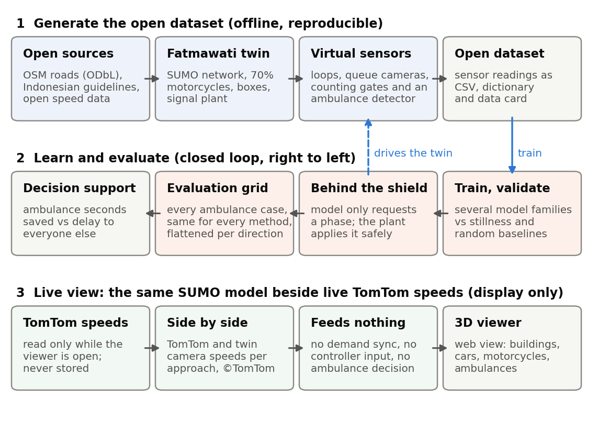
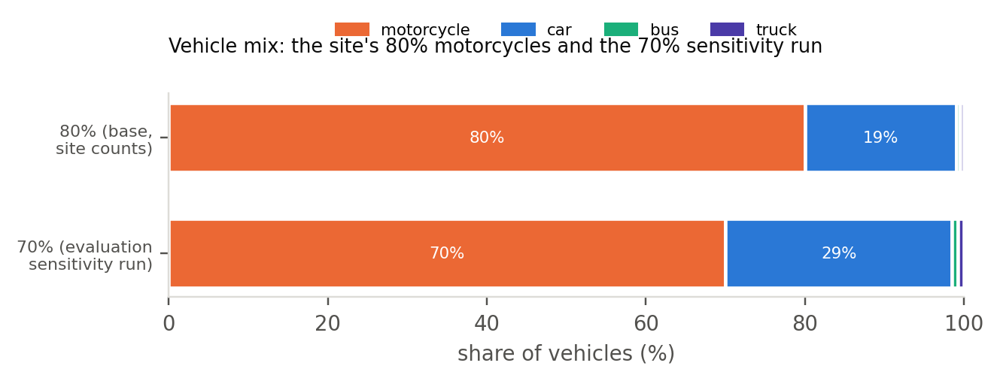
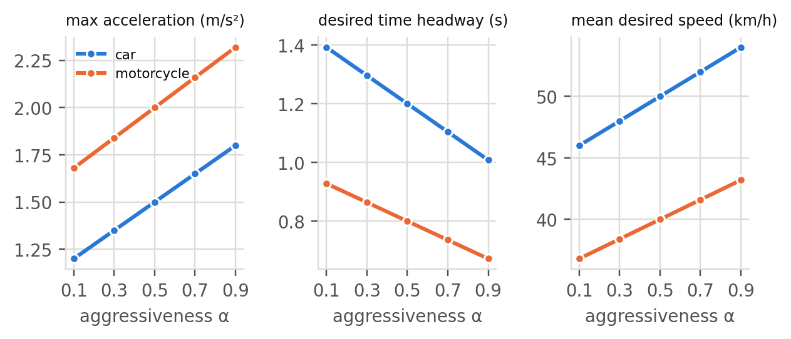
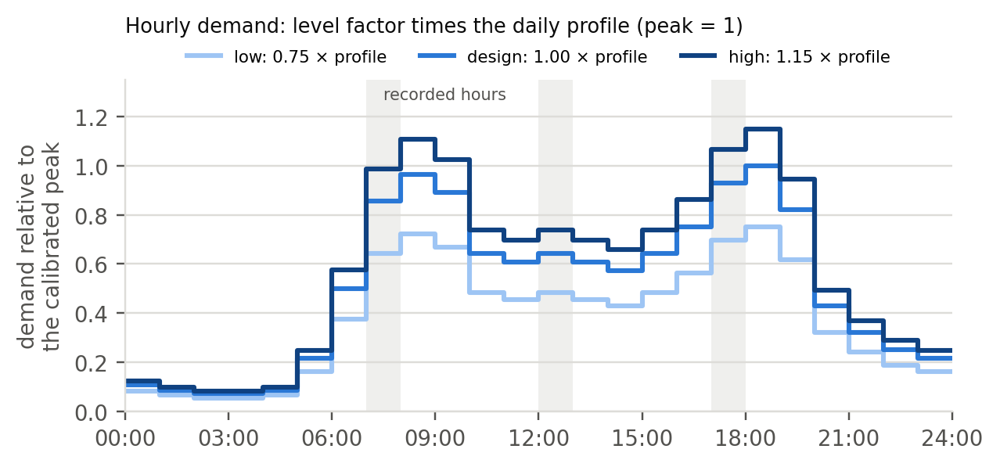
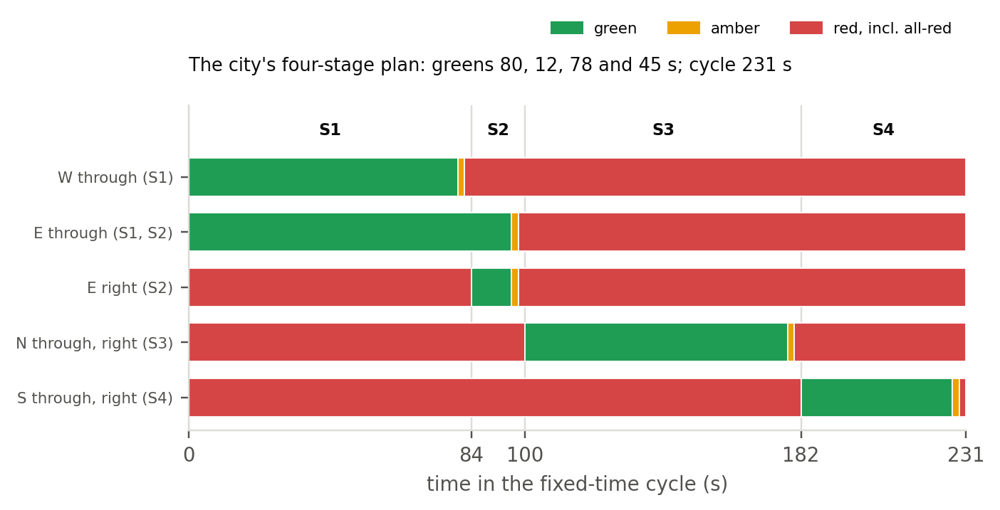
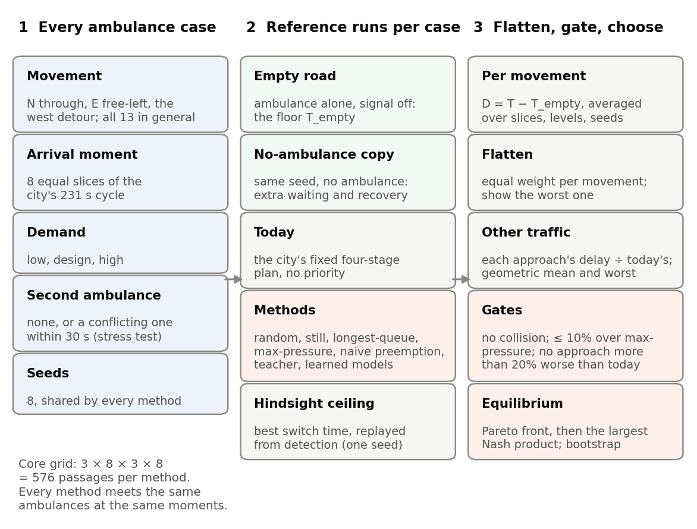
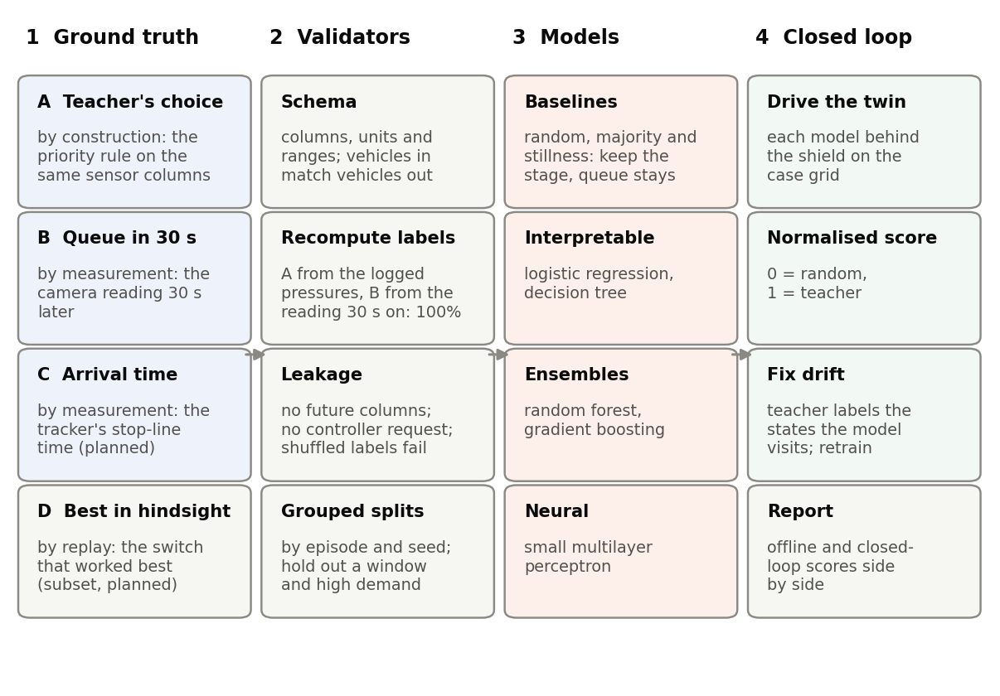

# 0. Purpose and reading guide

This document explains how the project turns open map data, Indonesian road-design rules and a traffic simulator into a digital twin of one real Jakarta junction, how the twin generates an open tabular dataset of ambulance passages, and how that dataset trains and tests a signal controller that gives ambulances priority. Every rule the twin applies is written out, with an equation where one exists, followed by a one-sentence reading in plain English.

The twin is built in SUMO 1.27.1, an open-source microscopic traffic simulator (Alvarez Lopez et al., 2018, 2026), and is driven from Python through SUMO's library interface, which lets a program read and change the simulation step by step (Eclipse SUMO, n.d.-c; Wegener et al., 2008). A digital twin in the full sense joins a model, a live data link and a synchronisation loop (Kušić et al., 2023). This project builds the model and a live view that shows TomTom's current speeds beside the twin's own. TomTom's terms allow display but not storage or use in safety-critical systems, so the live data feed nothing, and synchronisation waits for a source whose licence allows it (Section 12). The dataset is produced by the model alone.

**Status.** Built and run: the network, vehicle classes, ambulance rules and virtual sensors; the city's four-stage signal plan with the controllers on it; demand from the counted movements, calibrated to published queues (Section 11); the release of 108 simulated hours, whose labels pass the checks of Section 13.4; the models of Section 13 and their offline results (Section 13.9); and the evaluation grid with the learned controllers in closed loop, the hindsight ceiling and the 70% motorcycle run (Section 8.8). Planned: the cost-label task D at scale, DAgger retraining and a peak-then-shoulder evaluation. Each is marked where it appears.

## 0.1 How this document maps to the proposal and the report

| Proposal goal | Specified in |
|---|---|
| 1. A twin of Perempatan Fatmawati with motorcycles, motorcycle boxes, amber signals and ambulances | Sections 2 to 6 |
| 2. An open, reproducible dataset of sensor tables | Sections 9 and 10 |
| 3. Several model families trained to imitate a priority-aware rule, behind a safety shield | Sections 5, 7 and 13 |
| 4. An evaluation over every ambulance case, flattened per direction and fair to every approach | Sections 8 and 13 |
| 5. A live view of TomTom speeds beside the twin, with nothing stored | Section 12 |

The Assignment 3 report presents the project under the unit brief's five sections within 2,500 words. Sections 1 to 3 of the report revise the proposal; Section 14 of this document supplies the material for the other two, under the brief's own names.

## 0.2 Notation and units

SI units throughout: metres (m), seconds (s), m/s and m/s². Flows are in vehicles per hour (veh/h) or passenger-car units per hour (pcu/h). Approaches are named by the direction traffic comes from: N, E, S, W.

| Symbol | Meaning |
|---|---|
| $v, \dot v$ | speed and acceleration of a vehicle |
| $v_0$ | a driver's desired speed |
| $a, b$ | maximum acceleration and comfortable deceleration |
| $T$ (SUMO: $\tau$) | desired time headway |
| $s, s_0, s^*$ | gap to the leader, minimum standstill gap, desired gap |
| $\alpha$ | latent driver aggressiveness, $\alpha \in [0, 1]$ |
| $\Lambda_\ell$ | base network inflow at demand level $\ell$ (veh/h) |
| $\pi(h)$ | daily profile multiplier for hour $h$ |
| $G_s, Y, R$ | green of stage $s$, amber and all-red durations |
| $I$ | intergreen: amber plus all-red |
| $S$ | saturation flow of an approach (pcu/h) |
| $e_k$ | passenger-car equivalent of vehicle class $k$ |
| $\text{ETA}$ | ambulance's estimated time to the stop line |
| $\Delta$ | the controller's decision interval, 5 s |
| $D$ | an ambulance's delay: its time through the junction minus its empty-road time |
| $A_m$ | flattened ambulance delay of method $m$: the mean over movements with equal weight |
| $R_{a,m}$ | stopped delay on approach $a$ under method $m$, divided by its fixed-time value |
| $N_m$ | Nash product: the product of every player's gain under method $m$ |
| $\eta_m$ | closed-loop score: the share of the teacher's advantage over chance that method $m$ keeps |
| $\gamma_m$ | the share of the teacher's gain over today's plan that method $m$ keeps |
| $\Gamma_k$ | the gain that perfect switch timing adds to max-pressure on movement $k$ |

# 1. System overview

{width=100%}

The work runs in three stages (Figure 1).

1. **Generate.** Open map data become a SUMO network of the study area; Indonesian design rules set the signal timings and the motorcycle boxes; a demand model fills the network with motorcycles, cars, buses, trucks and ambulances; virtual sensors at and around the junction record each simulated hour (an *episode*) the way loops, cameras and an ambulance tracker would. Their readings, a data dictionary and a data card form the open dataset.
2. **Learn and evaluate.** Several model families are trained on the tables to imitate a priority-aware signal rule and are compared with stillness and random baselines (Section 13). The models are then deployed in the same twin, behind the signal plant, and every method meets the same grid of ambulance cases on the same seeds (Section 8).
3. **Live view.** The same model runs in real time in a web viewer that draws it in three dimensions and shows TomTom's current speeds on the approaches next to the twin's camera speeds. The TomTom values are displayed only: they are not stored and feed neither the demand, the controllers nor any ambulance decision (Section 12).

# 2. Study area and road network

## 2.1 The site

{width=100%}

Perempatan Fatmawati is the junction of Jl. RS Fatmawati (north–south) with Jl. TB Simatupang to the east and Jl. RA Kartini to the west, in Cilandak, South Jakarta (centre -6.29250, 106.79522). The JORR toll road runs above it on a viaduct in the median of TB Simatupang, so the junction at street level is two crossings 51 m apart: eastbound traffic uses the northern crossing and westbound traffic the southern one, and one signal controller runs both. Left turns, which do not cross oncoming traffic under left-hand driving, use free slip lanes; right turns cross the median segment between the two crossings and meet a second signal there. The city's plan bans the right turn from the west, and published counts show none (Sumabrata et al., 2026). RSUP Fatmawati, a national referral hospital with a 24-hour emergency department (Direktorat Jenderal Kesehatan Lanjutan, n.d.; RS Fatmawati, n.d.), lies 326 m south of the junction on Jl. RS Fatmawati (Figure 2a). Every ambulance that reaches the hospital from the north, east or west crosses the junction. The junction appears on the city's 2023 list of signals connected to its area traffic control system (Dinas Perhubungan Provinsi DKI Jakarta, 2026).

The four signalised approaches have 3 lanes from the north, 4 from the east, 2 from the south and 2 from the west (Figure 2b).

## 2.2 Extracting the roads

Roads are downloaded from OpenStreetMap for a square of half-width $r = 2.7$ km around the junction. In degrees the square is

$$ \Delta\varphi = \frac{r}{110.6\ \text{km}}, \qquad \Delta\lambda = \frac{r}{111.32\ \text{km} \cdot \cos\varphi_0}, $$

where $\varphi_0$ is the junction's latitude. *Reading:* a degree of latitude is about 110.6 km everywhere, while a degree of longitude shrinks with the cosine of the latitude, which near the equator changes it very little. Only the road classes that carry through traffic are kept: toll roads and their ramps, trunk, primary, secondary and tertiary roads. Residential streets and alleys are left out; their traffic enters and leaves the model at the edges of the kept network.

The resulting network has 706 road segments (edges), 431 junctions (nodes) and 10 signal controllers, with 293 lane-kilometres of road:

| Road class | Lane-kilometres |
|---|---|
| toll road (motorway) | 54.2 |
| toll ramps | 19.3 |
| trunk | 47.4 |
| trunk links | 2.2 |
| primary | 29.6 |
| secondary | 57.3 |
| secondary links | 0.2 |
| tertiary | 82.8 |
| tertiary links | 0.1 |
| **total** | **293.1** |

## 2.3 Converting to a simulation network

The map is converted with SUMO's network converter (Eclipse SUMO, n.d.-d, n.d.-e) under the following rules.

- **Left-hand traffic.** Vehicles drive on the left, so near-side turns are left turns; SUMO must be told this explicitly for a left-hand country (Eclipse SUMO, n.d.-e).
- **Uniform lanes.** Every lane is 3.25 m wide. Width tags in the map had split some lanes into strips too narrow for a car; two-way streets mapped as a single lane per direction are widened to 3.0 m per lane for the same reason.
- **Conflicts across lanes.** Movements that enter different lanes of the same road are still checked against each other, so two vehicles cannot be placed on crossing paths.
- **U-turns only where mapped.** Turnarounds exist only at the median openings that the map records, including the loops either side of the junction; the converter would otherwise add one at every junction.
- **One controller for both crossings.** Signals that the map tags on approach roads are attached to the junction nodes, and both crossings at Fatmawati become one controller with 20 signalled movements.
- **Speed limits.** Where the map has no speed tag, arterials take 50 km/h, the national limit for urban areas (Peraturan Menteri Perhubungan Nomor PM 111 Tahun 2015, art. 3(4)). Tertiary roads and slip lanes take 40 km/h and toll roads 80 km/h, which are the twin's assumptions within that regulation's limits.
- **No motorcycles on toll roads.** Toll roads are for vehicles with four or more wheels, and motorcycles may use them only on physically separated lanes (Peraturan Pemerintah Nomor 23 Tahun 2024, art. 65); the toll roads in the study area have none.

## 2.4 Motorcycle boxes

Indonesian guidance provides a *ruang henti khusus* (RHK), a box in front of the car stop line where motorcycles wait at red (Kementerian Pekerjaan Umum dan Perumahan Rakyat [Kementerian PUPR], 2015). On every signalised approach with two or more lanes the twin gives cars a stop line 8 m behind the motorcycles' stop line:

$$ x^{\text{stop}}_{\text{car}} = L_e - 8\ \text{m}, \qquad x^{\text{stop}}_{\text{motorcycle}} = L_e, $$

where $L_e$ is the length of the approach lane up to the junction. *Reading:* at red, cars stop 8 m short of the junction, and motorcycles may ride past them into the box.

The guideline sets the box at 8, 10 or 12 m deep, chosen by how many motorcycles gather during one red: across two 3.5 m lanes an 8 m box holds 37 motorcycles of the design size, 2.0 m by 0.8 m, and suits 30 to 37 motorcycles per red. It applies to approaches with at least two lanes, none of them a direct left-turn lane (Kementerian PUPR, 2015). The twin uses the 8 m depth on every signalised approach with two or more lanes and builds the box with SUMO's stop offset, which holds back every vehicle class except those named as exceptions, here motorcycles (Eclipse SUMO, n.d.-f). Its lanes are 3.25 m wide rather than the guideline's 3.5 m, so each box holds slightly fewer motorcycles than the guideline's tables.

## 2.5 How many vehicles a lane can store

A standing queue occupies, per vehicle, its length plus the standstill gap. A lane of length $L$ therefore stores

$$ N_{\max} = \left\lfloor \frac{L}{\sum_k p_k\,(l_k + s_{0,k})} \right\rfloor $$

vehicles of a mix with class shares $p_k$, lengths $l_k$ and standstill gaps $s_{0,k}$, before counting motorcycles that stand side by side. *Reading:* a 100 m lane holds about 15 cars but far more vehicles of the Jakarta mix, because motorcycles are short and two or three of them fit across one lane. That lateral packing is what the sublane model of Section 3.4 reproduces.

# 3. Vehicles and drivers

## 3.1 Vehicle classes and mix

{width=92%}

Five classes share the roads. Classified counts on Jl. RS Fatmawati north of the junction found about four in five vehicles to be motorcycles (Yusuf & Isradi, 2025), more than the 60 to 71% that Indonesian guidance gives for urban traffic (Kementerian PUPR, 2015), the 72% reported on Jakarta's odd-even corridors (Wiguna, 2019) and the 76% share of motorcycles among the motor vehicles registered in Jakarta (Badan Pusat Statistik Provinsi DKI Jakarta, 2025). The base mix therefore follows the site: 80% motorcycles, 19% cars, and 0.5% each of buses and minibuses (*angkot*) and trucks. The evaluation repeats its runs at 70% motorcycles, closer to the city-wide figure, with the other classes scaled in proportion (Figure 3). Ambulances are a separate class with their own arrival process (Section 6). Toll-road trips are cars, buses and trucks only.

The parameters of the middle driver profile of each class are:

| Class | Length × width (m) | Min. gap (m) | Max. accel. (m/s²) | Comfort decel. (m/s²) | Headway τ (s) | Desired-speed factor | Lateral behaviour |
|---|---|---|---|---|---|---|---|
| car (α = 0.5) | 4.5 × 1.8 | 2.0 | 1.5 | 2.0 | 1.2 | N(1.00, 0.08) in [0.85, 1.15] | keeps to the lane centre |
| motorcycle (α = 0.5) | 2.0 × 0.8 | 0.5 | 2.0 | 3.0 | 0.8 | N(0.80, 0.12) in [0.55, 1.05] | filters anywhere in the lane |
| bus / angkot | 10.0 × 2.5 | 2.5 | 1.0 | 2.0 | 1.5 | N(0.90, 0.05) in [0.80, 1.00] | keeps to the lane centre |
| truck | 8.0 × 2.4 | 2.5 | 0.9 | 2.0 | 1.5 | N(0.85, 0.05) in [0.75, 0.95] | keeps to the lane centre |
| ambulance | 6.0 × 2.1 | 2.0 | 2.5 | 3.0 | 0.9 | 1.25 | keeps to the lane centre |

**Where the values come from.** The motorcycle's 2.0 by 0.8 m footprint is the design motorcycle of the Indonesian box guideline, based on the common 110–125 cc class (Kementerian PUPR, 2015). SUMO's own motorcycle type is modelled on a large touring motorcycle, 2.2 by 0.9 m with an acceleration of 6 m/s² (Eclipse SUMO, n.d.-k), so every motorcycle value is set explicitly. No Jakarta measurements of motorcycle acceleration, headway or desired speed were found, so the remaining values are assumptions that calibration must settle (Section 11). Studies from Vietnam and India give the ranges they are checked against: a mean motorcycle headway of 1.16 s, about 0.9 s net of the motorcycle's own length, against the twin's 0.8 s (Minh et al., 2005b); a centre-to-centre spacing of 1.10 m between riders side by side, which leaves 0.3 to 0.5 m of clearance (Minh et al., 2005a), against the twin's 0.5 m; and an acceleration from standstill of about 1.2 to 1.3 m/s² (Dey et al., 2013; Minh et al., 2007). The twin's motorcycle accelerates harder than that, at up to 2.0 m/s², and moves sideways at up to 1.5 m/s, more slowly than the 2.7 to 2.8 m/s measured for swerving riders in London (Lee et al., 2012); both are flagged for calibration. The published simulation of this junction used tighter motorcycle gaps, 0.2 m standing and 0.3 m sideways (Sumabrata et al., 2026); in the twin they raised lane collisions about fifteenfold without improving the queue fit, so the twin keeps 0.5 m for both.

## 3.2 Driver heterogeneity

Drivers differ. Each car and motorcycle driver belongs to one of five profiles of a latent aggressiveness $\alpha \in \{0.1, 0.3, 0.5, 0.7, 0.9\}$, drawn with equal probability, and $\alpha$ shifts every trait in a correlated way:

$$ \theta(\alpha) = \bar\theta \left(1 + c_\theta\,(\alpha - 0.5)\right), $$

with slope $c_\theta = +0.5$ for a car's acceleration ($+0.4$ for a motorcycle's), $+0.3$ for a car's comfortable deceleration, $-0.4$ for the time headway of both, and $+0.2$ for the mean of the desired-speed factor. On top of the profile, each vehicle's desired speed is the road's limit multiplied by a factor drawn from a normal distribution clipped to a plausible range (the table above). *Reading:* an aggressive rider accelerates harder, follows closer and wants to go faster, and a calm one the opposite; within a profile, individual desired speeds still vary.

{width=100%}

## 3.3 Following the vehicle ahead

Every class uses SUMO's Extended Intelligent Driver Model (EIDM) (Salles et al., 2022). Its core is the Intelligent Driver Model of Treiber et al. (2000): a driver wants a gap

$$ s^*(v, \Delta v) = s_0 + \max\!\left(0,\; vT + \frac{v\,\Delta v}{2\sqrt{a b}}\right), \qquad \Delta v = v - v_{\text{lead}}, $$

and accelerates as

$$ \dot v = a\left[1 - \left(\frac{v}{v_0}\right)^{\delta} - \left(\frac{s^*(v,\Delta v)}{s}\right)^{2}\right]. $$

*Reading:* accelerate towards your preferred speed, ease off as you near it, and brake harder the closer you are to the vehicle ahead compared with the gap you want; the wanted gap is a standing buffer plus about $T$ seconds of travel, plus more when you are closing in.

SUMO's version differs from this textbook form in ways that matter for queues at a signal. Below the desired speed it uses the improved IDM of Treiber and Kesting (2013, Eq. 11.23),

$$ \dot v = \begin{cases} a\,(1 - z^2), & z = s^*(v,\Delta v)/s \ge 1, \\ a_{\text{free}}\left(1 - z^{2a/a_{\text{free}}}\right), & z < 1, \end{cases} \qquad a_{\text{free}} = a\left[1 - \left(\frac{v}{v_0}\right)^{\delta}\right]. $$

*Reading:* when the gap is shorter than the gap the driver wants, brake as the IDM does; when it is longer, accelerate almost as on an empty road, so a released queue reaches its desired speed instead of creeping below it. On top of this the EIDM adds a heuristic that stops drivers over-braking when a gap closes slowly (Kesting et al., 2010), random errors in judging gaps and speeds, reaction delays, and a smooth drive-off from standstill (Salles et al., 2022). SUMO's code differs from the paper in two places: it uses the improved IDM above rather than the paper's own variant, and its default driving-error intensity is 0.04 rather than 0.1 (Alvarez Lopez et al., 2026). The EIDM is meant for time steps between 0.05 and 0.5 s, so the twin's 0.5 s step sits at the upper end of that range (Eclipse SUMO, n.d.-b).

## 3.4 Moving sideways: filtering motorcycles

SUMO's sublane model divides each lane into strips 0.8 m wide, so a vehicle occupies a lateral position as well as a lane and may share a lane with others side by side (Semrau & Erdmann, 2016). The strip width is the width of a motorcycle, as SUMO's documentation recommends for mixed traffic (Eclipse SUMO, n.d.-i). Cars, buses, trucks and ambulances keep to the centre of their lane. Motorcycles may take any lateral position, with at least 0.5 m of clearance to their neighbours and a lateral speed of up to 1.5 m/s, so they ride along lane lines and between standing cars and gather in the motorcycle box at red. Inside a junction, and for 3 s after leaving it, a motorcycle rides the centre of its lane: SUMO checks crossing and merging movements against each other but not two vehicles side by side on parallel movements, and without this rule motorcycles at the outer edges of neighbouring movements could overlap. Lane changes, including the moves of drivers making way for an ambulance (Section 6.2), pass SUMO's lane-change safety check: a vehicle changes lane only if the target lane has room and the move would bring it too close to neither the new leader nor the new follower, where too close is judged by the car-following model (Erdmann, 2015).

# 4. Demand

## 4.1 Traffic through the junction

Junction traffic follows the 13 movements that a published study counted on CCTV in the weekday peak (Sumabrata et al., 2026), in vehicles per hour:

| Approach | Through | Right | Left (free slip) | U-turn | Total |
|---|---|---|---|---|---|
| North (Jl. RS Fatmawati) | 3,135 | 1,254 | 1,067 | – | 5,456 |
| South (Jl. RS Fatmawati) | 1,495 | 2,174 | 963 | – | 4,632 |
| East (Jl. TB Simatupang) | 5,607 | 858 | 1,226 | 1,764 | 9,455 |
| West (Jl. RA Kartini) | 3,271 | banned | 1,215 | 1,848 | 6,334 |

Each movement's vehicles enter at the upstream end of their approach and leave at the far end of their exit. All flows of an approach are multiplied by one calibration factor $c_a$, fitted so that the approach's queue matches the published simulation (Section 11), so the turning shares stay as counted.

## 4.2 Background traffic

The rest of the network carries background traffic between its edges, so that the roads around the junction behave realistically; trips that would cross Fatmawati are excluded, so the background does not distort the calibration. Background trips start on *source* edges, where the square cut crosses a road, each weighted by its road class and number of lanes,

$$ w_o = c_{\text{class}(o)} \cdot n_{\text{lanes}}(o), $$

with class factors of 6.0 for trunk roads, 4.0 for primary, 2.0 for secondary, 1.0 for tertiary, and small factors for toll roads (0.6) and ramps (0.4). *Reading:* a four-lane trunk road feeds far more trips into the area than a one-lane tertiary road. A trip from source $o$ goes to sink $d$ with probability

$$ P(d \mid o) \propto w_d \left(1 + \frac{\lVert x_d - x_o \rVert}{1\ \text{km}}\right), \qquad d \text{ reachable from } o, $$

so longer trips are favoured and through traffic dominates the arterials, as it does in reality. *Reading:* the busier and the farther away a destination is, the likelier it is to be chosen. SUMO routes each trip along the fastest path.

## 4.3 When vehicles arrive

Vehicles of movement $m$ on approach $a$ arrive as a Poisson process,

$$ \lambda_m(t) = \frac{k_\ell \, c_a \, q_m \, \pi\!\left(h(t)\right)}{3600}\ \text{vehicles per second}, \qquad \Delta t_{\text{next}} \sim \text{Exponential}\!\left(\lambda_m(t)\right), $$

where $q_m$ is the movement's counted peak flow, $c_a$ the calibration factor of its approach, $k_\ell$ the demand level (0.75 low, 1.0 design and 1.15 high) and $\pi(h)$ the daily profile, scaled so that the calibrated peak equals 1 (Figure 5). *Reading:* each movement's vehicles appear independently at random, at the counted rate scaled by calibration, by the level and by the time of day, and the gaps between them are exponentially distributed.

{width=100%}

## 4.4 Ambulances

Ambulance requests arrive as a separate Poisson process of 6 per hour, start at the far ends of the four approach legs, and drive to RSUP Fatmawati. Ambulances from the west cannot turn right into Jl. RS Fatmawati under the city's plan: they cross on stage S1, turn at the U-turn east of the junction and come back through the east approach's free-left slip. The rate is far above reality on purpose: the goal is enough ambulance passages per simulated hour to estimate their delays precisely, not to reproduce the hospital's caseload. A separate random stream generates the ambulances, so for a given seed the cars and motorcycles are identical with ambulances switched on or off; this makes "with ambulances minus without" a paired comparison (Section 8.2).

# 5. The signal plant: Fatmawati's safety shield

## 5.1 The city's four-stage plan

The twin runs the static plan that Jakarta's transport agency uses at the junction, as published with a calibrated simulation of it (Sumabrata et al., 2026). It has four stages (Figure 6):

| Stage | Movements with green | Green (s) |
|---|---|---|
| S1 | west through and east through, on their separate carriageways | 80 |
| S2 | east through, continuing, and east right turn | 12 |
| S3 | north through and right turn | 78 |
| S4 | south through and right turn | 45 |

Left turns use free slip lanes outside the signal, and the right turn from the west is banned. Each stage ends with 2 s of amber and 2 s of all-red, so the intergreen is

$$ I = Y + R = 2 + 2 = 4\ \text{s}, $$

and the fixed-time cycle is

$$ C = \sum_{s=1}^{4} G_s + 4I = 80 + 12 + 78 + 45 + 4 \times 4 = 231\ \text{s}. $$

*Reading:* every approach waits through the other stages and their transitions, so the south approach, with the shortest green, sees a red of just over three minutes in every cycle. The paper prints a cycle of 253 s, but its stage times add up to 231 s; the twin uses the stage times.

{width=100%}

## 5.2 The plant's rules

The controller never switches the lights itself. At a *decision instant*, every 5 s, it *requests* the next stage, and the plant enforces four rules:

- a green runs for at least 5 s;
- under the adaptive controllers a green runs for at most 90 s, after which the plant moves to the next stage in the rotation S1, S2, S3, S4;
- a stage whose lanes hold standing vehicles and that has been red for 240 s is served next, the longest-waiting first;
- once a change starts, the full amber and all-red always run.

The fixed-time controller runs the city's greens exactly. *Reading:* whatever a controller asks for, the lights only change through a complete transition, and no stage with waiting vehicles is starved, so every controller, including a learned one, is safe by construction. This plant is the *safety shield* of the proposal.

## 5.3 Is a 2 s amber long enough?

An amber is long enough when a driver who sees it can either stop comfortably or reach the stop line before red. Gazis et al. (1960) showed that when it is too short a *dilemma zone* opens, in which a driver can do neither. The recommended practice of the Institute of Transportation Engineers sets the amber from the approach speed (Institute of Transportation Engineers [ITE], 2020, as cited in Cesme et al., 2023):

$$ Y = t + \frac{v}{2a + 2g_0 G}, $$

with a perception–reaction time $t = 1.0$ s, a deceleration $a = 3.05$ m/s², gravity $g_0 = 9.81$ m/s² and the grade $G$, zero on the flat approaches here. *Reading:* allow a second to react, then the time needed to brake from the approach speed at a comfortable rate.

At 40 km/h the formula gives 2.8 s and at 50 km/h 3.3 s (Figure 7a), and Indonesian amber is usually 3.0 s (Direktorat Jenderal Bina Marga, 2023). The city's plan gives 2 s. At 50 km/h that leaves a dilemma zone about 18 m long (Figure 7b), which the 2 s all-red only partly covers. The twin reproduces the plan as published and reports this as a finding about the real junction, not as a choice of the group.

{width=100%}

**Red clearance.** A vehicle that enters on the last moment of amber must leave the crossing before the next green starts. The traditional form of the requirement is

$$ r = \frac{W + L}{v}, $$

where $W$ is the length of the path across the crossing, $L$ the vehicle's length and $v$ its speed. *Reading:* the time to drive across the junction and get the whole vehicle out of it. With the Indonesian manual's default speed of 10 m/s and a 5 m car (Direktorat Jenderal Bina Marga, 2023), the paths measured on the twin's network need up to 3.5 s, against the plan's 2 s of all-red. Both current American practice and the Indonesian manual subtract the time the next stream needs to reach the conflict point (Cesme et al., 2023; Direktorat Jenderal Bina Marga, 2023), which this check does not yet measure; the junction-overlap counter of Section 8.7 watches for the consequences.

## 5.4 Capacity in Indonesian terms

Indonesia's road capacity manual states saturation flow in passenger-car units (pcu, *satuan mobil penumpang*) (Direktorat Jenderal Bina Marga, 2023). On a protected approach, one whose green no opposing stream shares, the base saturation flow is

$$ S_0 = 600 \cdot W_e\ \text{pcu/h}, $$

where $W_e$ is the effective approach width in metres. *Reading:* each metre of approach width discharges about 600 car-equivalents per hour of green. Vehicles convert to pcu with the manual's equivalents for protected approaches: 0.15 for a motorcycle, 1.0 for a car and 1.3 for a bus or truck. With the twin's 3.25 m lanes, $S_0$ is 3,900 pcu/h on the two-lane south and west approaches, 5,850 on the three-lane north and 7,800 on the four-lane east. At the site's mix the average vehicle counts as

$$ \bar e = 0.80 \times 0.15 + 0.19 \times 1.0 + 0.01 \times 1.3 \approx 0.32\ \text{pcu}, $$

so the same approaches discharge about 12,100, 18,100 and 24,100 vehicles per hour of green. *Reading:* because four in five vehicles are motorcycles, a lane passes about three times as many vehicles as a car-only lane of the same width. These are the targets the twin's measured saturation flow is checked against (Section 11).

The manual sizes cycles with Webster's (1958) formula,

$$ c = \frac{1.5\,H + 5}{1 - \sum_i (q/S)_i}, $$

where $H$ is the lost time per cycle and $(q/S)_i$ the flow ratio of the critical approach of stage $i$. *Reading:* the busier the critical approaches, the longer the cycle must be to serve them all. The manual recommends 80 to 130 s for four phases, a degree of saturation of at most 0.85 and, at large junctions, an intergreen of at least 6 s (Direktorat Jenderal Bina Marga, 2023). The city's plan, with its 231 s cycle and 4 s intergreen, lies outside both recommendations. The published analysis of the junction under that plan finds degrees of saturation of 0.86 on the north approach, 0.85 east, 0.79 south and 0.65 west, and an average delay of 85 s per vehicle, the manual's worst level of service (Sumabrata et al., 2026).

# 6. Ambulances and yielding

## 6.1 The ambulance

The ambulance class is SUMO's emergency vehicle class: 6.0 m long, with a desired speed of 1.25 times the road's limit, quicker acceleration (2.5 m/s²) and a shorter headway (0.9 s) than a car. Indonesian law gives an ambulance carrying a patient the right of way and exempts it from traffic signals (Undang-Undang Nomor 22 Tahun 2009, arts. 134–135). The twin nevertheless makes ambulances obey the lights, and they carry none of the devices that let SUMO's emergency vehicles ignore red (Eclipse SUMO, n.d.-a): their advantage comes only from the signal, which keeps every safety rule of Section 5 intact and makes the controller the object of study.

## 6.2 Who moves aside

{width=100%}

When an ambulance is on a road, the vehicle directly ahead of it in the same lane, if it is moving and within 80 m, tries to move toward the kerb; SUMO's lane-change safety check (Section 3.4) decides whether the gap in the kerb lane is safe, and if it is not the vehicle stays where it is. Vehicles in a standing queue do not move, and none ever crosses the stop line or enters the junction to make room. There is no rescue lane: SUMO can form one by shifting every vehicle sideways (Bieker-Walz et al., 2018; Eclipse SUMO, n.d.-a), but that model assumes every driver reacts and leaves room on wide roads, which a two-lane Jakarta approach full of motorcycles rarely does, and its default reaction probabilities have no published empirical source. A field study in Thailand saw 61% of motorcycles and 41% of cars give way to an ambulance using lights and siren (Apiratwarakul et al., 2018); the twin's vehicle ahead always tries, so its yielding in moving traffic is if anything optimistic. *Reading:* drivers make way where they can; a queue at a red light cannot, so the signal has to clear it in time (Figure 8).

## 6.3 What a controller knows about an ambulance

For each approach the controller receives what a priority-request detector would report, the information a vehicle-location feed from the ambulance service could provide: whether an ambulance is inside the approach's 300 m queue-camera zone, its distance $d$ to the stop line, its estimated time to the stop line

$$ \text{ETA} = \frac{d}{\max(v, v_{\min})}, \qquad v_{\min} = 5\ \text{m/s}, $$

the queue standing ahead of it in pcu, and whether its route crosses that approach's stop line. *Reading:* the time to arrive is the distance divided by the current speed, with a floor so that a stopped ambulance does not appear infinitely far away. An ambulance that will take a free-left slip or a U-turn loop never needs the signal, so it never triggers a priority request.

## 6.4 How long the queue ahead takes to clear

The priority-aware teacher asks for the stage that serves the ambulance's approach, S3 for the north, S4 for the south, S1 for the west and S2 for the east, when the ambulance is about to arrive and the queue ahead of it has just enough time to leave. Switching takes the intergreen $I$, the first queued vehicles lose a start-up time $l_s$, and the queue then discharges at the saturation flow $S$ of Section 5.4. The time needed to clear the path is

$$ t_{\text{clear}} = I + l_s + \frac{3600}{S}\sum_k e_k\, n_k , $$

with $I$ = 4 s, $l_s$ = 2 s, $S = 600\,W_e$ pcu/h, $n_k$ the vehicles of class $k$ standing ahead of the ambulance and $e_k$ their passenger-car equivalents (Direktorat Jenderal Bina Marga, 2023). *Reading:* the lights need 4 s to change, the first drivers need a moment to move off, and each car-equivalent ahead then needs its share of an hour's discharge. The 2 s start-up loss is an assumption that calibration will check against the twin's measured discharge (Section 11).

The controller decides only every $\Delta$ = 5 s, so the teacher acts at the last decision instant that still leaves the queue time to clear:

$$ \text{ETA} \le t_{\text{clear}} + \Delta . $$

*Reading:* if waiting for the next decision would already be too late, switch now.

For example, an ambulance on the two-lane west approach behind 20 motorcycles, 5 cars and a bus has 9.3 pcu ahead of it. At 3,900 pcu/h the path needs 4 + 2 + 8.6 = 14.6 s (Figure 9), so the teacher asks for S1 at the first decision instant at which the ambulance's ETA is 19.6 s or less; the same queue on the four-lane east approach needs only 10.3 s. A naive rule that always switches at 20 s is too early for short queues, which wastes green that others need, and too late for long ones, which leaves the ambulance standing.

{width=100%}

# 7. Controllers

Every controller maps the same sensor readings to a requested stage, and every request goes through the plant of Section 5. All of them run on the city's four-stage plan.

- **Random** (built; baseline): at each decision instant, request a stage drawn uniformly at random, from a random stream of its own so that the traffic is unchanged. It shows what control by chance achieves.
- **Still** (built; baseline): always request the stage that has green, so the plant's 90 s maximum moves the lights on. It shows what holding every green as long as allowed achieves.
- **Fixed-time** (built; today's stand-in): the city's plan of Section 5.1, S1 to S4 with greens of 80, 12, 78 and 45 s.
- **Longest-queue** (built): request the stage that serves the most standing vehicles, counted in the lane groups each stage releases, when it exceeds the current stage's by more than three.
- **Max-pressure** (built): approach $a$ has pressure $p_a = q_a - \sum_j \hat\beta_{aj}\, x_j$, its queue in pcu minus the queues $x_j$ on the exits its traffic enters, weighted by the shares $\hat\beta_{aj}$ of its traffic that the counting gates have so far seen take each exit (Varaiya, 2013). A stage is credited with the part of each approach's pressure that it would release,
$$ P_S = \sum_{a} p_a \, \frac{Q_{a,S}}{Q_a} , $$
where $Q_{a,S}$ is the standing pcu in the lane groups of approach $a$ that stage $S$ gives green and $Q_a$ all of approach $a$'s standing pcu. The controller requests the stage with the highest $P_S$ when it beats the current stage by 1 pcu. *Reading:* serve the stage that releases the most waiting traffic with somewhere to go. The east approach is the only one split between stages: its through lanes run in S1 and S2 and its right-turn lanes only in S2.
- **Naive preemption** (built): run the city's plan, but when an ambulance whose route crosses a stop line is 20 s or less away, change to its stage through the normal transition, hold the green until the ambulance has crossed, then resume the plan with the next stage. It ignores the queue ahead; this is the forced green of common practice. Like the fixed plan it runs outside the plant's maximum-green and starvation rules, so its holds can stretch other approaches' reds beyond 240 s: an ambulance stuck within 100 m keeps an estimated arrival under 20 s, because the estimate assumes at least 5 m/s, so the hold lasts until it crosses. Field systems bound the hold, often at 30 to 60 s; a bounded variant is left for future work.
- **Priority-aware teacher** (built; recorded as `priority_mp` in the controller column): request the ambulance's stage when its ETA $\le t_{\text{clear}} + \Delta$ (Section 6.4), otherwise behave as max-pressure; when ambulances wait on two approaches, the smaller ETA wins. *Reading:* switch at the last decision instant that still lets the last vehicle ahead cross before the ambulance arrives.
- **Learned controllers** (built; run in closed loop on the evaluation grid): the models of Section 13, each requesting the stage it predicts from the same row of readings the dataset records.
- **Hindsight ceiling** (built; run at low demand on one seed): save the simulation when the ambulance is detected, replay it once for each decision instant at which the ambulance's stage could be requested, and keep the replay with the lowest ambulance delay. SUMO can save and reload its state (Eclipse SUMO, n.d.-g), but reloading proved inexact in this version, so each replay instead starts from a copy of the running simulation process taken at detection; the copies are bit-identical, so every replay starts from exactly the same traffic.

# 8. Measuring performance: ground truth, every case, flattened and fair

This section answers one question: how to score a controller of the whole junction, both crossings under one signal, over every way an ambulance can meet it, so that no direction counts more than another and no direction pays for the others. Figure 10 summarises the design.

{width=100%}

## 8.1 Queues and delay, measured the way sensors measure them

Every measure is computed from the virtual sensors of Section 9, so that the same numbers could be produced at the real junction. The *camera queue* of an approach is the number of standing vehicles (speed below 0.1 m/s) that its queue camera sees on the approach road and the same street upstream of it, up to 300 m back; the road segment just before the stop line is only 10 to 20 m long, too short to hold a Jakarta queue. The camera's *queue length* follows the queue counter of the published simulation that calibration matches (Section 11): vehicles below 5 km/h, contiguous from the stop line with gaps of at most 20 m. Stopped delay per vehicle on approach $a$ over a period $[t_0, t_1]$ follows the logic of a manual intersection delay study: the queue is summed over time and divided by the vehicles that crossed the stop line,

$$ \bar d_a = \frac{\sum_{t = t_0}^{t_1} q_a(t)\,\Delta t}{N_a(t_0, t_1)}, $$

where $q_a(t)$ is the camera queue each second ($\Delta t = 1$ s) and $N_a$ the stop-line loop count. *Reading:* add up how many vehicles stood waiting in every second, which gives vehicle-seconds of waiting, and share it among the vehicles that were served.

## 8.2 Ground truth: reference runs for every case

A simulator can run the same traffic more than once, which a real junction cannot. Four reference runs turn that into ground truth for each ambulance case:

- **Empty road.** The ambulance drives alone through the junction with its signal switched off. Its time $T_{\text{empty},k}$ on movement $k$ is the floor no controller can beat, and it removes the differences in distance and turning between movements.
- **No-ambulance copy.** The same seed, traffic and controller with the ambulance removed. Ambulances come from their own random stream (Section 4.4), so every other vehicle is the same in both runs, and the difference between them is what the ambulance and the controller's response cost everyone else.
- **Today.** The city's fixed four-stage plan with no priority, the baseline every method is compared with.
- **Hindsight ceiling.** On one seed per case, the best switch time found by replaying the simulation from the moment of detection (Section 7): the most any switching rule could have achieved for that ambulance.

SUMO's drivers make small random errors (Section 3.3), so the two runs of a pair can drift apart slightly even where the ambulance has no effect; averaging over seeds removes that noise.

**A check by hand.** On an empty road, an ambulance that obeys the lights and arrives at a random moment waits at red for, on average,

$$ \bar w = \frac{r^2}{2C} = \frac{151^2}{2 \times 231} \approx 49\ \text{s}, $$

where $r$ is the red its approach sees in the city's cycle $C$; on the north approach, served by the 78 s green of S3, $r$ = 231 − 78 − 2 = 151 s. *Reading:* it meets red with probability $r/C$ and then waits, on average, half of the red. The waits measured in an empty-road run under fixed time must land within a few seconds of this before any other result is trusted.

The check has been run on the twin, with ambulances spread over 48 equal arrival moments per movement:

| Movement | Measured mean wait | $r^2/2C$ | Stopped | Moved off after its stage's green began |
|---|---|---|---|---|
| North through (S3) | 45.2 s | 49.4 s | 30 of 48 | within 0.5 s, every time |
| West detour (S1) | 44.3 s | 48.1 s | 30 of 48 | within 0.5 s, every time |
| East free-left | 0 s | 0 s | none | not applicable |

The measured waits are about 4 s shorter than the formula because an ambulance spends its last seconds before stopping braking, which counts as slow driving rather than standing; allowing for braking from 62.5 km/h at 3 m/s² brings the formula to 47.5 and 46.2 s. Every stopped ambulance moved off within one simulation step of its stage's green, so the plan runs exactly as specified and the measurements follow it.

## 8.3 Covering every ambulance case

| Factor | Levels | Why |
|---|---|---|
| Movement | N through, E free-left, and the detour of ambulances from the west (through on S1, a U-turn east of the junction, back through the free-left slip); all 13 movements in the general case | every direction an ambulance can come from |
| Arrival moment | 8 equal slices of the city's 231 s cycle | arrivals spread over green, amber and red as in reality |
| Demand | low, design, high | off-peak to peak |
| Second ambulance | none in the core grid; one from a conflicting approach within 30 s as a planned stress test | the hardest case for priority |
| Seeds | 4 | paired comparisons within the compute budget |

Ambulances are released from a fixed point on their approach, upstream of the longest queue: at least 400 m from the stop line where the road allows, otherwise just past the previous junction. Releases are 10 minutes apart, so one passage has ended before the next begins, and every method meets the same ambulances at the same moments, so all comparisons are paired. The core grid has 3 × 8 × 3 × 4 = 288 passages per method: each run releases 24 ambulances over 4.4 simulated hours, and each method runs once per level and seed, with ambulances and without. A method that decides exactly as another does when no ambulance is near, the teacher as max-pressure and naive preemption as the fixed plan, reuses that method's runs without ambulances, so the seven rule-based methods need 144 runs. Under adaptive controllers the cycle is not fixed, so the slices only spread the release times evenly; each passage therefore also records the signal state its approach showed when the ambulance was detected, and results are reported by that state as well.

**The regime problem.** Each run holds its demand level for 4.4 hours, far longer than a real peak. At the low level the junction stays stationary, but at the design and high levels the north approach, calibrated at its capacity (Section 11), never clears: its queue grows past the release point, and up to a fifth of the ambulances fail to reach the hospital before the run ends. The design and high levels are therefore reported as stress tests, and the main result uses the low level. A demand profile that rises to the peak and falls back to the shoulder would remove the problem and is left for the next release.

## 8.4 Ambulance measures, flattened over directions

For trip $i$ on movement $k$, the ambulance's delay is its time from the release point to the exit gate minus the empty-road time,

$$ D_i = T_i - T_{\text{empty},k} . $$

*Reading:* how much longer the passage took than it would on an empty road with the signal off. An ambulance that has not reached the exit gate when its run stops counts at the lower bound of its delay, the time it had spent so far, so a method gains nothing by stranding ambulances; the share stranded is reported beside the flattened delay. The mean over arrival slices, demand levels and seeds gives the delay $\bar D_{k,m}$ of movement $k$ under method $m$. *Flattening* then averages the movements with equal weight and keeps the worst in view:

$$ A_m = \frac{1}{K}\sum_{k=1}^{K} \bar D_{k,m}, \qquad \text{worst}_m = \max_k \bar D_{k,m} . $$

*Reading:* first average each direction, then give every direction the same say, so a busy direction cannot hide a neglected one. A frequency-weighted version, $\sum_k p_k \bar D_{k,m}$ with $p_k$ the share of ambulances arriving by movement $k$, answers the hospital's question of expected benefit and is reported second.

The hindsight ceiling replays each passage from the moment of detection under max-pressure, once for each decision instant at which the ambulance's stage could be requested, and keeps the best (Section 7). The replays fork from a run of their own, which need not match the grid's run draw for draw, so the ceiling enters as the gain $\Gamma_k$ that perfect timing adds to max-pressure on movement $k$, measured inside the replays. The share of that gain a method captures is

$$ G_{k,m} = \frac{\bar D_{k,\text{mp}} - \bar D_{k,m}}{\Gamma_k} , $$

reported only where the gain is several seconds. *Reading:* 0 is no better than max-pressure, and 1 matches max-pressure with the best switch found in hindsight; a method can exceed 1, because it changes more than the timing of one switch.

The ambulance's whole trip to the hospital (`travel_time_s` in the ambulance table) remains the patient's outcome, but it is not the junction's score. In the four-stage pilot the same east ambulance on the same seed spent 25 s between the gates under the fixed plan and 26 s under the teacher's rule, yet its whole trip differed by 327 s, almost all of it before it reached the camera zone.

## 8.5 Cost to everyone else, fair to every approach

For approach $a$, the extra waiting per vehicle that a passage causes is measured against the no-ambulance copy over the 10 minutes after release:

$$ X_{a,m} = \frac{\sum_t \left(q_a(t) - q^{\text{copy}}_a(t)\right)\Delta t}{N^{\text{copy}}_a} , $$

with $q$ the camera queue each second and $N^{\text{copy}}_a$ the vehicles the stop-line loops counted in the copy. *Reading:* the vehicle-seconds of waiting that would not have happened without the ambulance, shared among the approach's vehicles.

Approaches differ in width and demand, so each approach's stopped delay (Section 8.1) is indexed to its own value under fixed time on the same seed, and the indices are combined with a geometric mean:

$$ R_{a,m} = \frac{\bar d_{a,m}}{\bar d_{a,\text{today}}}, \qquad \bar R_m = \Big(\prod_{a \in \{N,E,S,W\}} R_{a,m}\Big)^{1/4}, \qquad \text{worst}_m = \max_a R_{a,m} . $$

*Reading:* 1.00 is the same delay as today; the geometric mean lets a doubling on one approach and a halving on another cancel, whatever each approach's size; and the worst approach shows who pays. Indexing judges only what a method changes, not the differences the junction's layout creates, and every approach waits a long red under the fixed plan, so the indices stay stable. The ratio of the largest to the smallest approach delay, which the episode table already reports, is kept as a secondary measure; it divides by the smallest delay and becomes unstable when one approach is nearly empty.

**Recovery.** From the moment the ambulance passes the exit gate, the one-cycle (231 s) rolling means of the camera queues are compared with those of the no-ambulance copy. The junction has recovered when, on all four approaches, they stay within 10% or one vehicle of the copy for a full cycle. Starting at the exit gate gives free-left ambulances a value too, and comparing with the copy rather than with the queue at detection removes the swing of the cycle.

**Starvation.** The longest red any approach sees during a passage is reported, against the 184 s the south approach waits in the city's plan.

## 8.6 From measures to a decision: the equilibrium

Methods are judged in four steps:

1. **Safety gate.** A method is ruled out if it significantly raises lane collisions per vehicle-kilometre above the city's fixed plan on the same level and seed: the lower end of the 95% interval of the paired ratio lies above 1. The sublane model produces some collisions at high density whatever the controller (Section 8.7), so the gate judges what a method adds, and absolute counts are reported beside it.
2. **Cost gates.** The flattened general delay $\bar R_m$ must stay within 10% of max-pressure's at the upper end of its 95% confidence interval over paired seeds. No approach may lose more than a set margin against today, 20% to start with, also at the upper end of its interval. The plant's starvation rule (Section 5.2) already bounds every red, so the longest red is reported rather than gated.
3. **Pareto front.** Among the methods that pass, any method that another beats on every measure at once, the flattened ambulance delay and each approach's indexed delay, is dropped. On what remains, no measure can improve without another getting worse.
4. **Equilibrium.** The ambulance, general traffic and each of the four approaches are treated as players in a bargaining problem (Nash, 1950). Each player's walk-away point is the worst outcome the gates allow: today's ambulance delay, 10% above max-pressure's general delay, and a 20% worsening on each approach. The method chosen maximises the product of the players' gains over those points,

$$ N_m = \left(A_{\text{today}} - A_m\right)\left(1.10\,\bar R_{\text{mp}} - \bar R_m\right)\prod_{a \in \{N,E,S,W\}}\left(1.20 - R_{a,m}\right). $$

*Reading:* a method scores well only if every player gains; a player pushed to the edge of its margin drives the product towards zero, so the product rewards balance rather than excellence on one measure. It needs no price for an ambulance second, and it does not depend on the units of each measure.

With few seeds the upper ends of the intervals can rule out every method even when none is worse. The cost and approach gates then fall back to point estimates, and the result says so; the safety gate stays a test of a significant rise, because rare collision counts make a point ratio mostly noise. The winner is recomputed on 1,000 bootstrap resamples of the seeds under the same rule, keeping each method's safety verdict from the full sample, and the share of resamples each method wins, or in which none passes, is reported with it. The slope of the Pareto front at the winner gives the price the choice implies: the road-user vehicle-seconds it trades for each ambulance second. That value is the $\lambda$ the cost label of Section 13.3 uses for its final model. All methods are also drawn on a trade-off chart, so that a city can see what any other choice would cost. The 10% bound and the 20% margin are proposed by the group and fixed before any result is seen.

## 8.7 Safety counters

The twin counts five events in every episode and reports them in a separate quality-control table, because they come from the simulator rather than from sensors. **Lane collisions** are two vehicles overlapping on a road under SUMO's collision check with no minimum-gap allowance. They rise with density and with tighter motorcycle gaps: at calibrated demand with the twin's 0.5 m gaps about 0.1 remain per 1,000 vehicle-kilometres, all between motorcycles at walking pace, against 1.4 with the published simulation's tighter gaps. They are an artefact of the sublane model rather than of any signal decision, so the safety gate of Section 8.6 compares each method with the fixed plan, counting only the collisions within 300 m of the junction, instead of requiring zero. **Junction overlaps**, vehicle shapes overlapping inside a junction, stay frequent at calibrated density, about 280 an hour across the network and 170 near the junction. They are a known limitation of SUMO's sublane and junction models with filtering motorcycles, which check crossing movements but not riders side by side, so they are counted and reported but are not part of the safety gate. **Teleports**, vehicles removed after being stuck for 300 s, indicate gridlock. **Vehicles waiting to enter** at the network edge show blocked inflow, and **unmatched exits**, gate detections without an entry, should be rare: the release has 96 among about 555,000 exits, from vehicles teleported across a gate. A surrogate measure of conflicts, the time-to-collision between a follower and its leader,

$$ \text{TTC} = \frac{s}{v_{\text{follower}} - v_{\text{leader}}}, \qquad v_{\text{follower}} > v_{\text{leader}}, $$

is planned as a further safety measure (Minderhoud & Bovy, 2001). Events at or below 1 s, Hayward's (1972) threshold for a near miss, and at or below 3 s, the default threshold of SUMO's conflict device, will be counted per thousand vehicle-kilometres (Eclipse SUMO, n.d.-h). *Reading:* the time left before two vehicles would touch if neither changed speed; short times mark near misses. SUMO's device ignores conflicts with vehicles in neighbouring lanes, so conflicts involving filtering motorcycles will be under-counted.

## 8.8 Results on the evaluation grid

The grid's 144 rule-based runs, the 20 closed-loop runs of the learned controllers at the low level and 24 runs at 70% motorcycles were completed on 4 and 5 October 2026. The main result uses the low level (Section 8.3).

| Method, low demand | $A_m$ (s) | Worst direction (s) | $\bar R_m$ | Worst approach | $\gamma_m$ | Gates, point estimates | $N_m$ |
|---|---|---|---|---|---|---|---|
| Learned gradient boosting | 115.8 | 238.8 | 0.69 | 0.94 | 0.67 | pass | 0.0592 |
| Longest queue | 122.4 | 203.5 | 0.66 | 0.93 | 0.43 | pass | 0.0590 |
| Priority teacher | 106.6 | 215.5 | 0.71 | 0.95 | 1.00 | pass | 0.0526 |
| Learned neural network | 99.1 | 192.5 | 0.76 | 1.03 | 1.27 | pass | 0.0117 |
| Max-pressure | 143.1 | 260.1 | 0.72 | 1.00 | −0.31 | pass, dominated | – |
| Learned logistic regression | 121.3 | 227.9 | 0.83 | 1.11 | 0.47 | fails safety and cost | – |
| Learned random forest | 125.2 | 241.1 | 0.94 | 1.26 | 0.33 | fails cost and approach | – |
| Naive preemption | 97.1 | 183.7 | 1.17 | 1.32 | 1.34 | fails cost and approach | – |
| Fixed plan (today) | 134.4 | 251.1 | 1.00 | 1.00 | 0 | fails cost | – |
| Learned decision tree | 179.7 | 280.7 | 1.14 | 1.54 | −1.63 | fails | – |
| Still | 1,726.6 | 4,755.5 | 2.23 | 11.27 | – | fails; 20% stranded | – |
| Random | 2,412.2 | 6,822.7 | 1.87 | 13.29 | – | fails; 25% stranded | – |

*Reading:* with four seeds the upper ends of the general and approach indices reach 1.5 to 1.9, so no method can be shown at the 95% level to stay within the gates, and the choice falls back to point estimates (Section 8.6). On them the learned gradient-boosting controller is the equilibrium, but only just: its Nash product beats longest-queue control's by 0.3%, and it wins 46% of 1,000 bootstrap resamples of the seeds, against 26% for the teacher, 21% for longest-queue control and 5% for the learned random forest. Choosing it means valuing one second of ambulance delay at 131 to 179 vehicle-seconds of everyone else's delay; above that range the teacher would be preferred, below it longest-queue control.

**What else the grid shows.** Naive preemption is the fastest for ambulances but adds 17% to everyone else's delay, and because it runs outside the plant's rules it left an approach red for up to 362 s at low demand and 565 s at high demand, against at most 252 s for every controller that only requests stages. Adaptive control raises the twin's collision rate within 300 m of the junction from 0.12 to between 0.16 and 0.31 per 1,000 vehicle-kilometres; the rise is significant only for the learned logistic regression. Recovery was censored on 64% to 100% of passages, because a run and its no-ambulance copy drift apart for good once the first ambulance passes, so recovery says little in this design; the extra waiting is noisy for the same reason and is reported with its median.

**Hindsight ceiling.** Replaying each of the 24 passages of seed 1 at the low level from its detection, with the ambulance's stage requested at every possible decision instant, shows what timing alone could add to max-pressure: the gain $\Gamma_k$ is 107 s per passage on the north movement, 112 s on the west detour and 12 s on the east free-left, which needs no signal and gains only from relieved spillback. On those passages perfect timing would take max-pressure's flattened delay from 159 s to 82 s. Naive preemption captures 95% of that gain, the learned random forest, neural network and logistic regression about 60%, the teacher 15% and longest-queue control 1%. *Reading:* the best switch for the ambulance alone usually comes at detection, whereas the teacher waits for the last moment that still clears the queue, to spare the cross traffic; with eight passages per movement on one seed these shares are indicative only.

**Stress tests.** At the design and high levels the priority teacher has the lowest ambulance delay, 59% and 38% below the fixed plan, and strands the fewest ambulances, 1% and 5% against 16% and 19%. Every adaptive method, however, leaves its worst approach 3.2 to 4.2 times its fixed-plan delay, so none passes the approach gate there.

**Vehicle mix.** With 70% motorcycles instead of 80% at the same counts, the extra cars raise the load in pcu by about a quarter. Ambulance delay grows 1.9 to 2.3 times for every method, and the adaptive methods leave one approach 1.8 to 2.9 times worse than the fixed plan, so no method passes the gates and no equilibrium is declared. The learned gradient-boosting controller still matches the teacher's ambulance delay, 215 s against 220 s and 279 s under the fixed plan: the ambulance gain survives the change of mix, the fair balance does not.

# 9. The dataset: what sensors would record

The released dataset contains what roadside sensors at and around Perempatan Fatmawati would record, not the simulator's internals: no vehicle trajectories, driver parameters or model states. A model trained on it therefore needs only inputs that real detectors deliver. The release holds 108 recorded hours: 77,760 learning rows, 732 ambulance trips and 200,880 one-minute loop rows (Section 9.4).

## 9.1 Virtual sensors

| Sensor | Number and place | What it records |
|---|---|---|
| Stop-line loop | 11, one per lane at the four stop lines | vehicles crossing by class, pcu, occupancy, speed |
| Entry and exit gates | 11 entry and 9 exit loops, 150 m from the centre (185 m on Jl. RA Kartini, outside its U-turn loop) | vehicles entering and leaving by class, so free-left slips and U-turns are counted; vehicles are matched between gates as video or number-plate cameras would match them |
| Queue camera | 4, one per approach, covering 300 m upstream | standing vehicles and pcu, queue length as a simulation queue counter measures it, space-mean speed, motorcycles in the box |
| Exit camera | 4, one per exit, covering 150 m | standing vehicles on the exit, which max-pressure needs |
| Priority-request detector | each queue-camera zone | an ambulance's presence, distance, ETA, the queue ahead of it in pcu, and whether its route needs the signal |
| Ambulance tracker | every ambulance | departure and arrival at RSUP Fatmawati, as a vehicle-location log would record them |

The sensors read the simulation exactly: the release contains no detection errors. Real detectors miss and misclassify vehicles, especially motorcycles filtering in dense traffic, so a measurement-error layer is listed as future work (Section 15).

## 9.2 Tables

| Table | One row per | What it holds |
|---|---|---|
| `sensors.csv` | sensor | identifier, kind, leg, lane, street, position, zone length |
| `loops_1min.csv` | loop and minute | counts by class (motorcycle, car, bus, truck, emergency), pcu, occupancy, speed |
| `cameras_1min.csv` | camera and minute | mean and maximum standing vehicles, pcu and queue length; speed; motorcycles in the box; seconds with an ambulance present |
| `ticks_5s.csv` | 5 s tick | **the learning table**: readings of all four approaches, the signal state and the labels (Section 9.3) |
| `signal_log.csv` | signal phase | start time, phase, approach and state (green, amber, clearance, all-red) |
| `turning_counts_15min.csv` | entry leg, exit leg, class and 15 minutes | turning counts and gate-to-gate travel times (mean, median, 85th percentile) |
| `ambulance_trips.csv` | ambulance trip | departure, detection, gate, stop-line and arrival times; travel and cordon times; recovery |
| `episodes.csv` | simulated hour | scenario (time window, demand level, seed, controller) and the sensor-derived outcomes of Section 8 |
| `simulation_qc.csv` | simulated hour | the simulator's own diagnostics (Section 8.7), marked as not sensor readings |

The tables come with a data dictionary that gives every column's unit, meaning and role (key, feature, label, outcome, scenario, reading, metadata or quality control), the configuration that generated the release, a data card in the datasheets-for-datasets pattern (Gebru et al., 2021) and SHA-256 checksums. The road network that the sensors sit on is derived from OpenStreetMap and travels with its own licence (Section 14.5).

## 9.3 The learning table

Each row of `ticks_5s.csv` is one 5 s tick and holds a block of columns for each approach (the `*` below stands for N, E, S or W):

| Group | Columns |
|---|---|
| keys | `episode_id`, `t`, `clock` |
| traffic | standing vehicles and pcu (`q_veh_*`, `q_pcu_*`), queue length, motorcycles in the box, camera speed, stop-line counts in the last 5 s and 60 s, gate arrivals in the last 60 s, exit-camera queue, approach pressure (`pressure_*`); per stage, the standing vehicles it would release (`stage_q_S1` to `stage_q_S4`) and its pressure (`stage_pressure_S1` to `stage_pressure_S4`) |
| ambulance | detected (`ev_*`), distance, ETA (`ev_eta_s_*`), the queue ahead in pcu (`ev_q_ahead_pcu_*`) and whether its route needs the signal (`ev_needs_signal_*`) |
| signal | the stage that has or last had green (`stage`), phase state (`phase_state`), the target stage during a change (`transition_to`), time in phase, time since green |
| metadata | the controller running the episode and its last request (`controller_request`) |
| labels | `y_teacher_stage`, the stage the teacher requests; `y_q_veh_30s_*`, each approach's standing vehicles 30 s later |

**Leakage rules.** No feature uses information from after the tick. The clock is a key, never a feature, so a model cannot learn the demand schedule instead of the traffic. The running controller's last request is metadata, never a feature: in episodes run by max-pressure or by the teacher it repeats the label (Section 13.4).

## 9.4 Scenarios, seeds and splits

The release runs three recorded hours of the day (starting at 07:00, 12:00 and 17:00), three demand levels (0.75, 1.0 and 1.15 times the calibrated peak) and four controllers (fixed-time, longest-queue, max-pressure and the teacher), with three seeds each: 108 episodes, each a 15-minute warm-up followed by 60 recorded minutes, so 108 simulated hours. Within a window, level and seed the demand is identical for every controller, so comparisons are paired. The four controllers act as a behaviour mixture: the teacher's label is computed at every tick whatever controller is running, so the table holds the states a learned controller will meet, both the teacher's own and states the teacher would not have produced. Each episode's seed fixes its random streams for vehicles, ambulances and controllers, so any row can be regenerated from the configuration. The evaluation grid of Section 8.3, including its runs at 70% motorcycles (Section 3.1), is generated separately. Splits are made by episode and seed, never by row (Section 13.4).

# 10. From simulation to tables

Each episode runs a 15-minute warm-up, which is not recorded, and 60 recorded minutes; the simulation continues briefly beyond the recorded hour so that the last forecast labels can be filled. The virtual sensors are read every simulated second and aggregated into their tables: one-minute loop and camera rows, 15-minute turning counts, a row per 5 s tick, a row per signal phase and a row per ambulance trip. The teacher's label is computed at every tick from the same readings the features hold, and the 30 s forecast label by shifting each approach's queue six ticks ahead within the episode. Episode outcomes are computed from the sensor tables alone. Generation is one process per episode, so a release is a set of independent jobs that run in parallel; the 108-episode release took 82 minutes on eight processor cores.

# 11. Calibration and validation

Jakarta's open-data portal holds no traffic counts for the junction, but a published study counted every movement on CCTV in the weekday peak, analysed the junction with the Indonesian manual and calibrated a VISSIM model of it (Sumabrata et al., 2026). The twin is calibrated against that study and against classified counts on Jl. RS Fatmawati (Yusuf & Isradi, 2025).

**Kept from observation.** The turning shares of the 13 counted movements (Section 4.1), the vehicle mix at the site (Section 3.1) and the city's signal plan (Section 5.1). The study's motorcycle gaps were tested and rejected (Section 3.1).

**Fitted to congestion, not to volume.** About 25,900 vehicles per hour entered the junction in the counted peak. Fed those volumes, the twin saturates long before it carries them, because SUMO's motorcycles discharge far less densely than Jakarta's. The twin is therefore fitted to what congestion looks like: under the city's fixed plan, each approach's factor $c_a$ (Section 4.3) is scaled until the hour's longest camera queue matches the longest queue of the published simulation, 289.5 m north, 166.6 m south, 239.0 m east and 155.5 m west. The camera measures queue length as that simulation does: a vehicle is queued below 5 km/h, the queue runs from the stop line with gaps of at most 20 m, and its length is the back of the last such vehicle.

Proportional updates of the factors overshot. Near capacity an approach's longest queue in the hour either stays short or spills back past the 300 m camera, and which one happens varies from seed to seed. The factors were therefore bracketed, and the final ones were checked on four seeds, 11 to 14, that no other part of the work uses. An approach whose entry gates carry less than 90% of the demand sent to it is capacity-limited: its queue grows upstream, out of the camera's view.

| Approach | Factor $c_a$ | Longest queue, twin (SD), m | Published, m | Error | Stopped delay, twin, s | Control delay, manual, s | Entering, twin, veh/h | Share of the count |
|---|---|---|---|---|---|---|---|---|
| N | 0.242 | 306 (2) | 289.5 | +6% | 191 | 79.8 | 1,219 | 22% |
| E | 0.239 | 194 (59) | 239.0 | −19% | 98 | 78.7 | 2,269 | 24% |
| S | 0.220 | 127 (4) | 166.6 | −24% | 86 | 106.3 | 1,008 | 22% |
| W | 0.360 | 73 (16) | 155.5 | capacity-limited | 42 | 78.3 | 2,219 | 35% |

*Reading:* the north matches within 10%. The east and the south stay short by 19% and 24%; at one factor the east's longest queue ranges from about 135 m to 270 m across seeds, so no factor lands reliably closer. The west cannot reach its target at all: above a factor of about 0.38 its demand backs up before the camera. The twin reproduces the junction's congestion with about a quarter of its counted traffic.

**Validation.** Neither measure below was used in fitting. Stopped delay counts only time spent below 5 km/h, so it should sit somewhat below the manual's control delay (Direktorat Jenderal Bina Marga, 2023). It does on the south and the west. The north's 191 s is more than twice the manual's 80 s, because its queue fills the camera zone for most of the hour, and the east's 98 s is a quarter above. The west's 42 s is low because its excess demand waits upstream, outside the camera. The twin's junction is therefore more congested than the manual predicts on the north and east, and the evaluation grid's three demand levels (Section 8.3) bracket that uncertainty.

**Turning shares and vehicle mix.** In the four-stage pilot's fixed-plan episode, every movement's share of its approach lies within 4.3 points of the counts, and 77.9% of the vehicles crossing the stop lines are motorcycles.

**Saturation flow (planned).** A standing queue is released on green and the headways of the 5th to the 15th vehicle crossing the stop line are averaged, giving the measured saturation flow $\hat S = 3600 / \bar h$ per lane in vehicles and, weighting each class by its car equivalent, in pcu. It is to be compared with the manual's $S_0 = 600\,W_e$ for the same approach (Section 5.4), and the start-up loss $l_s$ measured from the same discharges. *Reading:* if the twin's queues discharge much faster or slower than Indonesian junctions do, its capacity, and every delay it produces, is wrong. Until it is measured, the teacher uses the manual's values.

**Volumes.** The gap between the twin's entering flow $M$ and the count $C$ is reported with the GEH statistic (Department for Transport [DfT], 2026; Dowling et al., 2004),

$$ \text{GEH} = \sqrt{\frac{2\,(M - C)^2}{M + C}}, $$

which the published simulation kept below 5 for every movement. *Reading:* GEH is a difference scaled to the size of the flow, so a gap of 100 vehicles per hour matters on a quiet street and hardly at all on an arterial. The twin's entering flows give GEH values of 63 to 94 per approach. That is the price of fitting to congestion rather than to volume, and it is why the twin's results are read as the junction's behaviour under congestion, not as its throughput.

**Safety.** Over the four verification runs of 75 simulated minutes, the twin recorded about 7 lane collisions per run across the network, 2.5 of them in the study area, about 280 junction overlaps and 38 teleports. In the pilot, teleports affected 0.1% to 0.3% of trips. Zero collisions proved unreachable for a sublane model at this density, so the safety gate of Section 8.6 is relative: a method fails if it significantly raises collisions per vehicle-kilometre above the fixed plan.

**Ambulance travel times.** The empty-road time of every ambulance movement (Section 8.2) sets a floor; simulated passage times at night must lie close to it.

**Acceptance criteria and results.**

| Check | Measure | Accepted when | Result |
|---|---|---|---|
| Longest queue per approach | camera maximum, fixed plan, design level | within 10% of the published simulation, a threshold the group sets | north met; east −19% and south −24% not met; west capacity-limited |
| Turning shares | each movement's share of its approach | within 5 points of the counts | met: largest gap 4.3 points |
| Delay per approach | stopped delay against the published analysis | reported | north and east above, south and west below |
| Saturation flow per lane | $\hat S$ from 5th–15th headways | within 15% of $600\,W_e$, a threshold the group sets | not yet measured |
| Vehicle mix at the stop line | share of motorcycles | within 5 points of 80% | met: 77.9% |
| Volumes | GEH of entering flows against the counts | reported | 63 to 94: the twin carries 22% to 35% of the counts |
| Safety | lane collisions per vehicle-km | no significant rise over the fixed plan (Section 8.6) | about 7 per 75-minute run; judged per method |
| Gridlock | teleports | under 1% of trips at the design level | met: 0.1% to 0.3% |

# 12. The live view

TomTom's flow-segment service returns, for the road segment nearest a point, the current speed, the free-flow speed, the matching travel times, a confidence between 0 and 1, and whether the road is closed (TomTom, 2025). Its terms shape what the project may do with them (TomTom, n.d.-b):

- free use is for internal evaluation and testing only (clause 2.2);
- results may be cached only on the client and only for as long as the response's cache header allows (11.4), and the responses the group tested allowed no caching at all;
- no derived database may be built from them (11.6.1), and no machine-learning process may keep them in a data set that answers other people's queries (11.6.4);
- they may not be used in any high-risk system critical to people's health or safety (11.6.9), which an ambulance-priority controller is;
- they may not be combined with other data in a way that would put them under an open licence such as the ODbL (20.2.3), and TomTom must be credited (17.3).

The live view therefore *shows* TomTom's current and free-flow speeds for each approach next to the speeds the twin's own queue cameras measure, labelled © TomTom. It polls the service only while the viewer is open, with a request cap inside the free allowance of 20,000 requests a month (TomTom, n.d.-a), and keeps nothing. The TomTom values feed nothing: not the demand, not any controller and not any ambulance decision, and no comparison measure is computed from them.

A twin in the full sense would synchronise its demand to live data, as a SUMO twin of the Geneva motorway does every minute from traffic counters (Kušić et al., 2023); other SUMO twins also leave live integration to a later stage (Schaffland et al., 2024). Here that step waits for a live source whose licence allows it, such as the city's own detectors under a data agreement (Section 15).

**Viewer.** A web viewer draws the twin in three dimensions from the same network and OpenStreetMap building footprints, with models for cars, motorcycles and ambulances, so that operators and markers can see what a controller does.

# 13. Learning: ground truth, validators, models and evaluation

## 13.1 Supervised tasks and their ground truth

Supervised learning needs labels that are right. The twin provides labels of three kinds (Figure 11):

| Task | Label | Ground truth | Status |
|---|---|---|---|
| A. Imitation | `y_teacher_stage`: the stage the priority-aware teacher requests at the tick | by construction: the teacher is a fixed rule on the same sensor columns | built |
| B. Forecast | `y_q_veh_30s_*`: each approach's standing vehicles 30 s later | by measurement: the camera's own later reading | built |
| C. Ambulance arrival | seconds until a detected ambulance whose route needs the signal crosses that approach's stop line | by measurement: the tracker's later crossing time | built |
| D. Best action | the switch time that gave the lowest ambulance delay | by replay from the moment of detection (Section 7) | labels on one seed; model planned |

Task A teaches a model to behave like the teacher, so the teacher is its ceiling; task D could take a model beyond the teacher, at a far higher cost per label. Tasks B and C need no teacher at all, because the future is the label, and they give a controller the two predictions it needs most: how queues will grow and when the ambulance will arrive. Savithramma et al. (2022) learned a related quantity with gradient-boosted trees, the green time needed to clear a mixed queue including two-wheelers before an emergency vehicle arrives. Behavioural cloning of signal decisions has also been trained on traffic engineers' interventions (Li et al., 2022) and on plans optimised offline (Li et al., 2020).

{width=100%}

## 13.2 Baselines: the ground base every model must beat

| Task | Random | Majority or mean | Stillness |
|---|---|---|---|
| A | a stage drawn uniformly, or by label frequency | always the most common stage | keep the current stage |
| B | a queue drawn from the training distribution | each approach's mean queue | the queue stays as it is now |
| C | none | the mean arrival time | distance ÷ current speed, the teacher's own ETA |

The random and still controllers of Section 7 play the same role in closed loop. The four-stage pilot shows why every baseline is needed. Its two episodes were run by the fixed plan and by the teacher itself. Even under the teacher, the stage on the street matched the teacher's request on only 30% of ticks, because the plant holds a stage for its minimum green and runs the intergreen before it grants a request; under the fixed plan it matched on 14%. Always guessing the most common stage, S3, matched on 39%. For the 30 s queue, persistence beat the mean queue on all four approaches, by 21% on the west to 57% on the east, and on the pilot's one held-out episode no model beat persistence by more than 1%. A model is judged against the best of its baselines, never the weakest.

## 13.3 Models

Every task uses the same features, splits and measures, so the models differ only in what they can represent:

- **Interpretable:** multinomial logistic regression with balanced class weights, and a decision tree of limited depth whose rules can be read and compared with the teacher's.
- **Ensembles:** a random forest (Breiman, 2001) and histogram gradient boosting (Pedregosa et al., 2011); on medium-sized tabular data, tree ensembles usually match or beat neural networks (Grinsztajn et al., 2022).
- **Neural:** a small multilayer perceptron, for completeness.

The regression tasks use the same families, with ridge regression in place of logistic regression. The features are the columns whose role in the data dictionary is *feature*; the clock and the running controller's request are excluded (Section 9.3).

**What the models minimise.** A gradient-boosted model is built by adding small trees one at a time, each fitted to the gradient of a loss with respect to the current predictions, so the loss is where the label enters.

- *Task A* has four classes, the stages. The model gives each stage $s$ a score $F_s(x)$ and a probability $p_s(x) = e^{F_s(x)} / \sum_r e^{F_r(x)}$, and minimises the weighted multinomial log-loss
$$ L = -\frac{1}{\sum_i w_i}\sum_i w_i \log p_{y_i}(x_i), \qquad g_{i,s} = p_s(x_i) - \mathbb{1}[y_i = s], $$
where $y_i$ is the teacher's stage at tick $i$ and $g_{i,s}$ the gradient that the next tree for stage $s$ is fitted to. *Reading:* the model is penalised by how unlikely it found the teacher's choice, and each round raises the probability of the right stage and lowers the others. The weights $w_i$ give every stage the same total weight, as the flattening of Section 8 gives every direction, and add weight to ticks with an ambulance present so that the rare ticks that matter most are not drowned out; the extra weight is tuned by grouped cross-validation. Logistic regression, the random forest and the neural network minimise the same log-loss in their own ways.
- *Task B* predicts a count, so gradient boosting uses the Poisson loss $\sum_i (\hat y_i - y_i \log \hat y_i)$, which keeps predictions positive and weighs a miss by the size of the queue; the other families use squared error, with predictions clipped at zero.
- *Task C* uses the quantile loss $\sum_i \max\{\tau (y_i - \hat y_i),\ (\tau - 1)(y_i - \hat y_i)\}$ with $\tau$ below one half. Predicting an arrival too late is costlier than too early, because a late prediction makes the switch late and leaves the ambulance in the queue, so the model is pushed to err early.
- *Task D* makes the cost itself the label. For each stage $a$ that could be requested, the replay gives $J(a) = \lambda\, D(a) + \sum_{\text{approaches}} X(a)$, the ambulance's delay weighted by $\lambda$ plus the extra vehicle-seconds of waiting the choice causes everyone else (Section 8.5). A regression with squared error learns $J$ for every stage and the controller picks the cheapest. No single $\lambda$ can be defended in advance (Section 8.6), so it is varied, each value giving one point of the trade-off chart, and the final model uses the $\lambda$ that the equilibrium implies.

## 13.4 Validators

Labels are ground truth only if they are checked. Four validators run on every release before any model is trained:

1. **Schema and conservation.** Every column exists with the unit, range and role the data dictionary gives; ticks are 5 s apart; vehicles counted in at the entry gates match those counted out plus those still inside.
2. **Label recomputation.** The forecast label must equal the camera reading six ticks later in the same episode, and the teacher's label must be reproduced by applying the teacher's rule to the logged stage pressures, current stage and ambulance columns. On the release the forecast label matched all 308,448 checkable values. The teacher's label was reproduced on all but 79 of 77,760 ticks, none with an ambulance; at each of the 79, two stage pressures tie, or differ by exactly the 1 pcu margin, at the logged precision of 0.01 pcu, so the controller's decision on unrounded values could go either way. The last 30 s of each episode use readings taken after the recorded hour, and nothing crosses from one episode to the next.
3. **Leakage audit.** No feature may be computed from after the tick, and the running controller's request is excluded because in teacher-run episodes it equals the label. As a final check, every model is retrained on shuffled labels and must fall to the random baseline; if it does not, information is leaking (Ojala & Garriga, 2010).
4. **Grouped splits.** Rows 5 s apart are near-duplicates, so splits keep whole episodes together (Roberts et al., 2017). The third seed of every scenario is the test set, and hyperparameters are tuned by cross-validation grouped by episode within the first two seeds. Two further hold-outs test generalisation: one time window (train on morning and midday, test on evening) and the high demand level (train on low and design). The evaluation grid draws its own demand, and its fourth seed appears nowhere in the release.

## 13.5 Measures

- **Task A:** balanced accuracy and macro-F1, which give every stage the same weight in the spirit of Section 8's flattening; accuracy on the ticks where the teacher switches and on the ticks with an ambulance present, the rare ticks that matter most; and the confusion matrix. Scores are reported separately for each controller that generated the episodes, because the label's distribution depends on it.
- **Tasks B and C:** mean absolute error and its skill against the best baseline,
$$ \text{SS} = 1 - \frac{\text{MAE}_{\text{model}}}{\text{MAE}_{\text{baseline}}} . $$
*Reading:* 0 is no better than the baseline, 1 is perfect, and a negative value is worse than the baseline.
- **Uncertainty:** 95% intervals from resampling whole episodes.

## 13.6 Closed loop: the final validator

Offline accuracy does not guarantee good control: a model that errs drives the junction into states the teacher never visited, and its errors compound (Ross et al., 2011). Each trained model therefore drives the twin behind the plant on the evaluation grid of Section 8.3 and is scored with the measures of Section 8. Its closed-loop score is normalised between the random controller and the teacher,

$$ \eta_m = \frac{A_{\text{random}} - A_m}{A_{\text{random}} - A_{\text{teacher}}} . $$

*Reading:* 0 is no better than chance, and 1 is as good as the teacher. A random controller that gridlocks crowds every sensible method near 1, so the share of the teacher's gain over today's plan is reported as well,

$$ \gamma_m = \frac{A_{\text{today}} - A_m}{A_{\text{today}} - A_{\text{teacher}}} . $$

*Reading:* 0 is no better than today's plan, 1 is as good as the teacher, and above 1 is better than the teacher. If a model falls short in closed loop, the states it visits are labelled by the teacher and added to the training data, and the model is retrained: the DAgger procedure of Ross et al. (2011).

## 13.7 Paired-seed comparison

For each method, demand level and movement, $n = 4$ seeds are run. For a measure $M$ the paired difference against max-pressure on seed $i$ is $\Delta_i = M_i^{\text{method}} - M_i^{\text{max-pressure}}$, and the result is reported as

$$ \bar\Delta \pm t_{n-1,\,0.975}\,\frac{s_\Delta}{\sqrt n}, $$

with $t_{3,\,0.975} = 3.182$ for four seeds. *Reading:* because both methods faced exactly the same vehicles, the spread of the differences is far smaller than the spread of the raw results, so four seeds separate large effects from noise; small effects stay inside the interval and are reported as unresolved. Flattened scores, which pool every cell, take their intervals from resampling seeds.

## 13.8 What we expect

The learned models should cut ambulance delay almost as much as their teacher, with the tree ensembles closest. The random and still controllers should be the worst, and their gap to the teacher sets the scale of the normalised scores. Whether the priority methods pass the cost gates is an open question that the report answers either way: a priority rule built on max-pressure inherits max-pressure's behaviour at high demand, and buying ambulance seconds always costs someone something.

## 13.9 Offline results on the release

The models were trained on seeds 1 and 2 of the release (51,840 ticks) and tested on seed 3 (25,920 ticks, 1,986 of them with an ambulance on an approach). Grouped cross-validation chose no extra weight for ambulance ticks: weights of 1, 5 and 20 gave cross-validated macro-F1 of 0.951, 0.949 and 0.946.

| Model or baseline | Macro-F1 | Accuracy | Accuracy, ambulance ticks | Accuracy, switch ticks |
|---|---|---|---|---|
| Gradient boosting | 0.962 | 0.969 | 0.956 | 0.974 |
| Neural network | 0.953 | 0.960 | 0.875 | 0.958 |
| Logistic regression | 0.909 | 0.920 | 0.819 | 0.917 |
| Random forest | 0.888 | 0.906 | 0.821 | 0.936 |
| Decision tree (depth 8) | 0.702 | 0.728 | 0.567 | 0.792 |
| Keep the current stage | 0.280 | 0.308 | 0.336 | 0.000 |
| Most common stage | 0.136 | 0.373 | 0.498 | 0.333 |
| Random stage | 0.236 | 0.248 | 0.248 | 0.248 |
| Gradient boosting on shuffled labels | 0.248 | 0.273 | 0.293 | 0.265 |

*Reading:* every model beats every baseline by a wide margin, and gradient boosting imitates the teacher on 97% of ticks, including 96% of the ticks with an ambulance. Trained on shuffled labels, the same model falls to chance, so its skill comes from the sensor columns and not from leakage. The teacher's request differs from the current stage on 69% of the test ticks, which is why keeping the current stage scores so low: the label is what the teacher asks for, and the plant grants it only after the minimum green and the intergreen.

**Generalisation.** Trained without the evening window, gradient boosting reaches a macro-F1 of 0.914 on it, against 0.950 for the model that saw evenings on other seeds; trained without high demand, 0.891 against 0.950. Its most important inputs, by the drop in macro-F1 when each is shuffled, are the pressure of stage S1 (0.36), the east and north queues in pcu (0.31, 0.28), the south approach's pressure (0.23) and the current stage (0.16): the quantities the teacher's rule is built from.

**Forecasts.** For the 30 s queue, gradient boosting and the random forest cut the mean absolute error of persistence by 31% to 38% on every approach, for example from 7.9 to 5.4 vehicles on the north. For the ambulance's arrival, the quantile model at $\tau = 0.2$ halves the error of the teacher's free-road estimate (58 s against 114 s) but predicts too late on 34% of ticks, above its 20% target; the free-road estimate is almost never late (1%), so it remains the safer input to a switching rule.

# 14. Material for the Assignment 3 report

## 14.0 Front matter the report must carry

- **First page:** whether the Assignment 3 topic differs from Assignment 1. The topic is unchanged; Sections 1–3 are revised from the proposal.
- **Second page:** the feedback received on Assignment 1 and how it was used (at most 150 words).
- **Files:** one PDF and one R Markdown file, never zipped; each member uploads the same report under their own name in the brief's pattern.

## 14.1 Characterising and Analysing Data (a): data sources and the four V's

- **Sources.** OpenStreetMap road geometry and building footprints (ODbL); Indonesian design rules for signals, capacity and motorcycle boxes; published counts, the city's signal plan and a calibrated simulation of the junction for calibration (Sumabrata et al., 2026; Yusuf & Isradi, 2025); the twin's own output, which is the dataset; live TomTom speeds, shown in the viewer only and never stored. The dataset is synthetic because ambulance passages cannot be recorded safely or completely on live roads; synthetic data from a validated generator are the accepted substitute in that situation (Jordon et al., 2022).
- **Volume.** A one-hour episode yields 720 learning rows, a row per loop and per camera for every minute, and the turning counts, signal phases and ambulance trips. The 108-episode release holds about 78,000 learning rows and well under a gigabyte of CSV, which fits a laptop; the evaluation grid adds 288 ambulance passages per method.
- **Velocity.** The simulation steps every 0.5 s; a decision is needed every 5 s, which any of the models serves in milliseconds; the live view polls TomTom only while it is open.
- **Variety.** Nine relational tables at different grains (sensor, minute, tick, signal phase, 15 minutes, ambulance trip, episode), the OpenStreetMap-derived road network, a JSON configuration, a data dictionary with column roles and a data card; counts, speeds, occupancies, lengths, categories and flags.
- **Veracity.** Ground truth is known by construction and checked by the validators of Section 13.4; realism rests on calibration (Section 11); limitations are listed (Section 15). Synthetic is not real: results describe the twin.

## 14.2 Characterising and Analysing Data (b): platforms, software and tools

| Role | Now | If the project expands |
|---|---|---|
| Simulation | SUMO 1.27 through its Python library interface (Alvarez Lopez et al., 2018) | many junctions on a cloud batch service |
| Map data | OpenStreetMap via the Overpass API; SUMO's network converter | real signal timings from the city's controllers |
| Modelling | Python with pandas and scikit-learn (Pedregosa et al., 2011) | gradient-boosting libraries on GPUs; a model registry |
| Demonstration | R with dplyr, ggplot2 and rpart in R Markdown (R Core Team, 2026) | dashboards on the same tables |
| Storage | CSV tables, configuration, checksums | columnar files (Parquet) in object storage; a query warehouse for simulation logs only |
| Live view | TomTom speeds displayed, never stored; a web service and a Three.js viewer | city detector feeds and ambulance vehicle-location data under agreements |

## 14.3 Characterising and Analysing Data (c): analysis techniques and statistical methods

- **Descriptive analysis:** delay distributions by class, approach, demand level and controller; motorcycle-box use; ambulance passage times by movement; label balance by generating controller.
- **Classification (Task A):** logistic regression, a decision tree, a random forest, gradient boosting and a small neural network, trained on the weighted log-loss of Section 13.3 to predict the teacher's stage, against random, majority and stillness baselines. Trees should do well because the teacher's rule is a threshold on counts and times, which trees express directly and auditors can read.
- **Regression (Tasks B and C):** queues 30 s ahead and ambulance arrival times with the same model families, scored by their skill against persistence and against the teacher's own ETA.
- **Validation:** label recomputation, a leakage audit with shuffled labels, splits grouped by episode and seed, and hold-outs by time window and demand level (Section 13.4).
- **Inference:** paired $t$-intervals over seeds (Section 13.7); the flattened ambulance delay with its worst movement; the cost gates on general delay and fairness; the Pareto front and the Nash equilibrium with its bootstrap win shares (Section 8.6).
- **Expected outcome:** ambulance delay falls substantially under the priority rule and its learned copies; the cost to general traffic is measured, and whether it passes the gates is reported either way.

## 14.4 Characterising and Analysing Data (d): demonstration in R

The R Markdown demonstration reads the released tables from the download link, checks row counts and column names against the data dictionary, summarises missing values, and plots the class mix at the stop lines, camera queues over an episode, stopped delay by controller, ambulance passage times and the label balance. It fits one small feasibility model, a decision tree on the teacher's label, holds out the third seed, and compares the tree with the stillness baseline:

```r
library(dplyr); library(tidyr); library(ggplot2); library(rpart)
ep  <- read.csv("episodes.csv");  lp  <- read.csv("loops_1min.csv")
tk  <- read.csv("ticks_5s.csv");  amb <- read.csv("ambulance_trips.csv")
lp %>% filter(kind == "stopline_loop") %>%
  summarise(across(c(n_motorcycle, n_car, n_bus, n_truck), sum)) %>%
  pivot_longer(everything(), names_to = "class", values_to = "n") %>%
  mutate(share = n / sum(n))
ggplot(ep, aes(controller, stopped_delay_s)) + geom_boxplot()
tk <- tk %>% left_join(select(ep, episode_id, seed), by = "episode_id") %>%
  filter(!is.na(y_teacher_stage)) %>% mutate(stage = factor(stage))
train <- filter(tk, seed <= 2); test <- filter(tk, seed == 3)
fit <- rpart(factor(y_teacher_stage) ~ stage_pressure_S1 + stage_pressure_S2 + stage_pressure_S3 +
               stage_pressure_S4 + stage + t_since_green_s + ev_N + ev_E + ev_S + ev_W, data = train)
mean(predict(fit, test, type = "class") == test$y_teacher_stage)   # decision tree
mean(as.character(test$stage) == test$y_teacher_stage)              # stillness baseline
```

## 14.5 Standard for Data Science Process, Data Governance and Management

- **Process.** CRISP-DM (Chapman et al., 2000): business understanding (the proposal), data understanding (calibration and the validators), data preparation (the generator, column roles and grouped splits), modelling (Tasks A to C), evaluation (closed loop on the case grid), deployment (the live view, as a research prototype).
- **Data standards.** FAIR principles (Wilkinson et al., 2016): a download link and a data card make the release findable; CSV keeps it accessible; SI units and a data dictionary with column roles make it interoperable; the configuration and seeds make any row reproducible. The data card follows the datasheets-for-datasets pattern (Gebru et al., 2021).
- **Licences.** The SUMO road network, with the project's lanes, boxes and signal edits, is a derivative of OpenStreetMap and is published under the Open Database Licence with the attribution "© OpenStreetMap contributors" (Open Data Commons, 2009). The sensor tables are a produced work: they are not meant for extracting map data, so they may carry the group's own licence with a notice that they were made from OpenStreetMap data available under the ODbL, provided the network, or the method that built it, is offered alongside them (Open Data Commons, 2009, ss. 4.3, 4.6; OpenStreetMap Foundation, 2014). No TomTom content is stored, published or combined with these data (TomTom, n.d.-b, cl. 20.2.3).
- **Accessibility, security and integrity.** Public download with SHA-256 checksums; versioned releases; code under version control.
- **Confidentiality and ethics.** The dataset contains no personal data: it holds aggregated sensor readings of simulated vehicles. A deployment would ingest ambulance location traces, which are personal data and, linked to patients, health data, a specific category under Indonesia's personal-data protection law that also requires an impact assessment (Undang-Undang Nomor 27 Tahun 2022, arts. 4, 34); de-identification, access control, purpose limitation and retention limits would apply before any real feed enters the twin. Priority shifts delay onto other road users, mostly motorcyclists, so delay is reported by approach and class, and the plant's maximum green guarantees that no approach starves. TomTom's terms rule its data out of any real deployment (Section 12). This is a research artefact; nothing here drives a real signal.

## 14.6 Use of generative AI

The report carries the statement used in the proposal, extended to cover the simulator, the data pipeline and this document: Claude (Anthropic) was used to draft and revise text, code and figures that the group reviewed, tested and modified, to run checks on the released labels, and to check reference details; the problem, design decisions and sources are the group's.

# 15. Limitations and future work

- **Behaviour.** Drivers follow car-following and lane-change models, not observed Jakarta behaviour; motorcycle parameters are assumptions checked against Vietnamese and Indian studies (Section 3.1). Pedestrians, parked vehicles, *ojek* pick-ups and angkot stops are not modelled.
- **Sensors.** The virtual sensors are exact; real loops and cameras miss and misclassify vehicles, especially filtering motorcycles.
- **Network and signals.** Residential streets are left out, and signal timings at the other nine controlled junctions are the converter's defaults, not the city's plans. The junction runs the city's published plan, whose 2 s amber, 4 s intergreen and 231 s cycle lie outside the Indonesian manual's guidance; the twin reproduces them as published (Sections 5.3 and 5.4). Lanes are 3.25 m wide, not the box guideline's 3.5 m.
- **Ambulances.** Ambulances obey the signals although the law exempts them; only the vehicle directly ahead yields, and no rescue lane forms; the ambulance rate is set for statistical power, not realism.
- **Simulation.** Vehicle shapes overlap inside junctions about 170 times an hour near the junction at calibrated density, a limitation of SUMO's sublane model with filtering motorcycles; these events are counted and reported, not hidden. The EIDM runs at the upper end of its recommended time step, and SUMO's conflict device ignores lateral conflicts, so motorcycle near misses will be under-counted.
- **Calibration.** The twin is fitted to published queues, not to the counted volumes, which it cannot carry; the gap between its volumes and the counts is reported (Section 11).
- **Evaluation regime.** The grid holds each demand level for 4.4 hours, so at the design and high levels the north approach never clears and those levels serve only as stress tests; the main result rests on the low level (Section 8.3).
- **Statistical power.** Four seeds per level are too few to show at the 95% level that any method stays within the gates; the choice rests on point estimates and bootstrap win shares (Section 8.6), and the closest contenders are statistically tied.
- **Learned controllers.** The models learned from one-hour windows and ran without paired no-ambulance runs, so their extra waiting and recovery are not measured; one of them, the decision tree, drove the junction worse than today's plan, and DAgger retraining (Section 13.6) is not yet done.
- **Live link.** TomTom's terms allow display only, so the twin is not synchronised with live traffic.
- **Future work.** A peak-then-shoulder evaluation with more seeds; a bounded pre-emption baseline; DAgger retraining; calibration against counts; real signal programmes; a measurement-error layer for the sensors; Task D labels at scale; a live link through the city's own detectors and ambulance vehicle-location data under data agreements; reinforcement learning.

# References

Alvarez Lopez, P., Banse, A., Behrisch, M., Erdmann, J., Flötteröd, Y.-P., Hilbrich, R., Nippold, R., & Wagner, P. (2026). *Simulation of Urban Mobility (SUMO)* (Version 1.27.1) [Computer software]. Zenodo. https://doi.org/10.5281/zenodo.20836073

Alvarez Lopez, P., Behrisch, M., Bieker-Walz, L., Erdmann, J., Flötteröd, Y.-P., Hilbrich, R., Lücken, L., Rummel, J., Wagner, P., & Wießner, E. (2018). Microscopic traffic simulation using SUMO. In *2018 21st International Conference on Intelligent Transportation Systems (ITSC)* (pp. 2575–2582). IEEE. https://doi.org/10.1109/ITSC.2018.8569938

Apiratwarakul, K., Artpru, R., Ienghong, K., Rattanaseeha, W., Piwhom, T., & Phungoen, P. (2018). [The study of driving behavior when encountering the light and siren on ambulance]. *Srinagarind Medical Journal, 33*(5), 404–407. https://li01.tci-thaijo.org/index.php/SRIMEDJ/article/view/141408

Badan Pusat Statistik Provinsi DKI Jakarta. (2025). *Jumlah kendaraan bermotor menurut jenis kendaraan (unit) di Provinsi DKI Jakarta, 2024* [Number of motor vehicles by type of vehicle (units) in DKI Jakarta Province, 2024] [Data set]. https://jakarta.bps.go.id/id/statistics-table/2/Nzg2IzI=/jumlah-kendaraan-bermotor-menurut-jenis-kendaraan-unit-di-provinsi-dki-jakarta.html

Bieker-Walz, L., Behrisch, M., & Junghans, M. (2018). Analysis of the traffic behavior of emergency vehicles in a microscopic traffic simulation. In E. Wießner, L. Lücken, R. Hilbrich, Y.-P. Flötteröd, J. Erdmann, L. Bieker-Walz, & M. Behrisch (Eds.), *SUMO 2018 – Simulating autonomous and intermodal transport systems* (EPiC Series in Engineering, Vol. 2, pp. 1–13). EasyChair. https://doi.org/10.29007/bv4j

Breiman, L. (2001). Random forests. *Machine Learning, 45*(1), 5–32. https://doi.org/10.1023/A:1010933404324

Cesme, B., Stevanovic, A., Day, C., Schroeder, B., Bonneson, J., & Hale, D. (2023). *Traffic signal change and clearance interval pooled fund study: Synthesis report* (Report No. FHWA-HOP-23-037). Federal Highway Administration. https://ops.fhwa.dot.gov/publications/fhwahop23037/fhwahop23037.pdf

Chapman, P., Clinton, J., Kerber, R., Khabaza, T., Reinartz, T., Shearer, C., & Wirth, R. (2000). *CRISP-DM 1.0: Step-by-step data mining guide*. SPSS.

Department for Transport. (2026). *TAG unit M3.1: Highway assignment modelling*. GOV.UK. https://www.gov.uk/government/publications/tag-unit-m3-1-highway-assignment-modelling

Dey, P. P., Nandal, S., & Kalyan, R. (2013). Queue discharge characteristics at signalised intersections under mixed traffic conditions. *European Transport \\ Trasporti Europei, 55*, Article 8. http://www.istiee.unict.it/europeantransport/papers/N55/ET_2013_55_8_Partha%20et%20al.pdf

Dinas Perhubungan Provinsi DKI Jakarta. (2026). *Data lokasi lampu lalu lintas Area Traffic Control System (ATCS) – ATCS terintegrasi aktif* [Locations of active integrated ATCS traffic signals] [Data set]. Satu Data Jakarta. Retrieved October 3, 2026, from https://satudata.jakarta.go.id/open-data/detail?kategori=dataset&page_url=data-lokasi-lampu-lalu-lintas-atcs-atcs-terintegrasi-aktif

Direktorat Jenderal Bina Marga. (2023). *Pedoman kapasitas jalan Indonesia* [Indonesian highway capacity guideline] (No. 09/P/BM/2023). Kementerian Pekerjaan Umum dan Perumahan Rakyat. https://binamarga.pu.go.id/index.php/nspk/detail/09pbm2023-pedoman-kapasitas-jalan-indonesia-

Direktorat Jenderal Kesehatan Lanjutan. (n.d.). *RSUP Fatmawati Jakarta*. Kementerian Kesehatan Republik Indonesia. Retrieved October 3, 2026, from https://keslan.kemkes.go.id/uptkami/detail/7

Dowling, R., Skabardonis, A., & Alexiadis, V. (2004). *Traffic analysis toolbox volume III: Guidelines for applying traffic microsimulation modeling software* (Report No. FHWA-HRT-04-040). Federal Highway Administration. https://ops.fhwa.dot.gov/trafficanalysistools/tat_vol3/vol3_guidelines.pdf

Eclipse SUMO. (n.d.-a). *Emergency*. SUMO Documentation. Retrieved October 3, 2026, from https://sumo.dlr.de/docs/Simulation/Emergency.html

Eclipse SUMO. (n.d.-b). *Extended Intelligent Driver Model*. SUMO Documentation. Retrieved October 3, 2026, from https://sumo.dlr.de/docs/Car-Following-Models/EIDM.html

Eclipse SUMO. (n.d.-c). *Libsumo*. SUMO Documentation. Retrieved October 3, 2026, from https://sumo.dlr.de/docs/Libsumo.html

Eclipse SUMO. (n.d.-d). *netconvert*. SUMO Documentation. Retrieved October 3, 2026, from https://sumo.dlr.de/docs/netconvert.html

Eclipse SUMO. (n.d.-e). *OpenStreetMap*. SUMO Documentation. Retrieved October 3, 2026, from https://sumo.dlr.de/docs/Networks/Import/OpenStreetMap.html

Eclipse SUMO. (n.d.-f). *PlainXML*. SUMO Documentation. Retrieved October 3, 2026, from https://sumo.dlr.de/docs/Networks/PlainXML.html

Eclipse SUMO. (n.d.-g). *SaveAndLoad*. SUMO Documentation. Retrieved October 3, 2026, from https://sumo.dlr.de/docs/Simulation/SaveAndLoad.html

Eclipse SUMO. (n.d.-h). *SSM device*. SUMO Documentation. Retrieved October 3, 2026, from https://sumo.dlr.de/docs/Simulation/Output/SSM_Device.html

Eclipse SUMO. (n.d.-i). *SublaneModel*. SUMO Documentation. Retrieved October 3, 2026, from https://sumo.dlr.de/docs/Simulation/SublaneModel.html

Eclipse SUMO. (n.d.-j). *Turns*. SUMO Documentation. Retrieved October 3, 2026, from https://sumo.dlr.de/docs/Tools/Turns.html

Eclipse SUMO. (n.d.-k). *Vehicle type parameter defaults*. SUMO Documentation. Retrieved October 3, 2026, from https://sumo.dlr.de/docs/Vehicle_Type_Parameter_Defaults.html

Erdmann, J. (2015). SUMO's lane-changing model. In M. Behrisch & M. Weber (Eds.), *Modeling mobility with open data: 2nd SUMO Conference 2014, Berlin, Germany, May 15–16, 2014* (pp. 105–123). Springer. https://doi.org/10.1007/978-3-319-15024-6_7

Gazis, D., Herman, R., & Maradudin, A. (1960). The problem of the amber signal light in traffic flow. *Operations Research, 8*(1), 112–132. https://doi.org/10.1287/opre.8.1.112

Gebru, T., Morgenstern, J., Vecchione, B., Vaughan, J. W., Wallach, H., Daumé, H., III, & Crawford, K. (2021). Datasheets for datasets. *Communications of the ACM, 64*(12), 86–92. https://doi.org/10.1145/3458723

Grinsztajn, L., Oyallon, E., & Varoquaux, G. (2022). Why do tree-based models still outperform deep learning on typical tabular data? In S. Koyejo, S. Mohamed, A. Agarwal, D. Belgrave, K. Cho, & A. Oh (Eds.), *Advances in Neural Information Processing Systems 35* (pp. 507–520). Curran Associates. https://doi.org/10.52202/068431-0037

Hayward, J. C. (1972). Near-miss determination through use of a scale of danger. *Highway Research Record, 384*, 24–34. https://onlinepubs.trb.org/Onlinepubs/hrr/1972/384/384-004.pdf

Jordon, J., Szpruch, L., Houssiau, F., Bottarelli, M., Cherubin, G., Maple, C., Cohen, S. N., & Weller, A. (2022). *Synthetic data – what, why and how?* arXiv. https://doi.org/10.48550/arXiv.2205.03257

Kementerian Pekerjaan Umum dan Perumahan Rakyat. (2015). *Pedoman perancangan ruang henti khusus (RHK) sepeda motor pada simpang bersinyal di kawasan perkotaan* [Guideline for designing motorcycle stop boxes at signalised intersections in urban areas] (Surat Edaran Menteri PUPR No. 52/SE/M/2015). https://binamarga.pu.go.id/index.php/nspk/detail/pedoman-perancangan-ruang-henti-khusus-rhk-sepeda-motor-pada-simpang-bersinyal-di-kawasan-perkotaan

Kesting, A., Treiber, M., & Helbing, D. (2010). Enhanced intelligent driver model to access the impact of driving strategies on traffic capacity. *Philosophical Transactions of the Royal Society A: Mathematical, Physical and Engineering Sciences, 368*(1928), 4585–4605. https://doi.org/10.1098/rsta.2010.0084

Kušić, K., Schumann, R., & Ivanjko, E. (2023). A digital twin in transportation: Real-time synergy of traffic data streams and simulation for virtualizing motorway dynamics. *Advanced Engineering Informatics, 55*, Article 101858. https://doi.org/10.1016/j.aei.2022.101858

Lee, T.-C., Polak, J. W., Bell, M. G. H., & Wigan, M. R. (2012). The kinematic features of motorcycles in congested urban networks. *Accident Analysis & Prevention, 49*, 203–211. https://doi.org/10.1016/j.aap.2011.04.002

Li, X., Ye, P., Jin, J., Zhu, F., & Wang, F.-Y. (2022). Data augmented deep behavioral cloning for urban traffic control operations under a parallel learning framework. *IEEE Transactions on Intelligent Transportation Systems, 23*(6), 5128–5137. https://doi.org/10.1109/TITS.2020.3048151

Li, X., Zhu, F., & Wang, F.-Y. (2020). Deep behavioral cloning for traffic control with virtual expert demonstration under a parallel learning framework. *IFAC-PapersOnLine, 53*(5), 176–181. https://doi.org/10.1016/j.ifacol.2021.04.096

Minderhoud, M. M., & Bovy, P. H. L. (2001). Extended time-to-collision measures for road traffic safety assessment. *Accident Analysis & Prevention, 33*(1), 89–97. https://doi.org/10.1016/S0001-4575(00)00019-1

Minh, C. C., Sano, K., & Matsumoto, S. (2005a). Characteristics of passing and paired riding maneuvers of motorcycle. *Journal of the Eastern Asia Society for Transportation Studies, 6*, 186–197. https://doi.org/10.11175/easts.6.186

Minh, C. C., Sano, K., & Matsumoto, S. (2005b). The speed, flow and headway analyses of motorcycle traffic. *Journal of the Eastern Asia Society for Transportation Studies, 6*, 1496–1508. https://doi.org/10.11175/easts.6.1496

Minh, C. C., Sano, K., & Nguyen, C. Y. (2007). Acceleration and deceleration models of motorcycle at signalized intersections. *Journal of the Eastern Asia Society for Transportation Studies, 7*, 2396–2411. https://doi.org/10.11175/easts.7.2396

Nash, J. F. (1950). The bargaining problem. *Econometrica, 18*(2), 155–162. https://doi.org/10.2307/1907266

Ojala, M., & Garriga, G. C. (2010). Permutation tests for studying classifier performance. *Journal of Machine Learning Research, 11*, 1833–1863. https://www.jmlr.org/papers/v11/ojala10a.html

Open Data Commons. (2009). *Open Data Commons Open Database License (ODbL) v1.0*. Open Knowledge Foundation. https://opendatacommons.org/licenses/odbl/1-0/

OpenStreetMap Foundation. (2014). *Produced work – guideline* [Community guideline]. https://osmfoundation.org/wiki/Licence/Community_Guidelines/Produced_Work_-_Guideline

Pedregosa, F., Varoquaux, G., Gramfort, A., Michel, V., Thirion, B., Grisel, O., Blondel, M., Prettenhofer, P., Weiss, R., Dubourg, V., Vanderplas, J., Passos, A., Cournapeau, D., Brucher, M., Perrot, M., & Duchesnay, É. (2011). Scikit-learn: Machine learning in Python. *Journal of Machine Learning Research, 12*, 2825–2830. https://jmlr.org/papers/v12/pedregosa11a.html

*Peraturan Menteri Perhubungan Nomor PM 111 Tahun 2015 tentang Tata Cara Penetapan Batas Kecepatan* [Minister of Transportation Regulation No. PM 111 of 2015 on Procedures for Setting Speed Limits] (Indonesia). Berita Negara Republik Indonesia Tahun 2015 Nomor 1102. https://peraturan.bpk.go.id/Details/103508/permenhub-no-111-tahun-2015

*Peraturan Pemerintah Nomor 23 Tahun 2024 tentang Jalan Tol* [Government Regulation No. 23 of 2024 on Toll Roads] (Indonesia). Lembaran Negara Republik Indonesia Tahun 2024 Nomor 85. https://peraturan.bpk.go.id/Details/286315/pp-no-23-tahun-2024

R Core Team. (2026). *R: A language and environment for statistical computing* (Version 4.6.1) [Computer software]. R Foundation for Statistical Computing. https://www.R-project.org/

Roberts, D. R., Bahn, V., Ciuti, S., Boyce, M. S., Elith, J., Guillera-Arroita, G., Hauenstein, S., Lahoz-Monfort, J. J., Schröder, B., Thuiller, W., Warton, D. I., Wintle, B. A., Hartig, F., & Dormann, C. F. (2017). Cross-validation strategies for data with temporal, spatial, hierarchical, or phylogenetic structure. *Ecography, 40*(8), 913–929. https://doi.org/10.1111/ecog.02881

Ross, S., Gordon, G., & Bagnell, D. (2011). A reduction of imitation learning and structured prediction to no-regret online learning. In G. Gordon, D. Dunson, & M. Dudík (Eds.), *Proceedings of the Fourteenth International Conference on Artificial Intelligence and Statistics* (Vol. 15, pp. 627–635). PMLR. https://proceedings.mlr.press/v15/ross11a.html

RS Fatmawati. (n.d.). *IGD (Instalasi Gawat Darurat)* [Emergency department]. Kementerian Kesehatan Republik Indonesia. Retrieved October 3, 2026, from https://rs-fatmawati.go.id/layanan/igd-instalasi-gawat-darurat

Salles, D., Kaufmann, S., & Reuss, H.-C. (2022). Extending the intelligent driver model in SUMO and verifying the drive off trajectories with aerial measurements. *SUMO Conference Proceedings, 1*, 1–25. https://doi.org/10.52825/scp.v1i.95

Savithramma, R. M., Sumathi, R., & Sudhira, H. S. (2022). SMART emergency vehicle management at signalized intersection using machine learning. *Indian Journal of Science and Technology, 15*(35), 1754–1763. https://doi.org/10.17485/IJST/v15i35.1151

Schaffland, A., Nelson, J., & Schöning, J. (2024). Simulating traffic networks: Driving SUMO towards digital twins. *SUMO Conference Proceedings, 5*, 113–125. https://doi.org/10.52825/scp.v5i.1105

Semrau, M., & Erdmann, J. (2016). Simulation framework for testing ADAS in Chinese traffic situations. In K. Lemmer (Ed.), *SUMO 2016 – Traffic, mobility, and logistics* (Berichte aus dem DLR-Institut für Verkehrssystemtechnik, Vol. 30, pp. 103–115). Deutsches Zentrum für Luft- und Raumfahrt. https://elib.dlr.de/104432/

Sumabrata, R. J., Haqueline, R., & Mauramdha, G. (2026). Microscopic simulation analysis of the Fatmawati intersection in Jakarta. In *Proceedings of the 19th International Conference on Quality in Research (QiR 2025)* (Advances in Engineering Research, Vol. 303, pp. 31–44). Atlantis Press. https://doi.org/10.2991/978-94-6239-717-0_4

TomTom. (n.d.-a). *Pricing*. Retrieved October 3, 2026, from https://docs.tomtom.com/pricing

TomTom. (n.d.-b). *TomTom portal terms & conditions*. Retrieved October 3, 2026, from https://docs.tomtom.com/legal/terms-and-conditions

TomTom. (2025, April 17). *Flow segment data* (Traffic API, service version 4). https://docs.tomtom.com/traffic-api/documentation/tomtom-maps/v1/traffic-flow/flow-segment-data/

Treiber, M., Hennecke, A., & Helbing, D. (2000). Congested traffic states in empirical observations and microscopic simulations. *Physical Review E, 62*(2), 1805–1824. https://doi.org/10.1103/PhysRevE.62.1805

Treiber, M., & Kesting, A. (2013). *Traffic flow dynamics: Data, models and simulation*. Springer. https://doi.org/10.1007/978-3-642-32460-4

*Undang-Undang Nomor 22 Tahun 2009 tentang Lalu Lintas dan Angkutan Jalan* [Law Number 22 of 2009 on Road Traffic and Transport] (Indonesia). Lembaran Negara Republik Indonesia Tahun 2009 Nomor 96. https://peraturan.bpk.go.id/Details/38654/uu-no-22-tahun-2009

*Undang-Undang Nomor 27 Tahun 2022 tentang Pelindungan Data Pribadi* [Law No. 27 of 2022 on Personal Data Protection] (Indonesia). Lembaran Negara Republik Indonesia Tahun 2022 Nomor 196. https://peraturan.bpk.go.id/Details/229798/uu-no-27-tahun-2022

Varaiya, P. (2013). Max pressure control of a network of signalized intersections. *Transportation Research Part C: Emerging Technologies, 36*, 177–195. https://doi.org/10.1016/j.trc.2013.08.014

Webster, F. V. (1958). *Traffic signal settings* (Road Research Technical Paper No. 39). Road Research Laboratory; Her Majesty's Stationery Office.

Wegener, A., Piórkowski, M., Raya, M., Hellbrück, H., Fischer, S., & Hubaux, J.-P. (2008). TraCI: An interface for coupling road traffic and network simulators. In *Proceedings of the 11th Communications and Networking Simulation Symposium* (pp. 155–163). ACM. https://doi.org/10.1145/1400713.1400740

Wiguna, D. K. S. (2019, August 6). Dishub DKI sebut rencana ganjil genap motor belum final. *ANTARA News*. https://www.antaranews.com/berita/996076/dishub-dki-sebut-rencana-ganjil-genap-motor-belum-final

Wilkinson, M. D., Dumontier, M., Aalbersberg, I. J., Appleton, G., Axton, M., Baak, A., Blomberg, N., Boiten, J.-W., da Silva Santos, L. B., Bourne, P. E., Bouwman, J., Brookes, A. J., Clark, T., Crosas, M., Dillo, I., Dumon, O., Edmunds, S., Evelo, C. T., Finkers, R., ... Mons, B. (2016). The FAIR Guiding Principles for scientific data management and stewardship. *Scientific Data, 3*, Article 160018. https://doi.org/10.1038/sdata.2016.18

Yusuf, M. H., & Isradi, M. (2025). The implementation analysis of the electronic road pricing (ERP) system on Fatmawati Road (Ketimun 1 intersection – TB Simatupang intersection). *Engineering and Technology Journal, 10*(3), 4052–4060. https://doi.org/10.47191/etj/v10i03.15


# Appendix A. Worked examples

The numbers in A.1 to A.3 and A.5 to A.7 are illustrative; A.4 uses the four-stage pilot.

**A.1 Stopped delay from a camera.** In one minute an approach's queue camera samples the standing vehicles every second, and the samples add up to 600 vehicle-seconds; the stop-line loops count 15 vehicles in the same minute. The stopped delay (Section 8.1) is 600 / 15 = 40 s per vehicle.

**A.2 When the teacher switches.** An ambulance enters the west approach's 300 m zone at 8 m/s with 9.3 pcu standing ahead of it, so the queue needs 14.6 s (Section 6.4) and the teacher's threshold is 14.6 + 5 = 19.6 s. At the 5 s decision instants its distance falls 300, 260, 220, 180, 140 and 100 m, giving ETAs of 37.5, 32.5, 27.5, 22.5, 17.5 and 12.5 s. The teacher requests S1 at the 17.5 s instant, the last one before the deadline, so the path is clear about 3 s before the ambulance arrives. Without the decision interval in the threshold, the rule would wait for the 12.5 s instant and leave the ambulance about 2 s behind a queue that is still moving off.

**A.3 Flattening the ambulance score.** Suppose the mean delays per movement, in seconds, are:

| Movement | Today (fixed time) | Method X | Hindsight ceiling |
|---|---|---|---|
| N through | 60 | 25 | 15 |
| E free-left | 12 | 10 | 8 |
| W detour | 85 | 55 | 20 |

Flattened, today scores (60 + 12 + 85) / 3 = 52.3 s and method X (25 + 10 + 55) / 3 = 30.0 s, with its worst movement, the west detour, at 55 s. Method X captures (60 − 25) / (60 − 15) = 0.78 of the possible gain from the north but only (85 − 55) / (85 − 20) = 0.46 from the west. If 60% of ambulances came from the north and 20% from each of the others, a pooled average would put X at 28 s and hide the west; the flattened score and its worst movement show it.

**A.4 Indexing fairness on the pilot.** One seed of the four-stage pilot was run under the fixed plan and under the teacher's rule. Their stopped delays per vehicle and the indices of Section 8.5 are:

| Approach | Fixed plan (s) | Teacher's rule (s) | Index $R$ |
|---|---|---|---|
| N | 60.6 | 32.0 | 0.53 |
| E | 49.5 | 23.8 | 0.48 |
| S | 86.3 | 38.8 | 0.45 |
| W | 38.4 | 22.4 | 0.58 |

The geometric mean is (0.53 × 0.48 × 0.45 × 0.58)^1/4^ = 0.51, and even the approach that gains least, the west, waits 42% less than under the fixed plan, so the 20% margin is met with room to spare. The largest-to-smallest ratio of delays falls from 2.25 to 1.73, but that ratio cannot say who pays for a gain; the index per approach can. This is one pair of 30-minute episodes and shows only how the measure works.

**A.5 GEH.** A simulated 900 veh/h against a count of 1,000 veh/h gives GEH = √(2 × 100² / 1,900) ≈ 3.2, which passes.

**A.6 Normalised closed-loop score.** If the random controller's flattened ambulance delay is 70 s, the teacher's 20 s and a model's 30 s, the model keeps (70 − 30) / (70 − 20) = 0.8 of the teacher's advantage over chance.

**A.7 Choosing the equilibrium.** Suppose four methods pass the safety gate, with three players for brevity: the ambulance, general traffic and the worst approach. Today's ambulance delay is 52 s and max-pressure's general index 0.80, so the walk-away points are 52 s, 0.88 and 1.20.

| Method | $A_m$ | $\bar R_m$ | Worst $R_{a,m}$ | Gains | $N_m$ |
|---|---|---|---|---|---|
| Max-pressure | 45 s | 0.80 | 0.95 | 7 × 0.08 × 0.25 | 0.14 |
| Teacher | 22 s | 0.86 | 1.10 | 30 × 0.02 × 0.10 | 0.06 |
| Learned | 28 s | 0.83 | 1.02 | 24 × 0.05 × 0.18 | 0.22 |
| Naive preemption | 18 s | 0.97 | 1.35 | past two walk-away points | ruled out |

The learned controller is the equilibrium without being best on any single measure: the teacher saves the most ambulance time among the methods that pass but leaves almost no room under the general-delay gate.
