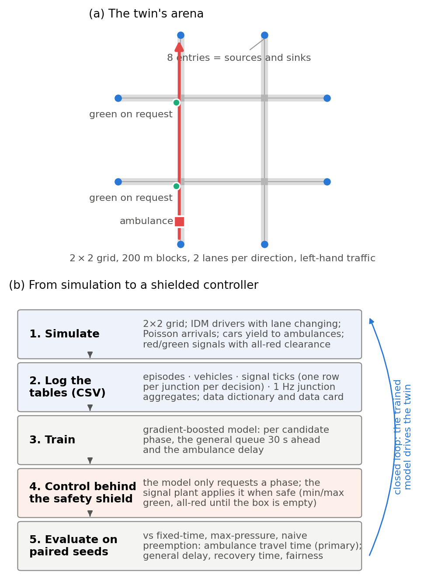
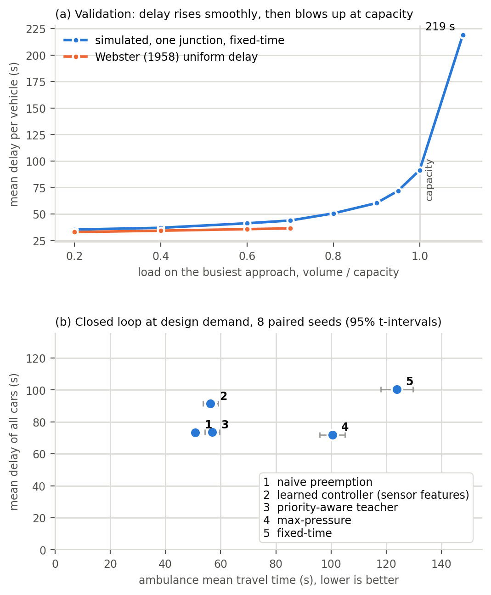

# 1. Introduction

## 1.1 Problem and context

Cars yield to Jakarta ambulances where they can, but a full two-lane queue at a red light cannot: the signal must clear it first. Jakarta's Area Traffic Control System (ATCS) can grant ambulances green, but a control-room operator decides each case from CCTV (UP.SPLL, n.d.). A learned policy needs vehicle-level data on ambulance passages, unobtainable safely on live roads; synthetic data from a validated simulator is the accepted substitute (Jordon et al., 2022).

**Problem statement.** Ambulances in congested Indonesian cities lose critical minutes at signalised intersections, and the established remedy, forced green, is manual and causes secondary congestion. We will build a simulation-based digital twin of a four-intersection, left-hand-traffic grid that generates open tabular data on ambulance passages, and train on it a supervised signal controller that cuts ambulance travel time within a stated bound on general delay.

## 1.2 Why it matters

Survival from out-of-hospital cardiac arrest falls by roughly two percentage points per minute of delay (Larsen et al., 1993). A Jakarta survey of 1,964 emergency-department patients found a median ambulance response of 24 minutes (Brice et al., 2022). Congestion is a direct cause (Griffin & McGwin, 2013): in TomTom's 2023 index a 10 km Jakarta trip took 23 minutes (The Jakarta Post, 2024).

## 1.3 Goals

1. **Twin.** Build and validate a microscopic simulator (Figure 1) of a 2×2 grid of signalised intersections: left-hand traffic, two lanes per direction with lane changing, red/green signals with internal all-red clearance, Intelligent Driver Model (IDM) drivers, Poisson arrivals, origin–destination routing and yielding to ambulances.
2. **Dataset.** Generate and publish at least 100 reproducible episodes as CSV tables with a data dictionary and data card: the Assignment 3 demonstration dataset.
3. **Model.** Train a gradient-boosted model to predict, per candidate phase, the ambulance delay and general queue 30 seconds ahead, deployed as a priority-aware controller behind a safety shield.
4. **Evaluation.** Compare it with fixed-time, max-pressure and naive full preemption on paired seeds: ambulance travel time (primary), general delay, recovery time and fairness (secondary), with confidence intervals over at least eight seeds.

Reinforcement learning and SUMO cross-validation are future work.

{width=100%}

# 2. Related Work

## 2.1 Traffic signal control

Fixed-time plans tuned with Webster's (1958) delay formula remain the deployed default. Max-pressure control (Varaiya, 2013) uses only local queue counts and is throughput-optimal under idealised assumptions: our main non-priority baseline. Learning-based control is dominated by deep reinforcement learning (Wei et al., 2019a, 2019b), which is hard to audit. On tabular data of this size, gradient-boosted trees match or beat deep models (Grinsztajn et al., 2022) and stay interpretable, hence our supervised choice.

## 2.2 Emergency-vehicle priority

Closely spaced preemption calls disrupt a corridor more than single calls (Nelson & Bullock, 2000). Chen et al. (2024) time preemption around queue spillback, then give other traffic compensating green; Roy et al. (2024) tune it in a Vissim-based digital twin, reporting about 20% lower emergency-vehicle travel times than conventional preemption; EMVLight (Su et al., 2023) couples reinforcement-learning routing and signal control on grids. All three use right-hand-traffic networks and release no tabular dataset.

## 2.3 Simulation and digital twins

The IDM (Treiber et al., 2000) is the standard car-following model and SUMO (Lopez et al., 2018) the standard simulator; we build our own so that two-colour signals, per-driver parameter distributions and left-hand two-lane geometry are first-class. A transport digital twin combines a model, a live data link and a synchronisation loop (Kušić et al., 2023); version 1 is the model layer.

## 2.4 Gap and novelty

- **No such open dataset exists:** we know of no public, reproducible tabular dataset of emergency-vehicle passages through a signalised grid.
- **Jakarta's left-hand geometry, with yielding.** Simulated cars move aside only into free gaps, never past the stop line; the preemption studies above model no yielding or only link-level yielding.
- **Interpretable supervised control behind a safety shield**, deployable on existing signal controllers.
- **The trade-off is the result.** Ambulance seconds saved are reported against secondary congestion and fairness across approaches, so a city can choose its operating point.

# 3. Business Model

## 3.1 Application area and the role of data

Emergency medical services and traffic management both answer to the city: the Transport Agency (Dishub DKI) operates ATCS through UP.SPLL and the Health Agency runs the 119 ambulance fleet. The dataset is the product: the twin's tables are training data for the controller, evidence for investment decisions, and a reusable benchmark. Primary data come from our Python simulator (seconds per simulated hour); public data (TomTom figures; Jakarta Open Data's ATCS signal inventory, Pemerintah Provinsi DKI Jakarta, n.d.) serve as context; calibration is future work. Preprocessing: warm-up filtering, episode-level splits, label post-pass; demonstration in R, modelling in Python.

{width=100%}

## 3.2 Value and benefits

For ambulance services: seconds saved and stops avoided. For the traffic authority: a bounded cost, general delay within a proposed 10% of max-pressure plus recovery time after each passage. For the city: evidence before capital spend (Figure 2), with ambulance GPS as the only new input.

## 3.3 Stakeholders and their needs

| Stakeholder | Need | How it is met |
|---|---|---|
| Ambulance crews and patients | Fewer stops, predictable passage | Primary KPI; ETA-aware pre-clearing |
| Dishub DKI / UP.SPLL operators | No manual intervention, no gridlock | Safety-shielded requests; gridlock flagged |
| General road users | Fair, bounded delay | Secondary KPI; fairness across approaches |
| City government | Evidence before investment | Paired-seed comparison |
| Researchers and students | Reusable data | CSV tables, data card, download link |

# References

Brice, S. N., Boutilier, J. J., Gartner, D., Harper, P., Knight, V., Lloyd, J., Pusponegoro, A. D., Rini, A. P., Turnbull-Ross, J., & Tuson, M. (2022). Emergency services utilization in Jakarta (Indonesia): A cross-sectional study of patients attending hospital emergency departments. *BMC Health Services Research, 22*, Article 639. https://doi.org/10.1186/s12913-022-08061-8

Chen, Y.-Y., Wang, J.-Y., Lo, S.-C., & Sung, W.-T. (2024). An emergency vehicle traffic signal preemption system considering queue spillbacks along routes and negative impacts on non-priority traffic. *IET Intelligent Transport Systems, 18*(8), 1385–1395. https://doi.org/10.1049/itr2.12518

Griffin, R., & McGwin, G., Jr. (2013). Emergency medical service providers' experiences with traffic congestion. *The Journal of Emergency Medicine, 44*(2), 398–405. https://doi.org/10.1016/j.jemermed.2012.01.066

Grinsztajn, L., Oyallon, E., & Varoquaux, G. (2022). Why do tree-based models still outperform deep learning on typical tabular data? *Advances in Neural Information Processing Systems, 35* (Datasets and Benchmarks Track). https://proceedings.neurips.cc/paper_files/paper/2022/hash/0378c7692da36807bdec87ab043cdadc-Abstract-Datasets_and_Benchmarks.html

Jordon, J., Szpruch, L., Houssiau, F., Bottarelli, M., Cherubin, G., Maple, C., Cohen, S. N., & Weller, A. (2022). *Synthetic data – what, why and how?* arXiv. https://doi.org/10.48550/arXiv.2205.03257

Kušić, K., Schumann, R., & Ivanjko, E. (2023). A digital twin in transportation: Real-time synergy of traffic data streams and simulation for virtualizing motorway dynamics. *Advanced Engineering Informatics, 55*, Article 101858. https://doi.org/10.1016/j.aei.2022.101858

Larsen, M. P., Eisenberg, M. S., Cummins, R. O., & Hallstrom, A. P. (1993). Predicting survival from out-of-hospital cardiac arrest: A graphic model. *Annals of Emergency Medicine, 22*(11), 1652–1658. https://doi.org/10.1016/S0196-0644(05)81302-2

Lopez, P. A., Behrisch, M., Bieker-Walz, L., Erdmann, J., Flötteröd, Y.-P., Hilbrich, R., Lücken, L., Rummel, J., Wagner, P., & Wießner, E. (2018). Microscopic traffic simulation using SUMO. In *2018 21st International Conference on Intelligent Transportation Systems (ITSC)* (pp. 2575–2582). IEEE. https://doi.org/10.1109/ITSC.2018.8569938

Nelson, E. J., & Bullock, D. (2000). Impact of emergency vehicle preemption on signalized corridor operation: An evaluation. *Transportation Research Record, 1727*(1), 1–11. https://doi.org/10.3141/1727-01

Pemerintah Provinsi DKI Jakarta. (n.d.). *Data lampu lalu lintas terintegrasi Intelligent Transport System Area Traffic Control System (ITS ATCS)* [Data set]. Jakarta Open Data. https://data.jakarta.go.id/dataset/data-traffic-light-atcs-dki-jakarta

Roy, S., Hunter, M., Saroj, A., & Guin, A. (2024). Development of emergency vehicle preemption strategies on smart corridors in a digital twin environment. In *Proceedings of the 17th ACM SIGSPATIAL International Workshop on Computational Transportation Science GenAI and Smart Mobility Session (IWCTS '24)* (pp. 12–21). ACM. https://doi.org/10.1145/3681772.3698213

Su, H., Zhong, Y. D., Chow, J. Y. J., Dey, B., & Jin, L. (2023). EMVLight: A multi-agent reinforcement learning framework for an emergency vehicle decentralized routing and traffic signal control system. *Transportation Research Part C: Emerging Technologies, 146*, Article 103955. https://doi.org/10.1016/j.trc.2022.103955

The Jakarta Post. (2024, January 16). Jakarta's global traffic ranking improves, but congestion worsens. *Asia News Network*. https://asianews.network/jakartas-global-traffic-ranking-improves-but-congestion-worsens/

Treiber, M., Hennecke, A., & Helbing, D. (2000). Congested traffic states in empirical observations and microscopic simulations. *Physical Review E, 62*(2), 1805–1824. https://doi.org/10.1103/PhysRevE.62.1805

UP.SPLL Dinas Perhubungan Provinsi DKI Jakarta. (n.d.). *ATCS Jakarta: Fungsi dan manfaat*. https://atcs-jakarta.com/

Varaiya, P. (2013). Max pressure control of a network of signalized intersections. *Transportation Research Part C: Emerging Technologies, 36*, 177–195. https://doi.org/10.1016/j.trc.2013.08.014

Webster, F. V. (1958). *Traffic signal settings* (Road Research Technical Paper No. 39). Her Majesty's Stationery Office.

Wei, H., Zheng, G., Gayah, V., & Li, Z. (2019a). *A survey on traffic signal control methods*. arXiv. https://doi.org/10.48550/arXiv.1904.08117

Wei, H., Xu, N., Zhang, H., Zheng, G., Zang, X., Chen, C., Zhang, W., Zhu, Y., Xu, K., & Li, Z. (2019b). CoLight: Learning network-level cooperation for traffic signal control. In *Proceedings of the 28th ACM International Conference on Information and Knowledge Management* (pp. 1913–1922). ACM. https://doi.org/10.1145/3357384.3357902

# Use of generative AI

We used Claude (Anthropic, via Claude Code, September–October 2026) to brainstorm framings, critique the simulator design, draft and revise this proposal to length from our problem choice, design decisions and notes, draft simulator code and figures that we reviewed, tested and modified, and check reference details by web search. The problem, design decisions and sources are our own; we re-checked every reference against its published version.
