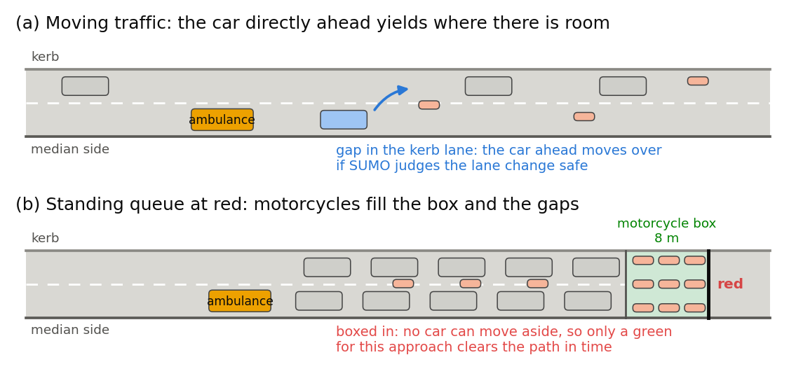

# 1. Introduction

## 1.1 Problem and context

Perempatan Fatmawati, under South Jakarta's JORR toll viaduct, lies 326 m north of RSUP Fatmawati, a national referral hospital with a 24-hour emergency department (Direktorat Jenderal Kesehatan Lanjutan, n.d.; Figure 1). About four in five vehicles here are motorcycles (Yusuf & Isradi, 2025); at red they fill the motorcycle box and every gap between cars (Figure 2). Indonesian law gives ambulances right of way and exempts them from signals (Undang-Undang Nomor 22 Tahun 2009, arts. 134–135), yet a boxed-in queue cannot move aside: only a timely green for the ambulance's approach clears the path. The junction already runs at the worst level of service, averaging 85 s delay per vehicle (Sumabrata et al., 2026).

{width=100%}

**Problem statement.** No data-driven ambulance-priority rule exists for motorcycle-dominated junctions, because ambulance passages cannot be recorded safely on live roads. We will build a digital twin of the junction, generate open sensor data on ambulance passages, and learn a priority controller that cuts ambulance delay while keeping every direction's delay fair and bounded.

## 1.2 Why it matters

Survival from cardiac arrest falls by about two percentage points for every minute advanced life support is delayed (Larsen et al., 1993). Among Jakarta emergency-department patients, the median ambulance response was 24 minutes and only 9% arrived by ambulance (Brice et al., 2022).

## 1.3 Goals

1. **Twin.** Build the junction and surrounding main roads in SUMO from OpenStreetMap, with motorcycle boxes, the city's four-stage signal plan, and drivers yielding to ambulances only where there is room.
2. **Dataset.** Publish at least 100 reproducible simulated hours as CSV tables of virtual sensor readings (loops, queue cameras, counting gates, ambulance tracker), with a data dictionary and card.
3. **Controller.** Train model families from logistic regression to gradient boosting and a small neural network to imitate a priority rule that requests the ambulance's stage once its arrival time falls within the time needed to clear the queue ahead:
$$\text{ETA} \le I + l_s + \frac{3600}{S}\sum_k e_k\,n_k + \Delta ,$$
where $I$ is the intergreen, $l_s$ the start-up lost time, $S$ the saturation flow, $n_k$ the vehicles of class $k$ ahead and $e_k$ their car equivalents (Direktorat Jenderal Bina Marga, 2023), plus $\Delta$, the 5 s decision interval. Labels are verified by recomputation; models must beat stillness and random baselines and only request stages, which the signal plant applies safely.
4. **Evaluation.** Test every method on one grid of ambulance cases against an empty-road reference: ambulance delay averaged with equal weight per direction, worst direction shown, each approach's delay indexed to the city's plan; Nash bargaining (Nash, 1950) picks the most balanced method.
5. **Live view.** Show live TomTom speeds beside the twin; the licence permits display only.

# 2. Related Work

## 2.1 Traffic signal control

Fixed-time plans follow Webster (1958), adapted for Indonesia's mixed traffic (Direktorat Jenderal Bina Marga, 2023). Max-pressure control (Varaiya, 2013) uses only local queues. Deep reinforcement learning dominates research but is hard to audit (Wei et al., 2019); on tabular data, tree ensembles match deep models and stay interpretable (Grinsztajn et al., 2022).

## 2.2 Emergency-vehicle priority

Chen et al. (2024) time preemption around queue spillback; Roy et al. (2024) tune it in a Vissim-based digital twin; EMVLight (Su et al., 2023) treats yielding as a speed rule. Savithramma et al. (2022) predict queue-clearing green time with gradient-boosted trees, but they, like a Surabaya SUMO study (Izzuddin et al., 2025), treat two-wheelers only as counts.

## 2.3 Motorcycles, simulation and twins

Motorcycle boxes shorten motorcycles' discharge headways (Wichitphongsa et al., 2025); SUMO (Alvarez Lopez et al., 2018) represents filtering with its sublane model (Semrau & Erdmann, 2016). A transport digital twin joins a model, a live data link and synchronisation (Kušić et al., 2023); like other SUMO twins (Schaffland et al., 2024), ours defers synchronisation: TomTom's terms forbid storage and safety-critical use (TomTom, n.d.).

## 2.4 Gap and novelty

- **A real Jakarta junction beside a national hospital,** with motorcycle boxes, left-hand driving and the city's own signal plan.
- **Space-limited yielding:** drivers move aside only into real gaps.
- **An open dataset** of ambulance passages as sensor tables with verified labels, which we have not found elsewhere.
- **Interpretable control behind a safety shield,** scored over every ambulance case, neglecting no direction.

# 3. Business Model

## 3.1 Application area and the role of data

{width=100%}

Three public bodies share the problem: RSUP Fatmawati's emergency department, Jakarta's 119 ambulance service (Pusat Krisis dan Kegawatdaruratan Kesehatan Daerah, n.d.) and the Transport Agency's signal-control unit, UP.SPLL. Data flow in three tiers: OpenStreetMap geometry (ODbL); published counts, signal plan and queues for calibration (Sumabrata et al., 2026); and the twin's sensor tables, the product: training data whose inputs real detectors deliver, investment evidence and a reusable benchmark. Preprocessing: warm-up removal, label recomputation, episode-grouped splits; demonstration in R, models in Python.

## 3.2 Value and benefits

For patients and crews, seconds saved and stops avoided. For the Transport Agency, a bounded cost: general delay within a proposed 10% of max-pressure, no approach more than 20% worse than today, recovery reported. For the city, evidence before spending and a pipeline that rebuilds any junction from open maps.

## 3.3 Stakeholders and their needs

| Stakeholder | Need | How the project meets it |
|---|---|---|
| Patients and ambulance crews | Fewer stops, predictable passage | Primary measure; pre-clearing |
| RSUP Fatmawati emergency department | Earlier, predictable arrivals | Passage times for every direction |
| UP.SPLL signal operators | No manual intervention, no gridlock | Shielded requests; gridlock counted |
| Motorcyclists and other road users | Fair, bounded delay | Approach delay against today; worst shown |
| City government and researchers | Evidence, reusable data | Paired-seed tests; open tables, data card |

# References

Alvarez Lopez, P., Behrisch, M., Bieker-Walz, L., Erdmann, J., Flötteröd, Y.-P., Hilbrich, R., Lücken, L., Rummel, J., Wagner, P., & Wießner, E. (2018). Microscopic traffic simulation using SUMO. In *2018 21st International Conference on Intelligent Transportation Systems (ITSC)* (pp. 2575–2582). IEEE. https://doi.org/10.1109/ITSC.2018.8569938

Brice, S. N., Boutilier, J. J., Gartner, D., Harper, P., Knight, V., Lloyd, J., Pusponegoro, A. D., Rini, A. P., Turnbull-Ross, J., & Tuson, M. (2022). Emergency services utilization in Jakarta (Indonesia): A cross-sectional study of patients attending hospital emergency departments. *BMC Health Services Research, 22*, Article 639. https://doi.org/10.1186/s12913-022-08061-8

Chen, Y.-Y., Wang, J.-Y., Lo, S.-C., & Sung, W.-T. (2024). An emergency vehicle traffic signal preemption system considering queue spillbacks along routes and negative impacts on non-priority traffic. *IET Intelligent Transport Systems, 18*(8), 1385–1395. https://doi.org/10.1049/itr2.12518

Direktorat Jenderal Bina Marga. (2023). *Pedoman kapasitas jalan Indonesia* [Indonesian highway capacity guideline] (No. 09/P/BM/2023). Kementerian Pekerjaan Umum dan Perumahan Rakyat. https://binamarga.pu.go.id/index.php/nspk/detail/09pbm2023-pedoman-kapasitas-jalan-indonesia-

Direktorat Jenderal Kesehatan Lanjutan. (n.d.). *RSUP Fatmawati Jakarta*. Kementerian Kesehatan Republik Indonesia. Retrieved October 3, 2026, from https://keslan.kemkes.go.id/uptkami/detail/7

Grinsztajn, L., Oyallon, E., & Varoquaux, G. (2022). Why do tree-based models still outperform deep learning on typical tabular data? In S. Koyejo, S. Mohamed, A. Agarwal, D. Belgrave, K. Cho, & A. Oh (Eds.), *Advances in Neural Information Processing Systems 35* (pp. 507–520). Curran Associates. https://doi.org/10.52202/068431-0037

Izzuddin, M. H., Hidayat, W. N., Shafyan, A., Kiyohara, R., & Santoso, D. S. (2025). Simulasi dan analisis perbandingan kinerja sistem lalu lintas untuk kendaraan ambulans darurat [Simulation and comparative performance analysis of traffic systems for emergency ambulances]. *Journal of Innovative and Creativity, 5*(2), 7340–7349. https://doi.org/10.31004/joecy.v5i2.1105

Kušić, K., Schumann, R., & Ivanjko, E. (2023). A digital twin in transportation: Real-time synergy of traffic data streams and simulation for virtualizing motorway dynamics. *Advanced Engineering Informatics, 55*, Article 101858. https://doi.org/10.1016/j.aei.2022.101858

Larsen, M. P., Eisenberg, M. S., Cummins, R. O., & Hallstrom, A. P. (1993). Predicting survival from out-of-hospital cardiac arrest: A graphic model. *Annals of Emergency Medicine, 22*(11), 1652–1658. https://doi.org/10.1016/S0196-0644(05)81302-2

Nash, J. F. (1950). The bargaining problem. *Econometrica, 18*(2), 155–162. https://doi.org/10.2307/1907266

Pusat Krisis dan Kegawatdaruratan Kesehatan Daerah. (n.d.). *Tentang PK3D Dinas Kesehatan DKI Jakarta* [About PK3D]. Dinas Kesehatan Provinsi DKI Jakarta. Retrieved October 3, 2026, from https://pk3d.jakarta.go.id/TentangKami

Roy, S., Hunter, M., Saroj, A., & Guin, A. (2024). Development of emergency vehicle preemption strategies on smart corridors in a digital twin environment. In *Proceedings of the 17th ACM SIGSPATIAL International Workshop on Computational Transportation Science GenAI and Smart Mobility Session (IWCTS '24)* (pp. 12–21). ACM. https://doi.org/10.1145/3681772.3698213

Savithramma, R. M., Sumathi, R., & Sudhira, H. S. (2022). SMART emergency vehicle management at signalized intersection using machine learning. *Indian Journal of Science and Technology, 15*(35), 1754–1763. https://doi.org/10.17485/IJST/v15i35.1151

Schaffland, A., Nelson, J., & Schöning, J. (2024). Simulating traffic networks: Driving SUMO towards digital twins. *SUMO Conference Proceedings, 5*, 113–125. https://doi.org/10.52825/scp.v5i.1105

Semrau, M., & Erdmann, J. (2016). Simulation framework for testing ADAS in Chinese traffic situations. In K. Lemmer (Ed.), *SUMO 2016 – Traffic, mobility, and logistics* (Berichte aus dem DLR-Institut für Verkehrssystemtechnik, Vol. 30, pp. 103–115). Deutsches Zentrum für Luft- und Raumfahrt. https://elib.dlr.de/104432/

Su, H., Zhong, Y. D., Chow, J. Y. J., Dey, B., & Jin, L. (2023). EMVLight: A multi-agent reinforcement learning framework for an emergency vehicle decentralized routing and traffic signal control system. *Transportation Research Part C: Emerging Technologies, 146*, Article 103955. https://doi.org/10.1016/j.trc.2022.103955

Sumabrata, R. J., Haqueline, R., & Mauramdha, G. (2026). Microscopic simulation analysis of the Fatmawati intersection in Jakarta. In *Proceedings of the 19th International Conference on Quality in Research (QiR 2025)* (Advances in Engineering Research, Vol. 303, pp. 31–44). Atlantis Press. https://doi.org/10.2991/978-94-6239-717-0_4

TomTom. (n.d.). *TomTom portal terms & conditions*. Retrieved October 3, 2026, from https://docs.tomtom.com/legal/terms-and-conditions

*Undang-Undang Nomor 22 Tahun 2009 tentang Lalu Lintas dan Angkutan Jalan* [Law Number 22 of 2009 on Road Traffic and Transport] (Indonesia). Lembaran Negara Republik Indonesia Tahun 2009 Nomor 96. https://peraturan.bpk.go.id/Details/38654/uu-no-22-tahun-2009

Varaiya, P. (2013). Max pressure control of a network of signalized intersections. *Transportation Research Part C: Emerging Technologies, 36*, 177–195. https://doi.org/10.1016/j.trc.2013.08.014

Webster, F. V. (1958). *Traffic signal settings* (Road Research Technical Paper No. 39). Road Research Laboratory; Her Majesty's Stationery Office.

Wei, H., Zheng, G., Gayah, V., & Li, Z. (2019). *A survey on traffic signal control methods*. arXiv. https://doi.org/10.48550/arXiv.1904.08117

Wichitphongsa, W., Kronprasert, N., Zaw, M. S., Pisetsit, P., & Satiennam, T. (2025). Modeling riding and stopping behaviors at motorcycle box intersections: A case study in Chiang Mai City, Thailand. *Infrastructures, 10*(4), Article 97. https://doi.org/10.3390/infrastructures10040097

Yusuf, M. H., & Isradi, M. (2025). The implementation analysis of the electronic road pricing (ERP) system on Fatmawati Road (Ketimun 1 intersection – TB Simatupang intersection). *Engineering and Technology Journal, 10*(3), 4052–4060. https://doi.org/10.47191/etj/v10i03.15

# Use of generative AI

We used Claude (Anthropic, via Claude Code, September–October 2026) to brainstorm, critique the simulator design, draft and revise this proposal from our decisions and notes, draft code, label checks and figures that we reviewed and tested, and check references by web search. The problem, decisions and sources are ours; we re-checked every reference.
